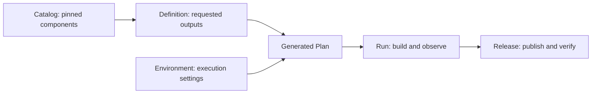

# NVIDIA Kubernetes Recipes (NVKR)

[](LICENSE)
[](.go-version)

**Build NVKE and AICR artifacts from pinned inputs and trace releases back to their sources.**
NVKR gives release engineers a CLI, reusable component catalogs and declarative
Definitions for NVIDIA Kubernetes® Engine (NVKE) and AI Cluster Runtime (AICR).
Select the executables, container images, Helm charts, deployment bundles or node
images to produce; NVKR derives the dependency graph
and runs local builds or generates GitHub Actions workflows. The hosted workflows
build, sign and publish releases with evidence consumers can verify against their
own policy.

[NVKE](https://github.com/dsx-ai-factory/nvke) installs and operates clusters.
NVKR owns the build and release workflow that supplies their artifacts.

> **Preview:** NVKR is available as a preview. Commands, input schemas and behavior can change between releases, and we do not recommend NVKR for production use. See [Preview status and known limitations](docs/overview/preview-status.md).

[Try it](#build-your-first-artifact) · [Documentation](docs/README.md) ·
[Contribute](CONTRIBUTING.md) · [Get help](SUPPORT.md)

## Build your first artifact

Start with the [hello demo](demos/hello/README.md): one tiny executable, built in Docker
and run on your host. Then use the [quickstart](docs/quickstart.md) to build the NVKE CLI,
controller container image and Helm chart with dependency SBOMs.
You need **Git 2.38 or later, Bash and running Docker**. You also need the pinned Go compiler; if it is missing, the launcher asks before installing it locally. You do not need Make or host Python.
Use Docker Desktop on macOS, or Docker on Linux.
NVKR runs on your host. The NVKE CLI and image it builds target Linux.
The launcher checks prerequisites, selects the required Go compiler and builds NVKR from source for your CPU architecture.
Git must already be installed. The launcher shows supported Docker installation actions and local Go setup for your approval before it runs them.

Open a terminal in a directory without an existing `nvkr` folder and copy the whole block:

```sh
git clone https://github.com/dsx-ai-factory/nvkr.git &&
cd nvkr &&
bash demos/demo-local.sh
```

Wait for `Hello, team!`, then run `bash scripts/nvkr-quickstart.sh` for the three NVKE artifacts.
In CI, a piped shell, or an agent terminal, pass `--install-go` to either script to
consent to installing the pinned Go SDK. A different Go patch version does not satisfy the pin.
If inherited Git settings are rejected, run `unset GIT_CONFIG_COUNT` before retrying.
The scripts run in child shells and retain their build directories. Nothing is published or deployed.

## From components to releases



- **Catalog:** reusable component producers and their pinned sources and tools.
- **Definition:** the named outputs, formats and platforms you want to build.
- **Environment:** where work runs and how publication and signing are configured.
- **Run:** one attempt, recording the required outputs, observations and failures.
- **Release:** published artifacts and evidence that consumers verify under their policy.

The Plan is generated for inspection; you author the Definition and Environment.
[What is NVKR?](docs/overview/what-is-nvkr.md) explains the lifecycle and its boundaries.

Start with the [tutorial Definition](docs/examples/nvke-tutorial/README.md),
which selects the NVKE CLI, management-plane image and Helm bundle. The
[combined NVKE candidate](inputs/definitions/nvke/README.md) expands that selection
to container and node images for AMD64 and ARM64. The [input index](inputs/README.md)
explains the available Definitions, catalogs and execution settings.

## Understand the evidence

A signature authenticates who made a statement about an artifact; a digest binds
that statement to specific bytes. Your Verification Policy chooses the accepted
workflow identity and issuer. Signing does not claim ownership of the included
software, and a valid signature alone does not establish deployment readiness.

| Operation | What it establishes |
|---|---|
| Browse a Release | Inspects metadata; does not verify signatures or download artifact payloads. |
| Pull an output | Retrieves and checks that output's payload integrity; does not verify signatures or consumer policy. |
| Verify `authenticity` | Authenticates signatures and evidence under your policy without downloading artifact payloads. |
| Verify `artifact-publication` | Authenticates the publication claim under your policy and checks the referenced artifact payloads. |

Both verification scopes use the `pipeline-attested` lane. Verification requires
Linux, pinned tools and an explicit policy; the [release quickstart](docs/release-quickstart.md)
walks through the commands and Docker-based verification from macOS.

**No NVKR Release is qualified at preview.** Supported verification does not
establish exact-byte reproduction, freedom from vulnerabilities or deployment
readiness. The maintained node-image SBOMs record producer and material subjects;
they do not inspect installed disk contents. See the
[implementation and evidence record](docs/adr/reconciliation/README.md) for recorded
Runs and the limits of what each establishes.

## Choose your next step

| Task | Guide |
|---|---|
| Select components, pins and overlays | [Catalogs and components](docs/catalogs-and-components.md) |
| Inspect Plans, graphs and changes | [Plan and graph inspection](docs/plan-and-graph-inspection.md) |
| Generate a hosted build and publication workflow | [Pipeline generation](docs/generate-pipeline.md) |
| Build AICR deployment bundles | [AICR inputs and hardware limits](inputs/definitions/aicr/README.md) |
| Build NVKE node images | [Node images](docs/node-images.md) |
| Browse, pull or verify a published Release | [Release quickstart](docs/release-quickstart.md) |
| Diagnose Helm or registry publication errors | [Registry diagnostics and compatibility](docs/publication-architecture.md#troubleshoot-helm-and-registry-rejections) |
| Work with an AI agent | [Use NVKR with your AI agent](docs/use-with-agents.md) and the [operator skill](.agents/skills/nvkr-operator/SKILL.md) |
| Look up terminology | [Concept reference](docs/user-concepts.md) |

GitHub Actions is the maintained hosted generator and signing/publication provider.
Builds require their declared runtime and source access. Hosted node-image disk
jobs also need the explicit native Linux KVM runner routes described in
the [preview limitations](docs/overview/preview-status.md).
The [documentation map](docs/README.md) and [demo index](demos/README.md) list
all the guides and examples.

## Contributing and support

Contributions, bug reports and documentation improvements are welcome.
[DEVELOPMENT.md](DEVELOPMENT.md) covers setup and `make check`;
[CONTRIBUTING.md](CONTRIBUTING.md) explains contribution and review requirements.

- **Questions:** [GitHub Discussions](https://github.com/dsx-ai-factory/nvkr/discussions/categories/q-a).
- **Chat:** the `#nvke` channel in the DSX AI Factory Slack.
  [Get an invite](https://inviter.co/dsx-ai-factory).
- **Bugs and feature requests:** [GitHub Issues](https://github.com/dsx-ai-factory/nvkr/issues).
- **Security vulnerabilities:** follow [SECURITY.md](SECURITY.md) and report privately.
- **Community:** [Code of Conduct](CODE_OF_CONDUCT.md), [Governance](GOVERNANCE.md),
  [Maintainers](MAINTAINERS.md) and [Support](SUPPORT.md).
- **Source releases:** [Release process](RELEASE.md), including approval and recovery.

## License

NVKR is licensed under the Apache License 2.0. See [LICENSE](LICENSE), [NOTICE](NOTICE),
and [THIRD_PARTY_NOTICES.md](THIRD_PARTY_NOTICES.md).

## Trademarks

Kubernetes® is a registered trademark of The Linux Foundation in the United States and other countries.
NVIDIA and the NVIDIA logo are trademarks and/or registered trademarks of NVIDIA Corporation in the U.S. and
other countries. Other company and product names may be trademarks of the respective companies with which
they are associated.
