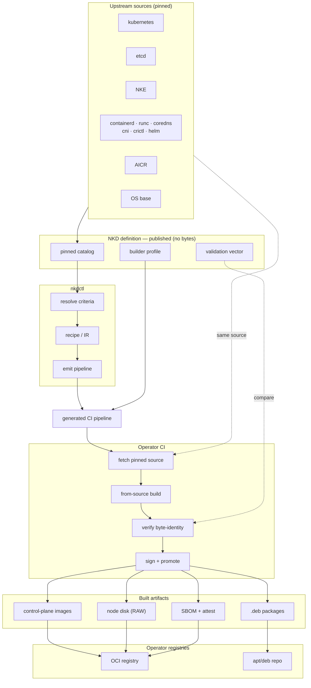
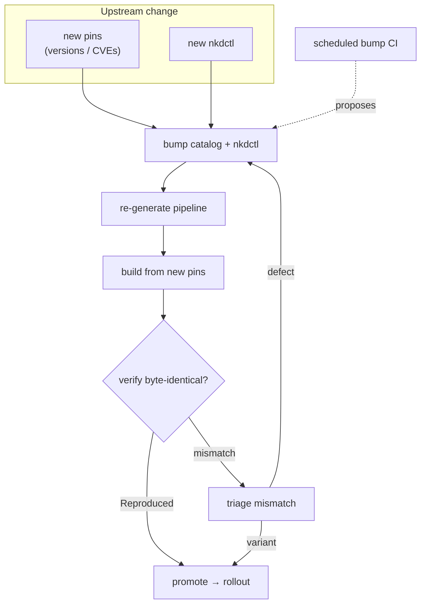
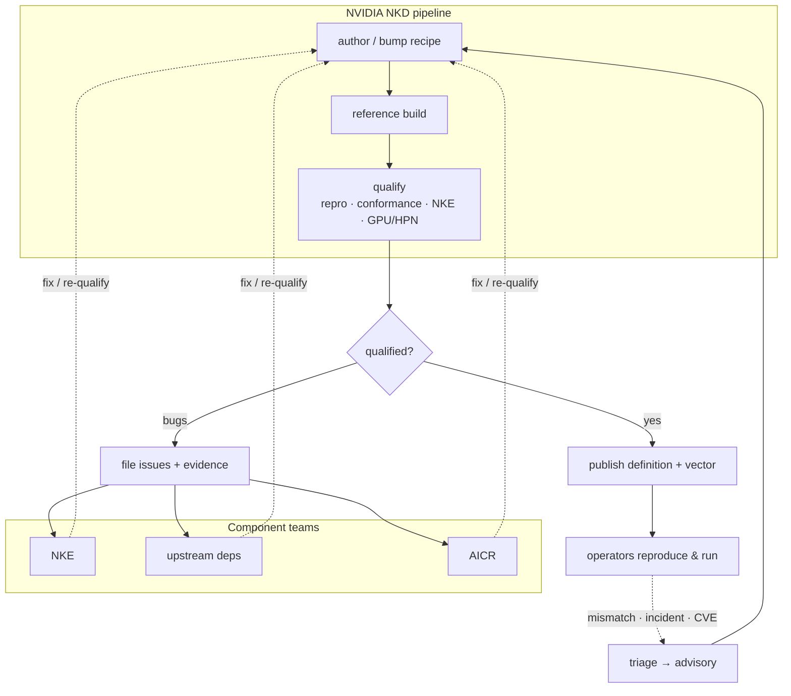
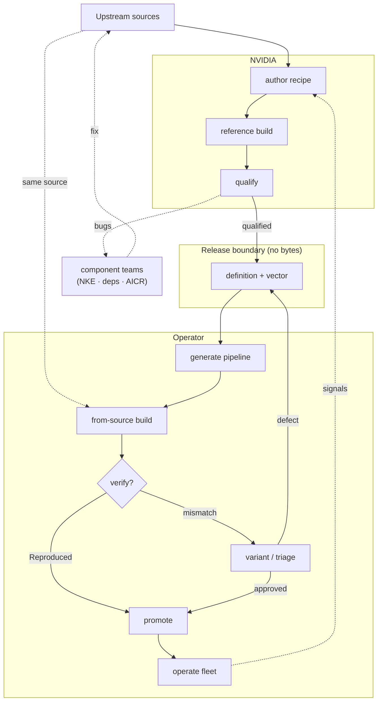

# NKD — Architecture diagrams

> [!CAUTION]
> **Target-architecture snapshot.** These diagrams are design input, not evidence that every depicted adapter
> or lifecycle is implemented. Use the proposed ADRs and `docs/adr/reconciliation.md` for current boundaries.

Four views, from a single build to the full two-actor lifecycle.

**Reading these diagrams**
- **Subgraphs = ownership boundaries** (NVIDIA · operator · shared definition).
- **Solid = flow**; **dotted = compare / feedback / same-input**.
- Same upstream sources are pinned once and built *independently* by NVIDIA and the operator; the **validation
  vector** is the compare anchor; **no artifact bytes cross the release boundary**.

---

## 1. High-level architecture

Sources → catalog + lockfile → `nkdctl` recipe → generated pipeline → the operator builds every artifact from
the same pinned sources, verifies against the published digests, and publishes to its own registries.

---

## 2. Operator maintenance loop

New pins **or** a new `nkdctl` version → re-generate the pipeline, rebuild from the new pins, re-verify.

---

## 3. NVIDIA pipeline + qualification feedback loop

NVIDIA builds + qualifies reference artifacts and publishes only the definition + vector. Failures file issues
to component teams, whose fixes re-qualify tags; operator field signals feed triage.

---

## 4. End-to-end lifecycle

Both actors + the release boundary, with both feedback loops.

