# nkdctl — supported flows

> [!CAUTION]
> **Historical POC flow snapshot.** These diagrams contain removed flags and workflows that now fail closed.
> They are retained for design traceability, not as a current support or release claim. Use the README support
> matrix, `nkdctl --help`, and `docs/adr/reconciliation.md` instead.

This document mapped the flows through the POC `nkdctl` code as
diagrams. It reflected what the binary did at that time, including the
honest edges: `bundle --engine local` is a dry-run, `disk` shells the repo's qcow2 scripts,
and cosign signing shells out to the `cosign` binary. Where a path is plumbing-only it is
paths then marked as plumbing-only.

Every command shares one front half — **load catalog → resolve criteria → compile IR →
`recipeDigest`** — then diverges. That shared spine is [§2](#2-the-shared-spine-criteria--ir).
Diagrams are grouped: resolution, emission, build, trust, packaging/boot, and catalog maintenance.

- [1. Command surface](#1-command-surface)
- [2. The shared spine](#2-the-shared-spine-criteria--ir)
- [3. Catalog load & fail-closed validation](#3-catalog-load--fail-closed-validation)
- [4. Asymmetric criteria match + arch defaulting](#4-asymmetric-criteria-match--arch-defaulting)
- [5. `recipe` — resolve & print](#5-recipe--resolve--print)
- [6. `bundle` — one IR, many engines](#6-bundle--one-ir-many-engines)
- [7. `build` — the hermetic local DAG](#7-build--the-hermetic-local-dag)
- [8. The build graph shape](#8-the-build-graph-shape-concrete)
- [9. Multi-arch (model B)](#9-multi-arch-model-b)
- [10. `bake-off` — two-environment byte-identity](#10-bake-off--two-environment-byte-identity)
- [11. Trust model: `attest` → `verify`](#11-trust-model-attest-publisher--verify-operator)
- [12. `verify` fail-closed decision gate](#12-verify-fail-closed-decision-gate)
- [13. `sbom`](#13-sbom)
- [14. `package`](#14-package)
- [15. `image` → `disk` → boot](#15-image--disk--boot)
- [16. `catalog` — pin / bump / update-ci](#16-catalog--pin--bump--update-ci)
- [17. Fail-closed exit codes](#17-fail-closed-exit-codes)

---

## 1. Command surface

Every verb sits over the SDK; the query flags (`--role --k8s --os --arch [--data]`) resolve a recipe
for the build-oriented verbs. Reserved axes (`--accelerator --service --intent --platform --tier
--compliance`) are hidden and fail closed if set.

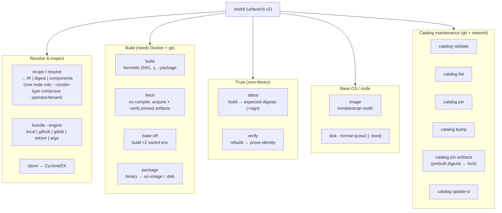

---

## 2. The shared spine (criteria → IR)

`resolveGraph()` is the front half of `recipe`, `bundle`, `build`, `bake-off`, `attest`, `verify`,
and `sbom`. It is pure and offline — no Docker, no clock, no host paths enter — so `recipeDigest` is a
deterministic function of (catalog, query).

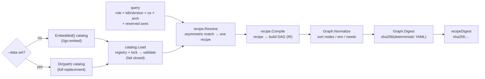

**Invariant:** `recipeDigest = sha256(MarshalYAMLDeterministic(IR))`. Same catalog + same query
(+ same arch) ⇒ byte-identical IR ⇒ identical digest. A different arch ⇒ a distinct digest
([§9](#9-multi-arch-model-b)).

---

## 3. Catalog load & fail-closed validation

A catalog is split like `go.mod`/`go.sum`: a hand-authored **registry** (`registry.yaml`: sources +
recipes + components) and a machine-managed **lock** (`pins.lock.yaml`). `Load` merges them into
concrete components and validates. Any unpinned ref or tag-pinned toolchain is a coded error — never a
silent default.

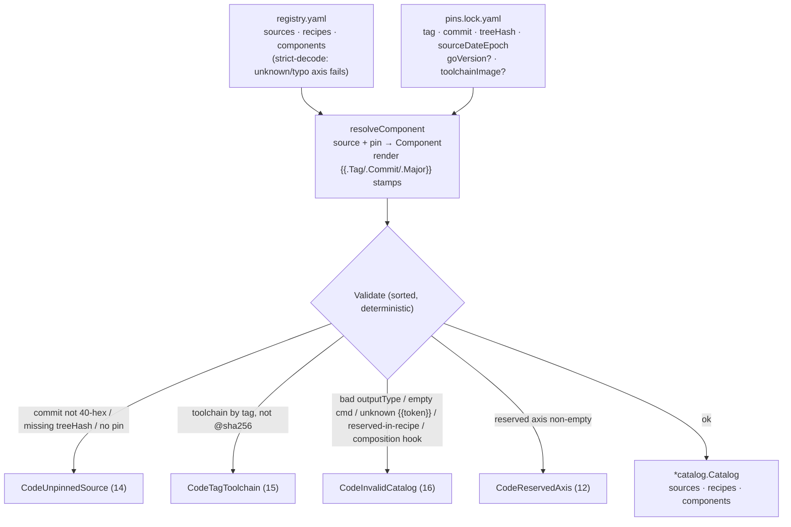

Toolchain pinning accepts two digest forms and rejects tags: `name@sha256:…` (registry) or a bare
`sha256:…` (local image id). Per-arch toolchains (`toolchainImagesByArch`) validate **every** listed
arch. The `{{.Arch}}` token is the only template allowed in a build command / artifact path; any other
`{{…}}` fails closed here.

---

## 4. Asymmetric criteria match + arch defaulting

`recipe.Resolve` picks exactly one recipe. Matching is **asymmetric**: a recipe field of `any`/empty is
a wildcard; a *specific* recipe field requires the query to supply exactly that value; a generic query
never matches a specific recipe. Ties break by specificity; a true tie fails closed.

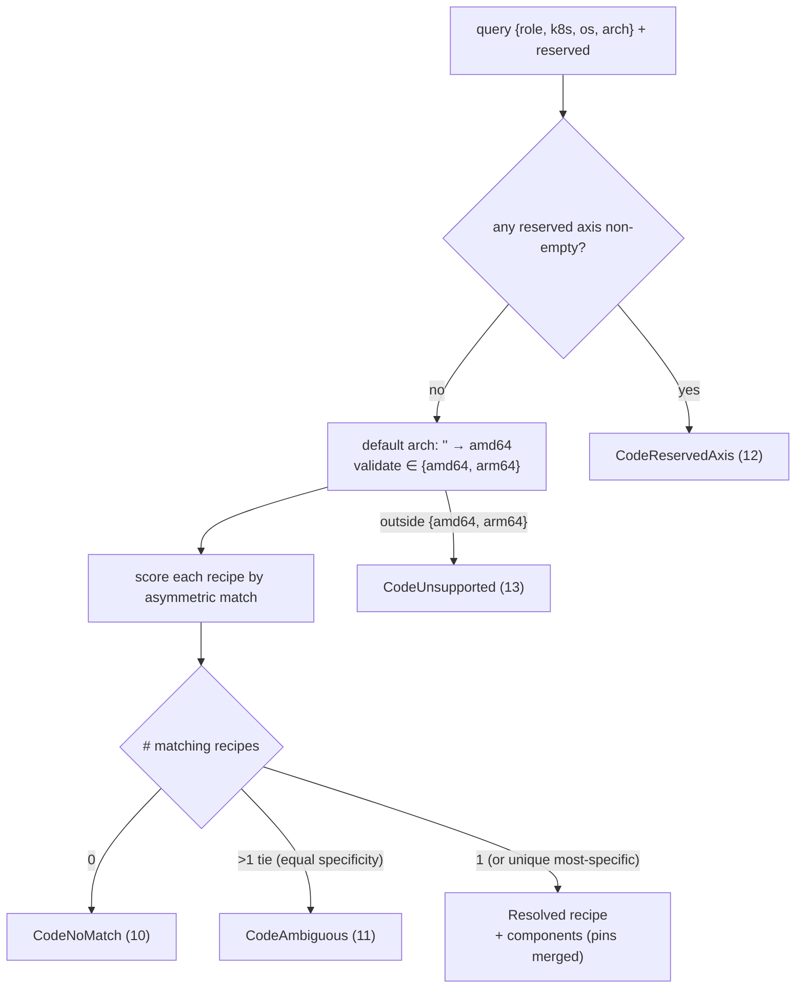

Active axes: `role × k8sVersion × os × arch`. `versionFrom` fills `k8sVersion` from a source pin, so a
version bump doesn't touch the recipe.

---

## 4b. Layered recipe composition (overlays / mixins) — the AICR-ported engine

A catalog may ship `overlays/` + `mixins/` instead of flat `recipes:`. Resolution then
*composes* (a faithful port of AICR's `pkg/recipe`): the recipe for a query is built by
merging a base + the matching overlay inheritance chains + mixins, not by picking one
recipe. Each layer ADDS a component, `enabled: false` DISABLES one, or `overrides:`
deep-merges onto it (child wins). The flattened set feeds the unchanged IR → recipeDigest.

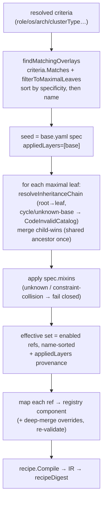

## 4c. clusterType (operator / tenant) composition

`clusterType` (`operator | tenant`) is another composition axis: overlays keyed on it diverge
the substrate between a management (operator) cluster and a workload (tenant) cluster. You
resolve either with the ordinary resolver — `nkdctl recipe --cluster-type operator|tenant --role
control-plane|worker` — one node role at a time (the atomic recipe you build/verify). Operator
vs tenant genuinely diverge: an `operator-control-plane` overlay inherits `control-plane`, adds
the CAPI controller (prebuilt lane), and overrides the substrate — a distinct recipeDigest.

---

## 5. `recipe` — resolve & print

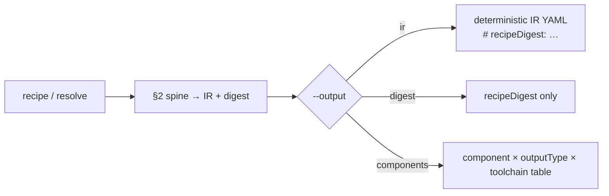

---

## 6. `bundle` — one IR, many engines

The one IR is *lowered* to each engine. Adapters map topology + transport only — **the build step is
the exact `docker run --network=none --platform linux/<arch> …` the local runner executes** — so every
engine builds byte-identically. `--engine local` dry-runs the local runner instead of emitting YAML.

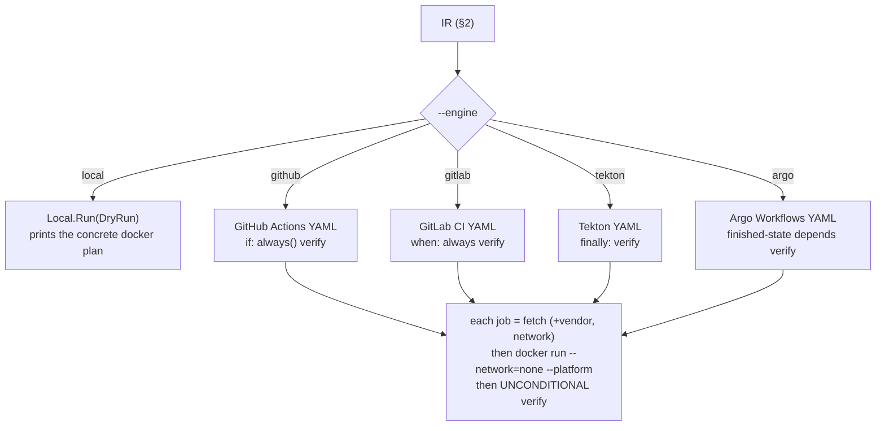

Adding an engine = one adapter; adding a component = one catalog entry, no code.

---

## 7. `build` — the hermetic local DAG

`pipeline.Local.Run` executes the IR as a concurrent DAG (`-j` jobs). The shared fetch is the only
barrier; independent component builds run in parallel and a single terminal `verify` waits on them all.
Builds are hermetic (`--network=none`) and parallel-safe (read-only shared source + a private writable
`WriteDir` per build). Fails closed on the first failure unless `--keep-going`.

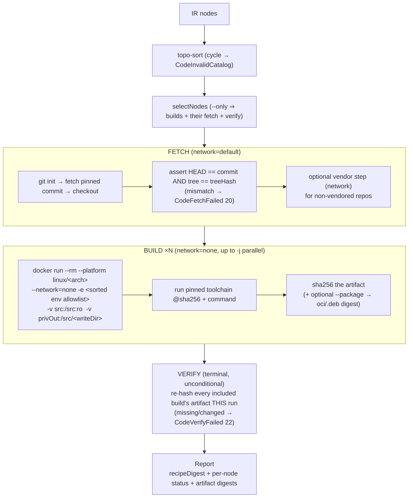

Host tuning (GOMAXPROCS, job count) is deliberately **not** in the IR — it can't change output bytes, so
reproducibility holds regardless of `-j`.

---

## 7b. `fetch` — the no-compile (prebuilt) lane

A deliberate, opt-in **parallel** to `build` (NKD-FR-BLD-050/051). A catalog may declare a component
`prebuilt` (a pinned https binary or an OCI image); `nkdctl fetch` compiles it to a **pull** node and acquires
it — no fetch-source, no toolchain, no compile — verifying the bytes against a signable, per-arch,
content-addressed digest. Fail-closed on mismatch. The pinned digest is the reproducibility anchor and is part
of `recipeDigest`; an all-prebuilt manifest carries **no** builder-profile digest (acquisition is
host-independent). A component is from-source **XOR** prebuilt **XOR** an exclusion.

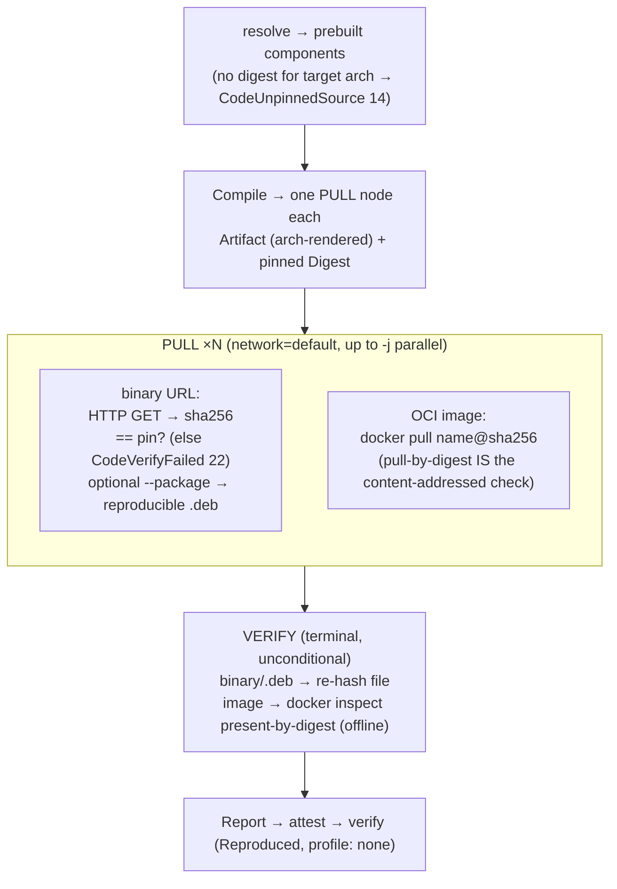

The four CI emitters lower a pull node identically: `curl -fsSL <url> && echo "<digest>  <f>" | sha256sum -c -`
for a binary, `docker pull <name>@<digest>` for an image; the unconditional `verify` job waits on every pull
job (one-IR-many-adapters, preserved).

---

## 8. The build graph shape (concrete)

A worked example: the **worker** recipe (8 components). Components sharing a `(repo, commit)` collapse
into one fetch; each build depends on its fetch; one verify depends on every build. `kubernetes` is one
fetch feeding four builds.

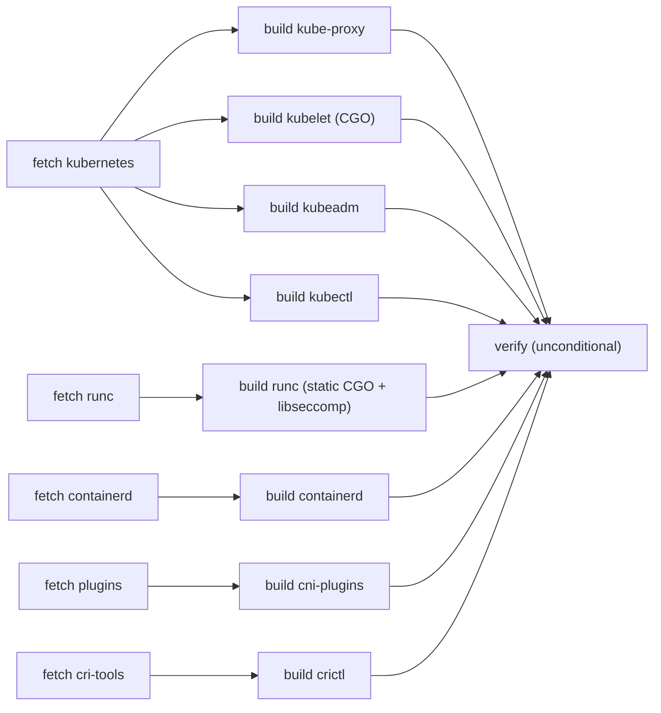

The **control-plane** recipe is the same shape at 8 fetches → 15 builds → 1 verify (adds etcd, coredns,
helm, and the kubernetes `pause` [C] + apiserver/controller-manager/scheduler).

---

## 9. Multi-arch (model B)

The **same** arch-agnostic recipe resolves for any arch and yields a **distinct, reproducible**
`recipeDigest` per arch. Each build is **native to its arch — no cross-compilation**: the IR pins
`platform: linux/<arch>`, the runner/emitters pass `--platform`, and the toolchain resolves per arch.

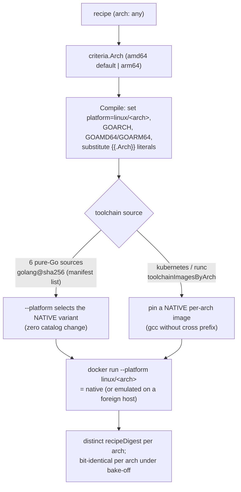

On an arm64 host, arm64 builds run natively and amd64 builds run under qemu binfmt as a stand-in for a
native amd64 CI runner. The arm64 IR contains **zero** `amd64`/`x86_64` literals.

---

## 10. `bake-off` — two-environment byte-identity

Builds the recipe **twice** under deliberately different host state, then asserts the resulting artifact
digests match. The pinned toolchain container fixes `/src`, `SOURCE_DATE_EPOCH`, `TZ=UTC` — so nothing
from the host leaks in.

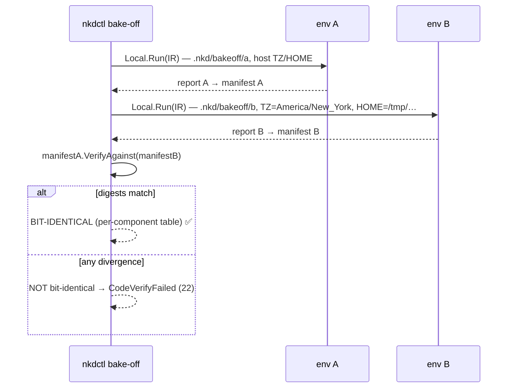

This is the within-machine varied-env gate; the ultimate gate runs the two builds on two distinct
machines (documented as not-yet-done).

---

## 11. Trust model: `attest` (publisher) → `verify` (operator)

Zero binaries in the trust model. The publisher runs the pipeline in the open and ships only a signed
**expected-digests** manifest (cosign keyless, detached). The operator rebuilds from source and proves
byte-identity. Cosign steps shell out to the `cosign` binary (plumbing: the argument construction is
tested, the signature execution is not).

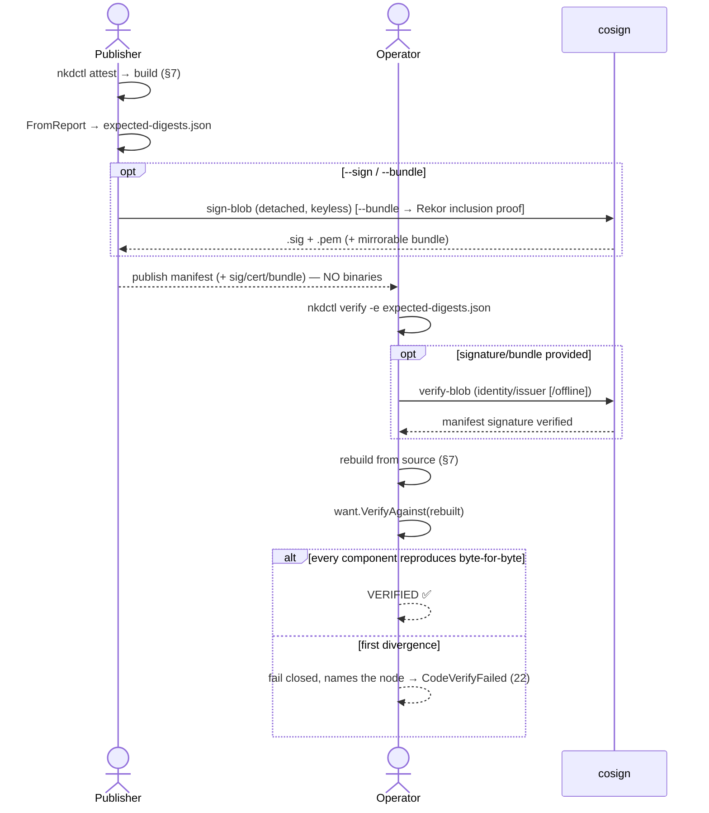

---

## 12. `verify` fail-closed decision gate

`verify` closes the offline fail-**open** hole *before* rebuilding: it refuses configurations that would
trust an unsigned or unprovable manifest unless an explicit escape hatch is set.

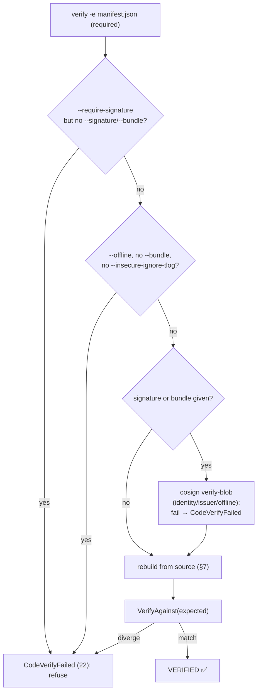

`--offline` verifies a mirrored bundle's Rekor **inclusion proof** with no network — a real airgap path,
not a tlog-ignore. `--insecure-ignore-tlog` is the one explicit, opt-in fail-open escape hatch.

---

## 13. `sbom`

Deterministic CycloneDX for the resolved recipe. With `--expected-digests` it folds in built artifact
hashes — after asserting the manifest's `recipeDigest` matches the resolved recipe (else fail closed).

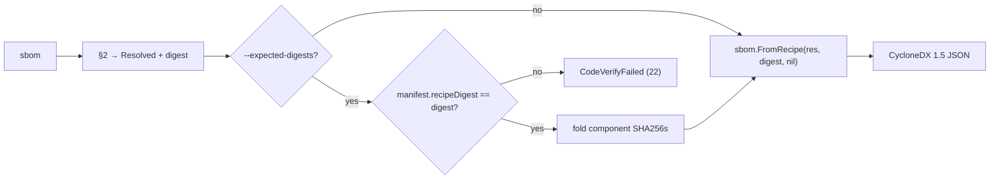

---

## 14. `package`

Assembles a prior build's compiled binary into its reproducible delivery artifact and records **that**
digest. Requires that `build` already ran (locates each binary via the IR + source-root).

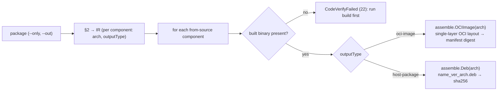

Both encoders are byte-reproducible (fixed uid/gid/mtime, `SOURCE_DATE_EPOCH`) and stamp the target
arch, so an arm64 image/`.deb` is labeled and digested distinctly from amd64.

---

## 15. `image` → `disk` → boot

The optional **thin base OS** path, decoupled from the substrate. `image` bootstraps a reproducible
rootfs via mmdebstrap from a date-pinned snapshot mirror; `disk` assembles a self-contained
UEFI-bootable qcow2 and can boot it under QEMU/OVMF to prove the from-source Kubernetes API is live.

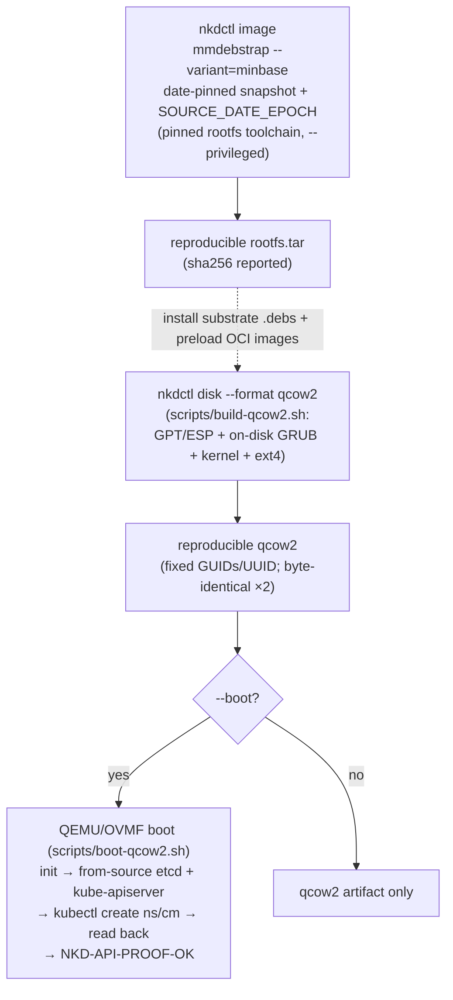

`--format` other than `qcow2` fails closed (`CodeUnsupported`). Byte-identity is asserted on the
pre-encryption image only; FDE is a documented overlay.

---

## 16. `catalog` — pin / bump / update-ci

The churn-decoupling story: the hand-authored **registry** never changes on a version bump; only the
machine-managed **lock** does, shipped as its own release train. `pin`/`bump` use git + network (resolve
tag → commit/tree/epoch, and `.go-version` → toolchain digest when the source declares
`toolchainBaseImage`). `update-ci` emits a scheduled GitHub Actions workflow that bumps, **rebuilds to
prove the bump still reproduces**, and opens a PR.

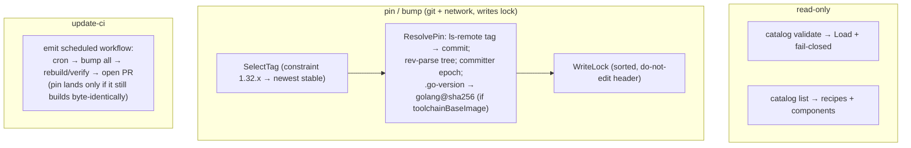

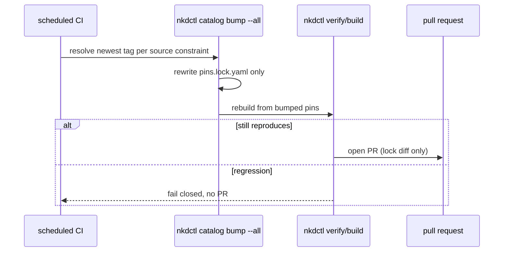

---

## 17. Fail-closed exit codes

Every failure path returns a distinct, coded process status (`pkg/nkd/errors`). This is what makes
"fail closed" observable in CI.

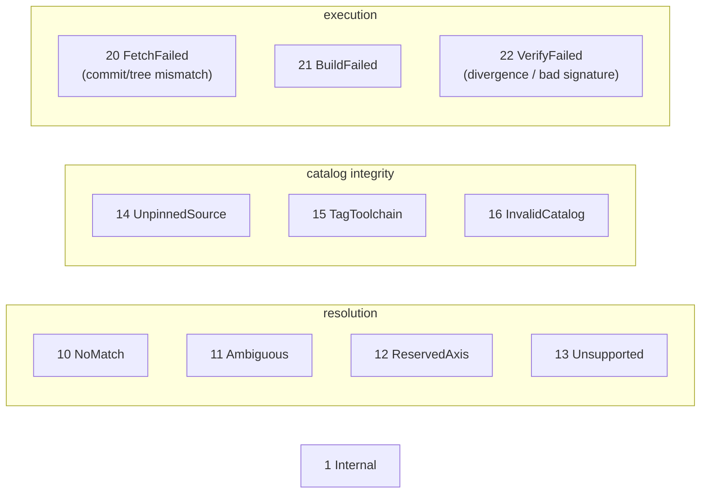

| Code | Exit | Raised when |
|---|---|---|
| `NoMatch` | 10 | no recipe matches the query |
| `Ambiguous` | 11 | two recipes match with equal specificity |
| `ReservedAxis` | 12 | a reserved axis (`accelerator`, …) is non-empty |
| `Unsupported` | 13 | arch outside `{amd64, arm64}`; unknown engine; `disk --format` ≠ qcow2; no packager |
| `UnpinnedSource` | 14 | floating/short commit, missing tree hash, or no lock pin |
| `TagToolchain` | 15 | a toolchain pinned by tag instead of `@sha256:` |
| `InvalidCatalog` | 16 | strict-decode/typo axis, composition hook, unknown `{{token}}`, bad outputType |
| `FetchFailed` | 20 | fetched commit or tree hash ≠ the pin |
| `BuildFailed` | 21 | a build container exits non-zero |
| `VerifyFailed` | 22 | rebuilt digest ≠ expected, or manifest signature fails |
| `Internal` | 1 | unexpected internal error |
