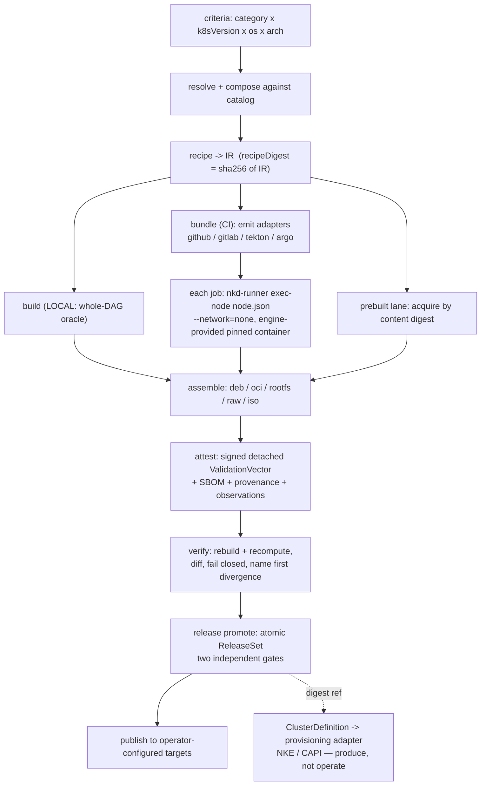
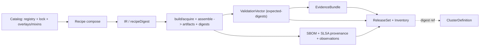
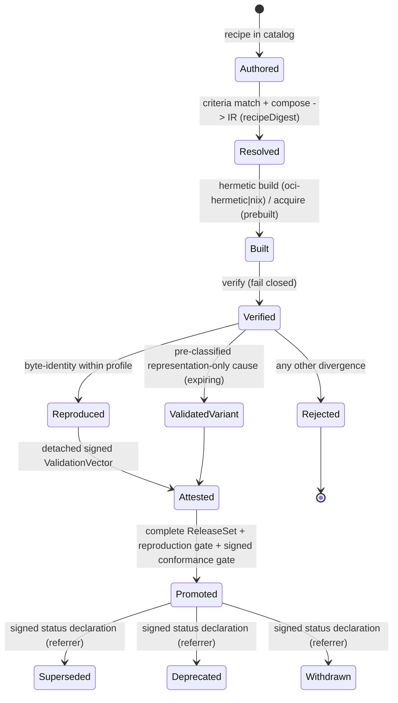

# NKD (NVIDIA Kubernetes Definition)

> [!CAUTION]
> **Historical architecture snapshot (superseded).** This document covers only ADR-01…ADR-22 and contains stale
> interface, module-topology, and completion claims. The current, all-ADR SADD is **`docs/sadd.md`**
> (ADR-01…ADR-25). The proposed ADR set and `docs/adr/reconciliation.md` remain the maintained engineering
> baseline and current support record, pending named-decider ratification.

## PLC-L1: Basic PLC: Software Architecture and Design Document

> **How to use this document.** This SADD records the architecture and design that realizes the requirements in
> the *NKD (NVIDIA Kubernetes Definition) SRD*. The load-bearing decisions are captured as **Architecture
> Decision Records** in `docs/adr/` (ADR-01…ADR-22); this document summarizes them and cites each inline as
> **(ADR-NN)**. The CLI/SDK surface is specified in `docs/cli.md`. Items only the owning team can supply are
> marked **[INPUT NEEDED]**. Diagrams are Mermaid (portable) plus prose; regenerate as images if pasting into
> Google Docs.

**Contents**

- Introduction — Purpose and Scope · Assumptions · Constraints · Dependencies · Definitions · References
- Architectural Details
- Design Details — Design Alternatives · Static Design (Configuration Data · External Interfaces · Dependencies · Integration Validation) · Dynamic Design (Functionality · Control Flow · Data Flow · Error Handling · Logging · State Machine) · Security Design · Test Automation · Other (Resource Limits · High Availability · Scalability · Future Work)
- Documentation Control

---

# Introduction {#introduction}

## Purpose and Scope {#purpose-and-scope}

The purpose of this document is to record the architecture and design that realizes the software requirements
outlined in the **NKD (NVIDIA Kubernetes Definition) SRD** (24 feature requirements FR-01…FR-24, 17 security
requirements SEC-01…SEC-18, 16 use cases UC-01…UC-16).

NKD is an **Apache-2.0, environment-agnostic Go CLI (`nkdctl`)** together with a **catalog** data model. It lets
a Kubernetes operator **build a Kubernetes substrate from upstream source, reproducibly, in their own
environment**, and prove byte-for-byte agreement with a publisher's signed expected identities — without the
publisher distributing any deployable binary. NKD is modeled on AICR's `criteria → recipe → bundle + SBOM`
pattern and reuses those patterns by reading/copying, never importing, to keep the linked dependency set
permissive and minimal.

Two concepts are kept strictly separate and this separation is load-bearing:

- **The TOOL (`nkdctl`)** — the resolver, pipeline emitter, reproducible-build discipline, and verify engine.
- **A CATALOG** — a pinned, validated component set plus signed expected-digests, published *on top of* the
  tool. NVIDIA publishes one; any operator can author their own. The default catalog is embedded in the binary
  via `//go:embed`; `--data <dir>` fully replaces it.

**In scope for this SADD:** the tool and the definition/trust model — the producer critical path
`criteria → resolve → recipe/IR → (build │ emit pipeline) → assemble → attest → verify → release promote →
publish`, plus the engine-agnostic **ClusterDefinition** NKD produces for a downstream provisioner.

**Out of scope (documented, not owned):** cluster instantiation and fleet lifecycle (performed by a downstream
consumer such as NKE, which is non-normative); the runtime-conformance suite (handed to NKD as a signed result,
never run by nkdctl); the *content* of any particular catalog; and the operator-owned base OS, kernel, FDE,
secrets, and site configuration.

## Assumptions {#assumptions}

Summarized from SRD §1.2; see the SRD for the authoritative list.

- The operator runs the released NKD pipeline in its own CI environment and controls its registries, apt/deb
  repositories, base OS, secrets, boot process, and deployment policy.
- The operator can mirror and retain the exact pinned sources, package snapshots, base images, toolchains, and
  builder/runner images without substitution, and those pinned inputs remain retrievable by immutable identity
  for the release's supported lifetime.
- Inputs within the reproducibility boundary can be pinned and normalized so that the definition, builder
  profile, and declared inputs determine the canonical outputs. Upstream components remain buildable in a
  supported environment and are deterministic or can be normalized by the pipeline.
- The operator runs the required Kubernetes conformance and NKE-compatibility validation in its own environment;
  artifact verification and runtime validation are independent gates.
- Operator execution does not require access to NVIDIA-internal systems, networks, services, credentials, or
  signing infrastructure. Air-gapped environments provide equivalent integrity and provenance verification using
  mirrored inputs and locally managed trust material.
- An authoritative owner maintains a versioned, machine-readable **Inventory** of the components and
  compatibility constraints required to deploy and operate each supported release; NKD consumes it as a pinned
  input (ADR-05, ADR-16).

## Constraints {#constraints}

Summarized from SRD §1.3. These are architectural invariants, not preferences. Each maps to one or more ADRs.

- **Definition, not distribution.** NKD defines and validates how artifacts are produced; it does not distribute
  the resulting deployable binaries. The trust distribution is a signed, **detached** expected-digests manifest
  (ADR-04, ADR-20).
- **Deterministic definition.** Recipes compile to a deterministic intermediate representation (IR) identified by
  digest: `recipeDigest = sha256(IR)`, serialized through **one canonical codec (RFC-8785 JCS)** with no
  grandfathered form. Output-affecting clock, randomness, host, and generated-identifier values are prohibited
  from the IR (ADR-01, ADR-02).
- **Immutable definitions.** Published recipes, profiles, manifests, and releases are immutable; any correction
  produces a new identity. Immutability is by **content-addressing**, not a maintained ledger (ADR-06).
- **Scoped, profile-bounded reproducibility.** Byte-for-byte reproducibility is asserted only for the same
  `recipe × build engine × input manifest × builder-profile` tuple. A builder profile is immutable and
  identified by its **signed** digest; the build must fail *before resolving inputs* if the environment does not
  satisfy output-affecting profile requirements (ADR-07, ADR-08).
- **Pinned, fail-closed inputs.** The catalog is split into a hand-authored **registry** (sources = repo +
  constraint + digest-pinned toolchain) and a machine-managed **lockfile** (resolved
  `{tag, commit, treeHash, sourceDateEpoch}` + prebuilt artifact digests); the **lock feeds `recipeDigest`**, so
  a pin bump is a recipe change. An unpinned source ref or a tag-not-digest toolchain fails resolution (ADR-22).
- **Pluggable, qualified builder types.** A component's from-source lane is built by a per-component **builder
  type** — `oci-hermetic` (a hermetic pinned OCI toolchain container) or `nix` (a locked flake realized in a
  pinned container) — chosen in the catalog and part of `recipeDigest`. The SRD is neutral on build substrate;
  it requires only an Apache-2.0-clean core with no incompatible dependency *linked in*, and a *qualified*
  builder. Nix is orchestrated as a subprocess, **never linked** (ADR-10).
- **Source-build boundary.** Artifacts within the reproducibility boundary are built from a pinned source in an
  isolated environment (`--network=none`) using immutable toolchain inputs. Externally built (**prebuilt**)
  artifacts are outside the from-source guarantee and must be explicitly identified; a component is from-source
  **XOR** prebuilt **XOR** an explicit exclusion (ADR-10, ADR-22).
- **Portable execution via a from-source runner.** Build logic is defined once (the IR) and lowered through
  multiple CI adapters that map topology/transport only. Each build node is executed by a **from-source,
  digest-pinned `nkd-runner`** (`nkd-runner exec-node <node.json>`) running directly in the engine-provided
  pinned container — no docker-in-docker — so byte-identity across engines is *structural*, not asserted across
  rendered strings. The runner digest is a builder-profile attribute (ADR-18, ADR-07).
- **Maintainable generated pipelines.** Emitted CI files are regeneration-canonical (never hand-edited), carry a
  `recipeDigest`/`bundleDigest` provenance marker, and self-detect drift via a fail-closed `bundle --check`
  gate; org customization uses a declared extension overlay or an emit-callable form, not a fork (ADR-21).
- **Canonical disk representation.** RAW (the logical byte stream) is the only canonical disk artifact;
  qcow2/VMDK/VHD/ISO are derived envelopes verified by the **decoded** logical-disk digest. Byte-reproduction
  claims apply to the pre-encryption content only; FDE forks a distinct, non-reproduction identity (ADR-14).
- **Independent, fail-closed gates.** Reproduction and runtime conformance are independent, mandatory
  operator-promotion gates. Verification is isolated from the build, runs as the unconditional final pipeline
  stage, fails closed with machine-readable errors and distinct exit codes, and NKD **consumes** a signed
  conformance result rather than running the suite. Partial release sets are not promotable (ADR-16, ADR-04,
  ADR-03).
- **Controlled variance.** A non-identical result may be accepted only for a pre-classified, representation-only
  cause; it receives a distinct, expiring identity and must not claim byte reproduction (ADR-07, ADR-16).
- **Open-source-clean.** The core is releasable under Apache-2.0 with no copyleft/BUSL dependency **linked** into
  it. GPL/other tools (qemu-img, cosign, `nix`) are **shelled as subprocesses only** (ADR-10, ADR-14).
- **Standard, replaceable interfaces.** Only documented industry-standard interfaces (OCI, apt/deb,
  PXE/iPXE/HTTP boot, Sigstore) are used; default implementations are replaceable by operator-selected
  equivalents (ADR-17, ADR-20).
- **Produce, don't operate.** NKD produces verifiable artifacts, evidence, re-selectable verified sets, and an
  engine-agnostic **ClusterDefinition**; it does not provision or operate the fleet. One ClusterDefinition is
  projected to many provisioning adapters (NKE, CAPI, …) (ADR-19).

## Dependencies {#dependencies}

External and cross-team dependencies (from SRD §1.4). Interfaces are detailed in *Design Details → Static
Design → External Interface and Specification*.

| Team or Company | Deliverable |
| :---- | :---- |
| Upstream OSS projects (Kubernetes, etcd, CoreDNS, containerd, runc, CNI-plugins, crictl, Helm) | Buildable, pinned source revisions + license metadata for each recipe component |
| Sigstore project | `cosign` / Fulcio / Rekor for detached keyless signing + transparency-log inclusion (operator-hosted or public) |
| Container runtime (Docker / Podman / BuildKit) | OCI toolchain-container execution with `--network=none` isolation |
| Nix (as a qualified builder) | `nix` CLI for locked-flake realization in a pinned container (subprocess; never linked) |
| CI engine vendors (GitHub, GitLab, Tekton, Argo) | Orchestrators the emitted pipeline is lowered onto (operator-selected; no single-vendor dependency) |
| **[INPUT NEEDED]** AICR team (NVIDIA) | The `aicr` CLI contract (`recipe` / `evidence digest` / `bundle`) for the accelerated-runtime integration |
| **[INPUT NEEDED]** NKE / downstream lifecycle team | The published artifact / compatibility / configuration / **signed conformance-result** consumption contract; the versioned NKE software inventory; the provisioning-adapter target |
| **[INPUT NEEDED]** Release Engineering (`release_eng`) | Publisher qualification pipeline + signing identity/policy |

## Definitions, Acronyms, Abbreviations {#definitions,-acronyms,-abbreviations}

| Term or Abbreviation | Description |
| :---- | :---- |
| **NKD** | NVIDIA Kubernetes Definition — the product/specification and its reproducible pipelines. |
| **`nkdctl`** | The Apache-2.0 Go CLI implementing NKD (the TOOL). |
| **`nkd-runner`** | The from-source, digest-pinned execution mode of `nkdctl`; `nkd-runner exec-node <node.json>` executes one IR node in the engine-provided container (ADR-18). |
| **Catalog** | A pinned, validated component set + signed expected-digests published on top of the tool. |
| **Registry / Lockfile** | The catalog's hand-authored *declare* file (sources + constraints + digest-pinned toolchains) and machine-managed *resolve* file (pins + prebuilt artifact digests); the lock feeds `recipeDigest` (ADR-22). |
| **Criteria** | The recipe-selection axes `category × k8sVersion × os × arch` (ADR-12). |
| **Category** | The recipe scope: `os`, `kubernetes` (node-level); `core-runtime`, `accelerated-runtime`, `operations`, `platform-services` (cluster-level helm) (ADR-12). |
| **Builder type** | The per-component from-source builder: `oci-hermetic` or `nix`; part of `recipeDigest` (ADR-10). |
| **Recipe** | A versioned specification of inputs, constraints, build operations, outputs, and validation requirements for one or more artifacts; compiles to the IR. |
| **IR (pipeline IR)** | The substrate-neutral, fully-resolved DAG of pinned build steps. `recipeDigest = sha256(IR)`. |
| **recipeDigest** | The sha256 of the canonically-marshaled IR — the recipe's immutable identity (ADR-01/02). |
| **Builder profile** | The signed, digest-identified environment (incl. the `nkd-runner` digest) that bounds a byte-identity claim (ADR-07). |
| **ValidationVector** | Binds one recipe + one builder profile to the expected artifact identities and evidence digests; the signed detached manifest verify checks against (ADR-05). |
| **Inventory** | The declarative member-list of a release: the *worklist* going in and the *completeness oracle* coming out (ADR-05, ADR-16). |
| **ReleaseSet** | The atomic, digest-addressable aggregate of release members + Inventory + evidence (ADR-05, ADR-16). |
| **ClusterDefinition** | The engine-agnostic definition NKD produces, projected to many provisioning adapters (ADR-19). |
| **EvidenceBundle** | Deterministic verify output: per-component verdicts, cause codes, per-block RAW granularity (ADR-05). |
| **ValidatedVariant** | A sanctioned, pre-classified, expiring, non-reproduction identity for a representation-only variance (ADR-07, ADR-16). |
| **SBOM** | Software Bill of Materials (CycloneDX), bound to an artifact's immutable identity (ADR-13). |
| **NKE** | NVIDIA Kubernetes Engine — a non-normative example downstream consumer / provisioning adapter. |
| **AICR** | NVIDIA AI Cluster Runtime — the reference accelerated-runtime integration (shelled, never linked) (ADR-12). |

## References {#references}

| SWE Number | Input Work Product | Revision | Location |
| :---- | :---- | :---- | :---- |
| **[INPUT NEEDED]** | NKD (NVIDIA Kubernetes Definition) SRD | 2026-08-19 | `docs/nkd-srd-doc.md` |
| **[INPUT NEEDED]** | NKD Architecture Decision Records (ADR-01…ADR-22) | current | `docs/adr/` |
| **[INPUT NEEDED]** | NKD CLI/SDK surface specification | current | `docs/cli.md` |
| **[INPUT NEEDED]** | NKD Epic Backlog | current | `docs/epics.md` |
| **[INPUT NEEDED]** | NKD POC narrative + verified results | current | `docs/poc.md` |
| **[INPUT NEEDED]** | Pin-currency / release-train design | current | `docs/versioning.md` |

---

# Architectural Details {#architectural-details}

This section documents the architecture that realizes the NKD SRD and the criteria by which the key options were
selected (see *Design Alternatives*). The authoritative rationale for each decision is the cited ADR.

**High-level description.** NKD is a **single-front-end / many-back-end** pipeline. An operator's *criteria*
(`category × k8sVersion × os × arch`) select and *compose* a *recipe* from a *catalog*; the recipe compiles to a
deterministic *IR* whose sha256 is the `recipeDigest`. **`resolve` is the only verb that produces the IR; every
other stage consumes it.** The IR is either built locally (the ground-truth oracle) or **lowered by adapters**
onto whichever CI engine the operator runs — where a from-source `nkd-runner` executes each node in the
engine-provided pinned container. Each component is built **from source hermetically** by its per-component
builder type (`oci-hermetic` or `nix`) or **acquired** by content-addressed digest (the prebuilt lane). Built
components are assembled into delivery artifacts; the publisher ships only a signed, **detached**
ValidationVector; and `nkdctl verify` independently rebuilds, recomputes, and compares — failing closed and
naming the first divergent node. Verified members promote atomically into a digest-addressable **ReleaseSet**,
which a **ClusterDefinition** references by digest for a downstream provisioner.



**Static aspects.** The tool is a set of Go packages under `pkg/nkd/` with a thin CLI in `cmd/nkdctl/` over a
`client/v1` SDK facade (ADR-17): `criteria` (asymmetric match, ADR-12), `catalog` (DataProvider + `//go:embed` +
registry/lock, ADR-22), `compose` (overlay/mixin composition, ADR-11), `recipe` (compose → IR → `recipeDigest`),
`ir` (typed DAG + canonical marshaler, ADR-01/02), `pipeline` (IR → engine adapters + local runner + the
`nkd-runner` exec-node mode, ADR-18/21), `assemble` (deterministic OCI/.deb/rootfs/disk, ADR-14), `attest` /
`sign` / `verify` (the trust surface, ADR-04/05/09/13), `profile` (builder profile, ADR-07), `variant`
(ValidatedVariant), `aicr` (shelled accelerated runtime, ADR-12), `errors` (coded errors → exit codes, ADR-03).
Planned per the ADRs: `canonical` (the JCS codec + digest-addressing, ADR-01), `release` (ValidationVector /
ReleaseSet / Inventory, ADR-05/16), `status` (supersede/withdraw referrers, ADR-06), `cluster`
(ClusterDefinition + projections, ADR-19), `mirror` (air-gap, ADR-15), `provenance`, `vuln`, `trust`.

**Dynamic aspects.** Three flows dominate (detailed in *Dynamic Design*): (1) **resolve→build** — criteria to a
composed pinned IR to per-component hermetic builds executed locally by a concurrent DAG scheduler or, in CI, by
`nkd-runner exec-node` per job; (2) **trust** — attest (sign a detached ValidationVector) then verify (rebuild,
recompute, cosign-verify, diff, fail closed) as the unconditional terminal, then assemble/SBOM; (3) **release**
— aggregate verified members into an atomic set gated by independent reproduction and handed-off runtime
conformance, immutable and digest-selectable, referenced by a ClusterDefinition.

**Key assumptions and limitations.**
- Reproducibility is **bounded to a signed builder profile** (ADR-07). A build under a different profile is a
  *variant*, not "reproduced"; the runner digest is part of that profile (ADR-18).
- The **from-source lane** proves "the same inputs rebuild the same bytes"; the **prebuilt lane** guarantees
  only "exactly these pinned bytes" (profile-independent) (ADR-10).
- nkdctl **produces** verifiable artifacts, evidence, re-selectable verified sets, and a ClusterDefinition; it
  does **not** operate the fleet, run the runtime-conformance suite, or own cluster instantiation (ADR-16,
  ADR-19).

---

# Design Details {#design-details}

This chapter documents the software design that satisfies the NKD SRD. Sections not applicable to a CLI/batch
tool are marked accordingly.

## Design Alternatives {#design-alternatives}

The load-bearing choices and the criteria used to select them; the full rationale, options, and consequences are
the Architecture Decision Records in `docs/adr/`.

| Decision | Options considered | Selected | Criterion | ADR |
| :---- | :---- | :---- | :---- | :---- |
| Build substrate | Single hand-rolled OCI pipeline; Nix-only; **pluggable builder types** | **Pluggable per-component builder types** (`oci-hermetic` \| `nix`), `nix` shelled never linked | Apache-clean core; qualify Nix without linking it; right tool per component | ADR-10 |
| Identity codec | Reuse `sigs.k8s.io/yaml`; freeze `json.MarshalIndent`; **one RFC-8785 JCS codec** | **One JCS codec incl. recipe identity** (no grandfathered form; schemaVersion + additive migration) | Cross-language recomputability; a single canonical form pre-launch | ADR-01 |
| Recipe granularity | One recipe = whole cluster; one per artifact; **one recipe = one category, reproducibility-bounded** | **Category-scoped recipe** (`category × k8sVersion × os × arch`); role/clusterType are composition | One builder profile + one verify pass per recipe; releases compose by digest | ADR-11, ADR-12 |
| Composition | Pick one matching recipe; **compose overlays + mixins** | **Compose** maximal-leaf overlays (single-parent inheritance) + orthogonal mixins; fail-closed on collision | Layered catalogs (base + role/os) without recipe explosion | ADR-11 |
| Pin model | Pins in tool code; one combined file; **registry (declare) + lock (resolve)** | **Two-file model**; the lock feeds `recipeDigest`; bump = lock diff | Stay current as *data* (catalog release), not a tool release | ADR-22 |
| Pipeline execution | Emitter renders per-node build strings; `nkdctl` launches nested containers; **from-source runner in engine container** | **`nkd-runner exec-node` in the engine-provided pinned container** (no DinD) | Structural byte-identity; no nested runtime | ADR-18 |
| Reproduction identity | Bind CI-adapter name; omit engine; **bind a semantic engine class + profile** | **`ReproTuple{recipeDigest, profileDigest, engineClass, inputManifestDigest}`** | One-IR-many-adapters preserved while bounding the claim | ADR-07 |
| Acquisition | From-source only; prebuilt only; **from-source XOR prebuilt XOR exclusion** | **Two honest lanes, per component** | Strong default guarantee + an opt-in weaker lane, same fail-closed discipline | ADR-10 |
| Canonical disk | Hash the qcow2 container bytes; **RAW-canonical, decode-verify envelopes** | **RAW logical stream canonical**; envelopes decoded + hashed; FDE forks identity | Reproducible disk identity independent of the envelope | ADR-14 |
| Promotion gates | Infer conformance from reproduction; run conformance in NKD; **two independent gates** | **Reproduction × handed-off signed conformance**, atomic completeness | One defect must not manufacture both artifact and proof; verifier isolation | ADR-16, ADR-04 |
| Cluster boundary | Emit an NKE-specific definition; **engine-agnostic ClusterDefinition + adapters** | **Engine-agnostic ClusterDefinition**, projected per adapter | Independence from any single control plane | ADR-19 |
| Accelerated runtime | Link AICR; **shell AICR** | **Shell AICR** (digest-pinned, verified) via a `Bundler` seam | Keep the core Apache-clean and dependency-minimal | ADR-12 |

## Static Design {#static-design}

### Configuration Data {#configuration-data}

All configuration is declarative and pinned; it is part of the attack surface (see *Security Design*).

- **Catalog** — the primary configuration input (ADR-11, ADR-22). `registry.yaml` (hand-authored: sources =
  repo + constraint + digest-pinned toolchain + per-component builder type, and the component set),
  `pins.lock.yaml` (machine-managed: resolved `{tag, commit, treeHash, sourceDateEpoch}` per source + prebuilt
  `artifacts:` digests), and optional `overlays/` + `mixins/` for layered composition. Embedded via
  `//go:embed`; **fully replaced** by `--data <dir>` with no code change. The lock feeds `recipeDigest`.
- **Inventory** — the declarative member-list of a release (`nkd-release.inventory.yaml`): the *worklist* for a
  multi-member `resolve --inventory` and the *completeness oracle* for `release promote` (ADR-05, ADR-16).
- **Reproducibility environment allowlist** — a fixed, pinned set injected into every build container:
  `SOURCE_DATE_EPOCH` (committer `%ct` of the pinned commit), `TZ=UTC`, `LC_ALL=C`, `GOTOOLCHAIN=local`,
  `GOFLAGS=-trimpath -buildvcs=false`, `GOOS/GOARCH/GOAMD64`, `CGO_ENABLED` per lane. Guarded so a catalog cannot
  override reproducibility keys (ADR-02).
- **Builder profile** — the signed, digest-identified environment descriptor including the **`nkd-runner`
  digest**; a fail-closed host preflight runs before inputs resolve (ADR-07, ADR-18). Mutated only via
  `profile repin … --sign`.
- **Pipeline extension overlay** — the operator-declared hook config (`pre-build` / `post-verify` /
  `pre-publish`) that `bundle` merges deterministically into the emitted pipeline; part of `bundleDigest` and
  drift-checkable (ADR-21).
- **Publish targets** — operator/transport config (per artifact type: OCI registry, apt/deb repo, object store)
  declared *outside* the catalog and excluded from `recipeDigest`; credentials by reference (ADR-20).
- **Trust store** — trusted signer OIDC issuer+identity pairs; precedence `CLI flags > operator store >
  catalog-advisory` (a catalog identity is never auto-trusted) (ADR-04).
- **CLI selectors** — `--engine`, `--data`, `--format`, `--offline`, `--mirror`, `--from-release`,
  `--inventory`, and the criteria axes; all default-driven and operator-overridable. No environment-specific
  value is hardcoded (ADR-17; `docs/cli.md`).

### External Interface and Specification {#external-interface-and-specification}

Each interface is a documented industry standard with a replaceable default implementation.

- **OCI registry.** Pull digest-pinned toolchain/`nix`/runner containers and prebuilt images; push deterministic
  control-plane images and attach manifest/SBOM/signature/status as **referrers**. A mutable tag cannot bypass
  digest+signature verification (SEC-13; ADR-06, ADR-20).
- **apt/deb repository.** Publish reproducible `.deb` host packages (operator-signed at their repo); standard
  `ar` layout, mtime-clamped, uid/gid-zeroed (ADR-14).
- **Git.** Fetch pinned source by 40-hex commit; verify commit + tree at fetch; derive `SOURCE_DATE_EPOCH` from
  the committer date; fail closed on any unpinned ref (ADR-22).
- **Container runtime.** Docker/Podman/BuildKit CLI (subprocess) run pinned toolchain containers
  `--network=none`, least-privileged; the engine provides the per-job container, `nkd-runner` executes in it
  (no DinD). Never linked (ADR-18, ADR-10).
- **Nix.** `nix` CLI (subprocess) realizes a locked flake closure in a pinned, rootless-userns container; the
  closure is pre-fetched, then the build runs offline. Never linked (ADR-10).
- **Sigstore.** `cosign sign-blob` / `verify-blob` (subprocess), Fulcio, Rekor — a detached signature over the
  ValidationVector; airgap uses a mirrored bundle + offline Rekor inclusion proof (never tlog-ignore).
  Operator-configurable OIDC identity; no NVIDIA identity hardcoded (ADR-04, ADR-15).
- **qemu-img.** Pinned subprocess seam to decode a disk envelope to its logical stream for verification;
  fail-closed if absent (ADR-14).
- **CI engines.** GitHub Actions / GitLab CI / Tekton / Argo YAML. The IR is lowered to `nkd-runner exec-node`
  jobs under `--network=none` plus a separate network fetch/vendor step, ending in an unconditional verify;
  adapters map topology/transport only (ADR-18).
- **AICR CLI.** `aicr` subprocess (digest-pinned): `aicr recipe → aicr evidence digest` (verified against the
  pinned profile digest, fail-closed on drift) `→ aicr bundle`. Injected through a `Bundler` seam; never
  imported (ADR-12).
- **Provisioning adapters.** The ClusterDefinition is *projected* to NKE / CAPI / others; NKD produces the
  projection, the engine provisions (ADR-19).
- **Boot / provisioning + object storage** (optional). NKD *produces* digest-referenced PXE/iPXE/HTTP/ISO
  artifacts and stores artifacts/manifests/SBOMs/evidence by immutable identity; it does not serve DHCP/TFTP/HTTP
  (ADR-14, ADR-20).

### Dependencies {#dependencies-1}

See *Introduction → Dependencies* for the cross-team table. The engineering dependencies that gate design are:

| Team or Company | Deliverable | Ref | Commit? |
| :---- | :---- | :---- | :---- |
| Upstream OSS | Buildable pinned source + deterministic (or normalizable) builds | §External Interfaces (Git) | **[INPUT NEEDED]** |
| Sigstore | cosign/Fulcio/Rekor behaviors + a supported version floor | §External Interfaces (Sigstore) | **[INPUT NEEDED]** |
| AICR team | Stable, digest-pinnable `aicr` CLI + deterministic bundle output | §External Interfaces (AICR) | **[INPUT NEEDED]** |
| NKE / downstream | Published consumption contract + **signed conformance-result** schema + NKE software inventory + provisioning-adapter target | §Security Design; Future Work | **[INPUT NEEDED]** |

#### Integration Validation Plan {#integration-validation-plan}

> **[INPUT NEEDED]** — participants and target dates.

Design-level integration validation (not QA) to prove the external interfaces are sufficient and roughly
functional, completed before code-complete:

| Functionality to Validate | Teams Participating | Interfaces Covered | Date Complete |
| :---- | :---- | :---- | :---- |
| One IR lowered to all CI engines runs `nkd-runner exec-node` byte-identically (no DinD) | **[INPUT NEEDED]** | CI engines / container runtime | **[INPUT NEEDED]** |
| `nix` locked-closure realized offline reproduces the same artifact digest as `oci-hermetic` peers | **[INPUT NEEDED]** | Nix / container runtime | **[INPUT NEEDED]** |
| Executed cosign sign → verify → tamper-fails round-trip (incl. offline Rekor inclusion) | **[INPUT NEEDED]** | Sigstore | **[INPUT NEEDED]** |
| Two-environment bake-off reproduces the hard lanes bit-identically | **[INPUT NEEDED]** | Container runtime / Git | **[INPUT NEEDED]** |
| A signed conformance result is ingested and gates promotion; a missing one fails closed | **[INPUT NEEDED]** | NKE / downstream | **[INPUT NEEDED]** |
| AICR `recipe → evidence digest → bundle` verified against the pinned profile | **[INPUT NEEDED]** | AICR CLI | **[INPUT NEEDED]** |

## Dynamic Design {#dynamic-design}

### Functionality and Behavior {#functionality-and-behavior}

`nkdctl` exposes a small, consistent surface over a reusable SDK facade (full specification in `docs/cli.md`).
**`resolve` is the only source-selecting verb** (criteria \| `--inventory` \| `--from-release`) and produces the
IR; every other spine verb consumes it. The producer spine is `resolve → (build │ bundle) → assemble → attest →
verify → release promote → publish`, where `build` (local, whole-DAG oracle) and `bundle` (CI emission) are
*parallel* IR consumers. Supporting nouns are `catalog` (list/categories/validate/bump), `release`
(show/status/promote/select/rollback/supersede…), `profile` (show/digest/preflight/sign/repin), `cluster`
(define/validate/project), and `mirror` (plan/stage/check/import); read verbs are `query`, `diff`, and
`resolve --explain`. `nkd-runner exec-node` is the internal per-node executor, never operator-typed. Every
generator has a fail-closed `--check` twin; every fail-closed path returns a distinct coded exit code (ADR-03).

### Control Flow {#control-flow}

Resolve → build → assemble → attest → verify, ending in the unconditional terminal verify.

```mermaid
sequenceDiagram
  participant Op as Operator CLI
  participant Res as resolve/compose
  participant IR as ir (recipeDigest)
  participant Run as build (local) / nkd-runner (CI)
  participant At as attest/sign
  participant Ve as verify (isolated)
  Op->>Res: criteria (category x k8s x os x arch) | --inventory | --from-release
  Res->>Res: asymmetric match + compose overlays/mixins (else fail closed)
  Res->>IR: compile -> IR; recipeDigest = sha256(IR)
  Op->>Run: build (per-component DAG, --network=none, per builder type)
  Run-->>Op: per-component artifact digests -> assemble
  Op->>At: attest -> detached signed ValidationVector (+ SBOM + provenance)
  Op->>Ve: verify
  Ve->>Ve: cosign-verify manifest vs pinned issuer/identity
  Ve->>IR: rebuild + recompute recipeDigest (independent)
  Ve->>Ve: diff digests -> first divergent node
  Ve-->>Op: exit 0 (Reproduced) | non-zero coded (Rejected)
```

### Data Flow {#data-flow}

Data is content-addressed end to end; the only identities that cross the publisher→operator boundary are signed
digests, never binaries.



### Error Handling {#error-handling}

Errors are **fail-closed** and machine-diagnosable (ADR-03). Every failure at an I/O, subprocess, serialization,
or verification boundary is a typed `*errors.Error` mapped to a **distinct, stable process exit code** in one
frozen, banded table (semantic 0–3; resolve/crypto 10–19; build/verify/trust/disk 20–29; retryable 30–31;
release/lifecycle 40–51; plus `pipeline-drift` for a stale/edited emitted pipeline, ADR-21). `verify` names the
**first divergent node**; a `Retryable()` predicate lets a CI gate distinguish a transient failure from an input
error. Logs are stderr-only and never contain credentials, tokens, or key material (SEC-09). Unsupported
flag/format combinations and reserved criteria axes fail closed rather than degrading.

### Logging and Debugging {#logging-and-debugging}

Diagnostics use a leveled structured logger (`log/slog`) on **stderr**; machine-consumable results (IR, SBOM,
manifest, report, evidence bundle) go to **stdout** or `--out` files only, so `stdout` is always a clean,
parseable stream (ADR-01). `--log-level` / `NKDCTL_LOG` set verbosity; `NO_COLOR` and non-TTY disable ANSI. The
primary debugging artifact is the deterministic **EvidenceBundle**: per-component verdicts, cause codes, and
per-block RAW granularity that diagnose a mismatch **from the published manifest alone**, without NVIDIA
reference bytes (ADR-05).

### State Machine {#state-machine}

The recipe/release lifecycle. Correction is never a mutation — it produces a new identity (ADR-06).



## Security Design {#security-design}

NKD's security model is **zero-binary trust**: the publisher runs the pipeline in public and ships only a signed,
**detached** ValidationVector (cosign keyless + Rekor inclusion); any operator independently reproduces and
verifies. The design satisfies SEC-01…SEC-18.

**Assets.** The `recipeDigest` identity; the signed ValidationVector; the signed builder profile (incl. the
runner digest); the operator's signing OIDC identity and trust store; the catalog; the ReleaseSet; and the
pinned input set (sources, toolchains, builder/runner images, prebuilt artifacts).

**Trust boundaries & data flow.** The publisher→operator boundary carries only signed digests. The
catalog→resolver boundary is fail-closed (unpinned ref or tag-not-digest toolchain aborts resolution, ADR-22).
The build→verify boundary is isolated (the verifier re-hashes independently and does not invoke the build
engine, ADR-04). The operator→registry boundary selects release sets by **immutable digest**; a mutable tag
cannot bypass digest+signature verification (ADR-16).

**Threat model (STRIDE-style) → defenses.**

| Adversary / threat | Defense | SEC |
| :---- | :---- | :---- |
| Malicious catalog author or overlay override (unpin a source / downgrade a toolchain / swap a builder type) | Fail-closed pinning at load and post-composition re-validation; builder type is part of `recipeDigest`; distinct coded errors | SEC-10, FR-04 |
| Compromised mirror/registry swaps a mutable tag | Select by immutable digest; digest+signature verify before use | SEC-13 |
| Signer-identity spoofing | Trust-store precedence; cosign-verify against a **pinned** issuer/identity; a catalog identity is advisory only | SEC-04, SEC-05, SEC-17 |
| Forged / stale "withdrawn" or "superseded" declaration (DoS a good release) | Status declarations are signed referrers; unsigned are ignored for enforcement unless required | SEC-16 |
| Trusted-root substitution in airgap | Mirror a pinned trusted-root snapshot; verify the offline Rekor inclusion proof (never tlog-ignore) | SEC-14 |
| A build defect manufacturing both artifact and proof | Verifier isolation (measure-only path; separate-binary later); reproduction × handed-off conformance are independent gates | SEC-07, SEC-08 |
| A tampered or unpinned build runner | The `nkd-runner` is built from source in step 1, digest-pinned in the signed profile, and verified before use | SEC-11, FR-06 |
| Secret leakage into artifacts/logs/env | Secrets referenced, never embedded; pinned env allowlist; artifact/log/SBOM/CI-YAML/target-config scanning | SEC-09 |
| Non-hermetic or privileged build | `--network=none`, least-privileged (rootless-userns for `nix`), pinned-digest containers; host/builder identity recorded only in the detached observations record | SEC-11 |
| Host/clock/profile/runner leaking into the recipe identity | IR-purity invariant + static lint + differential digest-stability test; runner/profile digests are profile attributes, excluded from `recipeDigest` | FR-03 |
| A stale or hand-edited emitted pipeline builds the wrong thing | `bundle --check` drift gate (fail-closed `pipeline-drift`) run as the pipeline's own first job | SEC-06 |

Recipes, pipeline bundles, validation vectors, and release sets are each integrity-protected and independently
digest-addressable (SEC-01); an expected digest is trusted only when authenticated by the signed validation
vector (SEC-02); signatures are always detached and never embedded in covered bytes (SEC-03).

## Test Automation {#test-automation}

Not a GPU-driver feature; this section describes design-for-testability rather than a QA plan.

The architecture is **deterministic and hermetic by construction**, which makes automated testing tractable:
`make test` runs pure logic offline (no Docker/network); resolve/compose/marshal are pure functions with
golden-digest fixtures (ADR-11 sweeps the criteria matrix); the coded-error/exit-code table is snapshot-tested
(ADR-03); the cosign Signer/Verifier and the external-transport seams are **injectable fakes** so trust/publish
logic is testable without a binary or a live registry (ADR-04, ADR-17); `verify` fail-closed paths are covered
by table tests naming the first divergent node; the **two-environment bake-off** asserts bit-identity as a gate
across builder types (ADR-08, ADR-10). Security-relevant hooks: fail-closed negatives
(unpinned/tag/reserved-axis/builder-mismatch), the IR-purity lint (ADR-02), secret-exclusion scans, and the
`bundle --check` drift gate (ADR-21). Build-heavy paths (from-source, disk assembly) are exercised via the local
runner as a ground-truth oracle for the CI emitters (ADR-18).

## Other Design Considerations {#other-design-considerations}

### Resource Limits {#resource-limits}

`nkdctl` is a batch/CLI tool; resource use is dominated by the build lane. Concrete numbers are environment- and
component-dependent — **[INPUT NEEDED]** for the target CI profile.

| Software Module | Resource Name | Requirement |
| :---- | :---- | :---- |
| build (from-source lane) | CPU | Go/CGO/`nix` builds saturate available cores; local default `-j 1`, per-component parallelism across CI runners |
| build | RAM | **[INPUT NEEDED]** (Kubernetes/CGO and `nix`-realize lanes are the peak) |
| build / assemble / mirror | Storage | Source checkouts, toolchain/`nix`/runner images, per-build writable output, artifact + optional air-gap mirror — **[INPUT NEEDED]** GB |
| resolve / emit / verify | CPU/RAM | In-memory transforms complete in seconds (`verify` additionally performs a full rebuild) |

### High Availability {#high-availability}

Not applicable as a runtime service — `nkdctl` is invoked per build/verify and holds no long-running state.
"Availability" in NKD terms is **input retrievability**: pinned inputs (sources, package snapshots, base images,
toolchains, builder/runner images) must remain retrievable by immutable identity for the release's supported
lifetime, and the operator's registry/mirror/CI availability is operator-owned. The offline/air-gap path (ADR-15)
removes any dependency on a hosted service for verification.

### Scalability {#scalability}

- **Parallelism.** The IR is job-per-component; the local runner is a concurrent DAG scheduler and the CI
  emitters fan out one `nkd-runner exec-node` job per component across runners (ADR-18).
- **Incremental work (FR-24).** Because every input is digest-pinned and immutable, an unchanged component keeps
  its `recipeDigest` and its prior verification/evidence is reused — a one-component bump re-builds/re-tests one
  recipe, not the whole set. Validation time scales with the change set, not the component count (ADR-16).
- **Multi-arch.** Builds are native per arch (model B, no cross-compilation); the same recipe yields a distinct,
  reproducible `recipeDigest` per arch (ADR-12).
- **Multi-member.** `resolve --inventory` fans the spine across a release's members; release sets scale by
  referencing independently-built members by digest rather than re-materializing inputs (ADR-05, ADR-16).

### Future Work {#future-work}

Tracked as the NKD epic backlog (`docs/epics.md`); the architecture is settled in ADR-01…ADR-22 and the surface
in `docs/cli.md`. Items where the current POC is deliberately incomplete, each with a decided ADR home:
executing cosign end-to-end (today plumbing-only; ADR-04); the `nix` builder lane and its rootless-userns
de-risking spike (ADR-10); a true **musl** static `runc` lane (glibc-static ships today); productionized
**two-machine** bit-identity (ADR-08); ISO/PXE/iPXE/HTTP boot, `qemu-img` decode-determinism, and FDE (ADR-14);
the first-class release-lifecycle objects — ValidationVector / ReleaseSet / Inventory / status referrers (ADR-05,
ADR-06, ADR-16); the `client/v1` SDK facade + context/cancellation plumbing (ADR-17); the engine-agnostic
**ClusterDefinition** + provisioning-adapter layer (ADR-19); the generated-pipeline extension surface (ADR-21);
and the two open surface questions in `docs/cli.md` §7 (`verify --boot`, `--from-release` placement).

---

# Documentation Control {#documentation-control}

| Item | Description |
| :---- | :---- |
| Title | NKD (NVIDIA Kubernetes Definition) — Software Architecture and Design Document (PLC-L1) |
| Author(s) | **[INPUT NEEDED]** |
| Reviewers | **[INPUT NEEDED]** |
| Approvers | **[INPUT NEEDED]** (per stakeholders) |
| Status | Draft |
| Related SRD | NKD (NVIDIA Kubernetes Definition) SRD (2026-08-19) |
| Related ADRs | ADR-01…ADR-22 (`docs/adr/`) |
| Related surface | `docs/cli.md` |

## Approvers

> **[INPUT NEEDED]** — modify according to stakeholders.

| Name | Role | Approval |
| :---- | :---- | :---- |
|  |  |  |

## Reviewers

> **[INPUT NEEDED]**

| Name | Role | Date |
| :---- | :---- | :---- |
|  |  |  |
