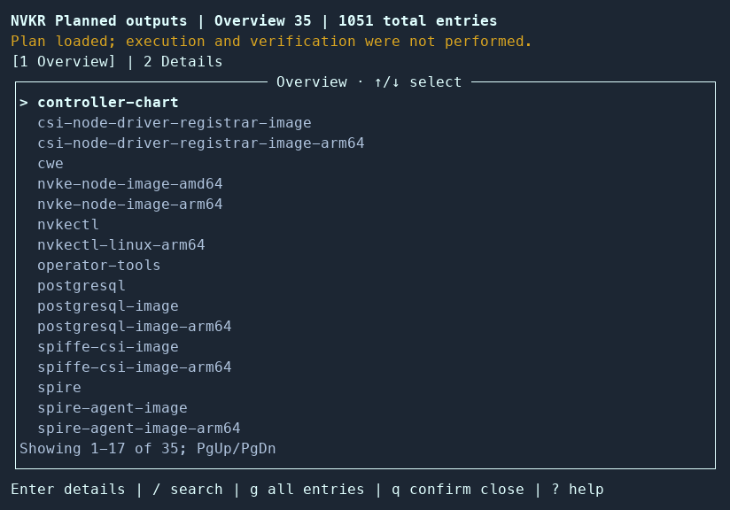
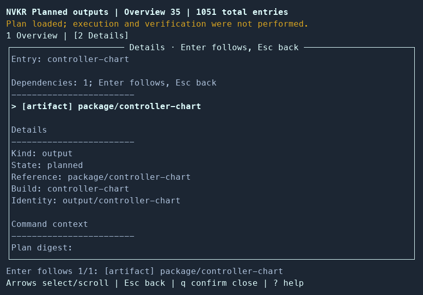
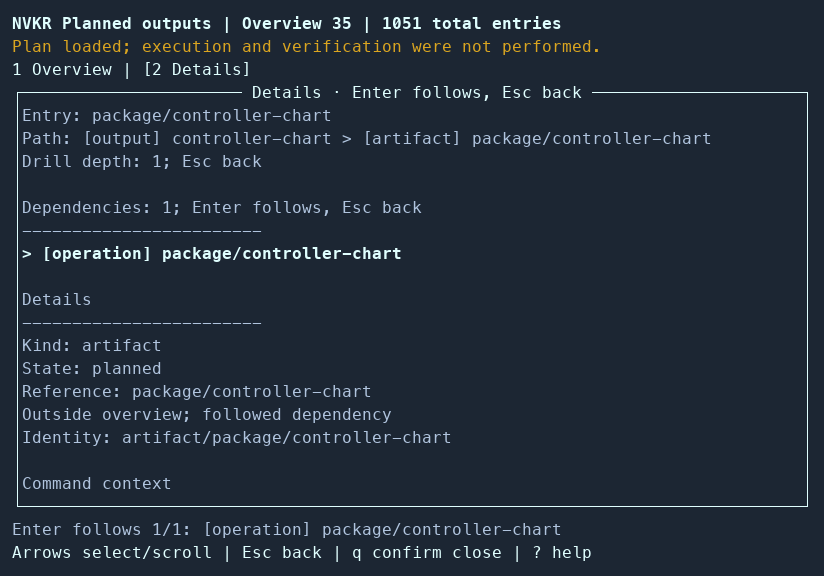
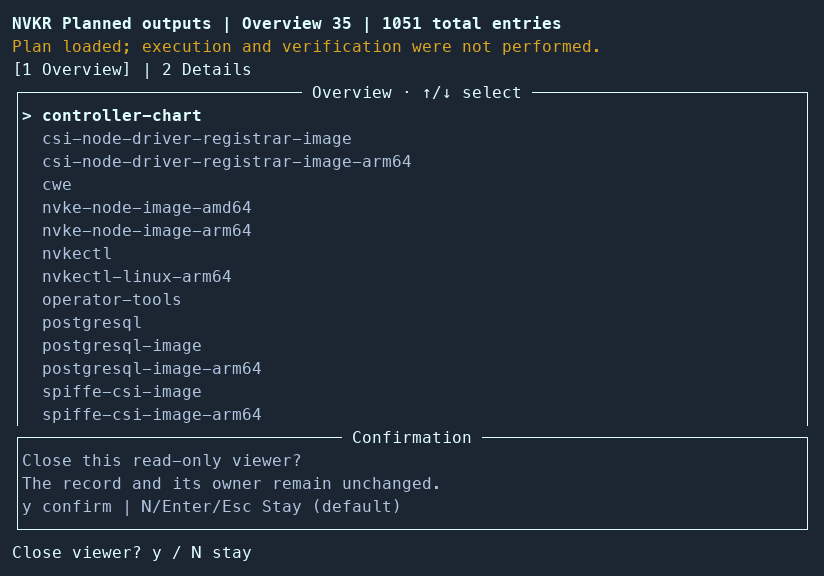
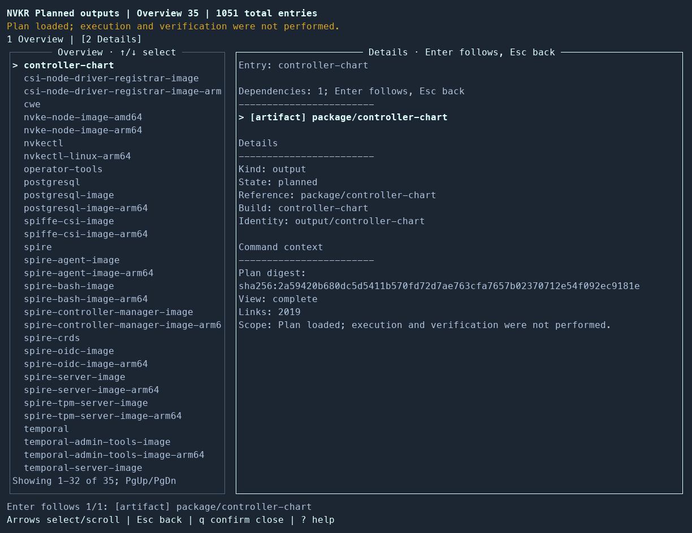
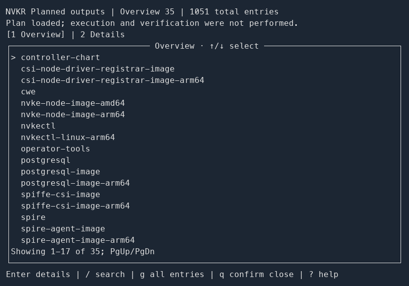

# Dashboard screenshots

These images show the current NVKR renderer in an 80x24 simulation terminal with
the shared NVKR/NVKE demo color palette and framed panes. The monochrome example
uses terminal-default colors; the wide Details example uses 120x40 cells.
All use the checked-in `.github/nvkr-run/plan.json`, whose validated Plan digest is
`sha256:2a59420b680dc5d5411b570fd72d7ae763cfa7657b02370712e54f092ec9181e`.
The Plan is loaded
and validated by `planview.Load`; `graphDisplay` supplies the same typed
description as `run graph --ui=tui`. Enter and Esc events drive the actual
`runpresenter.View`, and `tcell.SimulationScreen.GetContents` captures its cells.
The cells and their foreground/background colors are rasterized with Menlo
on a fixed-width cell grid with one shared font baseline per row, without
changing their text or layout. Box-drawing glyphs join at cell edges.
Monochrome cells illustrate a dark sample terminal's defaults; NVKR does not
choose the terminal's default colors.

This is controlled presentation evidence, not producer execution, release
verification or a human usability study. The fixed snapshot contains 35 named
outputs and 1051 total entries. No transport references or private paths are
included in the projection.

The capture overlay and Menlo/Pillow rasterization harness were local scratch
tools and are not committed or an automated drift gate. These images are a fixed
presentation capture; recapture from actual renderer cells when visible UI changes.
The operator-facing [lifecycle guide](../../lifecycle.md#dashboard-screenshots)
embeds the gallery.

