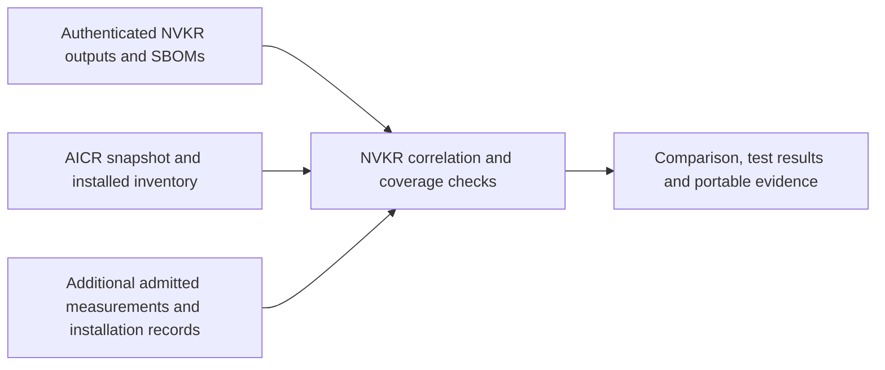

# Cluster observation and artifact attribution

**Status:** proposed feature design; no implementation or runtime acceptance.
**Date:** 2026-11-02

[ADR-29](adr/0029-cluster-observation-and-artifact-attribution.md) records the architectural decision.
This design owns the proposed workflow, reuse assessment, delivery slices and acceptance criteria.
It does not allocate a command, wire schema, digest family or approved collector/dependency version.

## User outcome

Select an exact NVKR build or Release, inspect an existing cluster, and find which deployed artifacts match
that build and its SBOMs. Save a snapshot and comparison, run upstream-owned validation against explicitly
identified subjects, and share independently verifiable evidence with readable results and TestGrid links.
The complete feature covers OCI images, Helm charts, OS images, and host packages/binaries.

The report answers three separate questions: what was produced or acquired, what was installed, and what
content was measured at observation time. It reports differences and unknowns as useful results. A successful
functional test cannot establish installed identity; an intact signature cannot establish a truthful host.

## Workflow and ownership

1. Authenticate the selected Run/Release and subject-bound evidence through existing lifecycle owners.
   Hold that exact baseline; a mutable tag or decoded release description is not acceptance. An admitted
   local diagnostic stays explicitly unsigned/unqualified and acquires no hosted publication identity.
2. Freeze the downstream deployment mapping and comparison policy. NVKE owns topology, installation,
   supported configuration and output applicability. Distinguish standalone outputs, contained dependencies,
   acquired artifacts, build-only tools and unused architectures; do not expect every SBOM row to be a Pod.
   Reuse NVKE's pinned deployment and component release declarations for this mapping where supported,
   extending the [existing import](nvke-pin-set-usage.md) rather than authoring a competing stack list.
   Those declarations describe intended installation; they do not prove what is running.
3. Discover the selected cluster scope, including unrecognized software. Save cluster/object/node identities,
   observation intervals and available resource versions, plus denied reads, unreachable nodes, exclusions
   and unsupported measurements. Do not describe several changing API reads as an atomic snapshot.
4. Compare observed subjects/content with the authenticated baseline under that frozen policy. Preserve
   installation-lineage gaps and ambiguous digest domains. Do not shrink the required scope after a failure.
5. Invoke selected upstream-owned checks through admitted artifact/cluster adapters. Record source/harness
   identity, tested subjects, selection, completeness, skips, original results and cleanup separately.
   Tests that allocate tenants or create resources require capacity, access and lifecycle ownership even
   when they use product APIs. Hardware provisioning remains downstream, outside the verifier.
6. Retain private originals and construct a reviewed shareable projection before signing. Package covered
   observations/results and a canonical file inventory bound to baseline, policy and target context.
   Verify all covered files and recompute comparison/coverage independently before displaying an accepted
   result. Public views disclose inaccessible observations; TestGrid links to the verified evidence.

Cluster observations do not change producer identities or the signed publisher SBOM. They introduce no
seventh authored public lifecycle input. They issue no conformance receipt or release authorization;
[ADR-16](adr/0016-release-gates-and-digest-first-selection.md#6-passive-external-qualification-handoff--deferred-producer-protocol)
continues to own the separate authenticated external-result qualification handoff.

## Attribution requirements

| Class | Expected and observed relationship | Limit that remains visible |
| --- | --- | --- |
| OCI | Authenticated image/index and native child joined to actual runtime identity, workload/container/node and architecture | PodSpec strings are discovery hints; an image identity does not measure writable layers, mounted executables or process memory |
| Helm | Exact archive and dependencies joined through an installation record to values, rendering inputs and live resources | A release version or stored manifest cannot retrospectively prove which archive was consumed; mutation/defaulting rules must be explicit |
| OS image | Delivered disk and applicable content inventory joined through authenticated boot/provisioning records to node measurements | Kernel/OS labels are not disk identity; hashing a running mutable disk cannot reproduce original QCOW2 bytes |
| Host package/binary | Exact package or binary and composition/file evidence compared with measured installed payloads | Package-manager names/versions alone are insufficient; generated files, configuration and package transformations need explicit policy |

Each required member/measurement returns matched, mismatched, not observed, unverified, or explicitly
non-applicable with a reason. Extra software remains visible and is evaluated by independent policy.
Overall match requires complete applicable coverage. A collector error, missing node, absent SBOM content
coverage, unsupported runtime identity or missing installation record cannot produce a complete match.
OCI/Helm delivery may land first, but it remains partial until OS/package acceptance is exercised.

Reuse NVKR's existing [CycloneDX evidence and signing owners](dependency-sboms.md) for subject-bound
build evidence. The observation/comparison is an additional record; it must not rewrite the publisher's
SBOM or introduce another SBOM implementation.

## AICR reuse assessment

AICR already contains reusable implementations. The inspected source is
[NVIDIA/aicr at 935e0746](https://github.com/NVIDIA/aicr/tree/935e0746dc54da890a23c1ecca998244b3a25de7).
These are source/API findings, not proof that the selected CLI release exposes every API or that NVKR can
already consume those records. Do not implement another collector or evidence stack before evaluating them.

| Existing capability | Reuse candidate | NVKR integration still required |
| --- | --- | --- |
| Node snapshots | Public [snapshotter](https://github.com/NVIDIA/aicr/tree/935e0746dc54da890a23c1ecca998244b3a25de7/pkg/snapshotter) API and collector implementations | Preserve collector failures/omissions and target/interval binding; a successful measurement call is not complete coverage |
| Installed Helm/Argo inventory | Public [inventory](https://github.com/NVIDIA/aicr/tree/935e0746dc54da890a23c1ecca998244b3a25de7/pkg/inventory) readers | Caller-scoped chart/version inventory is not whole-scope discovery, original archive-byte lineage or comparison with current live resources |
| Evidence construction/publication | Public [attestation](https://github.com/NVIDIA/aicr/tree/935e0746dc54da890a23c1ecca998244b3a25de7/pkg/evidence/attestation) APIs | Existing inputs/subjects describe AICR recipe, snapshot and phase results; NVKR source Run/output/baseline bindings need an admitted adapter or upstream extension |
| Independent evidence verification | Public [verifier](https://github.com/NVIDIA/aicr/tree/935e0746dc54da890a23c1ecca998244b3a25de7/pkg/evidence/verifier) API | Evaluate NVKR-specific expected subjects, observation trust, coverage and comparison; do not accept an AICR recipe digest as an NVKR artifact identity |

The current AICR Kubernetes image collector normalizes PodSpec image references and deduplicates them by
image name. That is useful discovery, but it cannot establish the actual runtime/native-manifest digest
required here. Its OS collector covers OS/kernel configuration; it does not establish a delivered disk's
boot lineage or measure all installed package payloads. These gaps require attribution adapters, upstream
extensions or other admitted collectors, not a duplicate snapshot/evidence framework.

AICR's root [license](https://github.com/NVIDIA/aicr/blob/935e0746dc54da890a23c1ecca998244b3a25de7/LICENSE)
is Apache-2.0. That alone does not approve a linked dependency closure. Current
[contribution policy](../CONTRIBUTING.md#the-invariants-your-change-must-respect) directs AICR reuse through
reading/source adaptation rather than importing. Evaluate a pinned, bounded CLI adapter where its exported
contract suffices, or reviewed source adaptation with required notices. A direct Go-library integration is
an alternative requiring an explicit policy decision plus version, transitive-license, provenance,
compatibility and vulnerability review. This PR adds no module, vendored code or executable pin.

[Proposed pinned-tool producers](adr/0027-pinned-tool-producers.md) and the separate AICR bundle work address
build-time production of recipe bundles. They are related reuse paths, not implementations of live cluster
observation, installed-byte attribution or this runtime evidence contract.

## Worked example: was the built artifact deployed?

AICR supplies reusable observations; NVKR supplies the join to its authenticated build baseline and the
comparison/coverage decision. Additional runtime, host or installer measurements fill specific gaps in the
existing observations. Prefer extending reusable upstream interfaces where practical. This does not require
another snapshot framework, and the existing AICR snapshot is not a complete byte inventory of every node.



### Raw AICR observation

This shortened excerpt preserves values from AICR's checked-in
[snapshot fixture](https://github.com/NVIDIA/aicr/blob/935e0746dc54da890a23c1ecca998244b3a25de7/pkg/operator/aicrjob/testdata/v1.0.0/snapshot-eks-amazonlinux.json).
It is a test fixture, not a fresh cluster capture or NVKE acceptance result:

```yaml
kind: Snapshot
apiVersion: aicr.run/v1
measurements:
  - type: K8s
    subtypes:
      - subtype: server
        data:
          version: v1.37.0
          platform: linux/arm64
      - subtype: image
        data:
          coredns: v1.14.6
          etcd: 3.7.0-0
  - type: OS
    subtypes:
      - subtype: release
        data:
          PRETTY_NAME: Amazon Linux 2023.9.20260901
  - type: SystemD
    subtypes:
      - subtype: kubelet.service
        data:
          ActiveState: active
          SubState: running
```

This supplies useful facts about versions, configuration and service state. The separate AICR Helm/Argo
inventory API supplies installed-release observations; it is not implicitly part of this snapshot excerpt.
Neither a reported version nor an active service joins those facts to an NVKR output's exact bytes.

The public [NodeSnapshotter](https://github.com/NVIDIA/aicr/blob/935e0746dc54da890a23c1ecca998244b3a25de7/pkg/snapshotter/snapshot.go)
coordinates local node collectors or opt-in agent-job execution. The caller must establish which nodes
were measured: cluster-wide Kubernetes facts do not make local host facts a measurement of every node.
A successful collection call also does not prove every collector succeeded: individual failures can be
logged and skipped. Where structured status is unavailable, retain unknown coverage or extend the upstream
interface; do not infer successful complete collection from the call returning without an error.

### Preserve identity and add missing measurements

The current [image collector](https://github.com/NVIDIA/aicr/blob/935e0746dc54da890a23c1ecca998244b3a25de7/pkg/collector/k8s/image.go)
reads PodSpec strings, removes registry paths/digests and deduplicates by image name. For example, these
synthetic references can both become the same `controller: v1` summary:

```text
registry-a.example/team/controller:v1@sha256:<digest-A>
registry-b.example/other/controller:v1@sha256:<digest-B>
```

Those digest labels are illustrative placeholders, not valid digests or executable inputs. Keep the original
reference, target object/node identity and actual runtime identity rather than trying to reconstruct them
from that summary. Normalize the runtime-reported digest through an admitted adapter: a config digest,
manifest digest and multi-platform index digest cannot be compared as though they were interchangeable.

| Existing observation | Additional observation or record | Purpose |
| --- | --- | --- |
| AICR image name/tag summary | Full requested reference, actual runtime identity and digest kind, native platform, container/Pod/workload/node IDs | Resolve the running native image subject and compare it to the correct named output |
| AICR installed chart/version inventory | Exact consumed chart archive bound by an installation record, values/render inputs and live resources | Establish chart installation lineage and identify configuration/resource drift |
| AICR OS release/kernel configuration | Node-bound disk boot/provisioning record and measured applicable contents | Connect a node to its delivered OS image; retain gaps for historical nodes without lineage |
| AICR service/version facts | Installed package records and measured payload/executable files | Detect changed binaries or package contents despite equal names/versions |
| Available measurements | Per-target collection status, denied reads, unsupported collectors and observation interval | Establish coverage; a skipped collector or unreachable node cannot become a match |

### Correlate one built output

The following is proposed comparison pseudodata. It illustrates required relationships, not a selected wire
schema, implemented command or real result. Placeholders stand for independently authenticated references
and full digests. The example uses the maintained `cwe` output and its `nvke-controller` component:

```yaml
baseline:
  release: <authenticated immutable release reference>
  output: cwe
  component: nvke-controller
  sourceCommit: <recorded source commit>
  imageIndex: <digest-I>
  platform: linux/arm64
  nativeManifest: <digest-A>
  sbom: <authenticated subject-bound SBOM reference>
observed:
  clusterUID: <observed cluster identity>
  workloadUID: <observed workload identity>
  podUID: <observed Pod identity>
  nodeUID: <observed node identity>
  requestedImage: registry.example/nvke-controller:v0.22.0
  platform: linux/arm64
  runtimeNativeManifest: <digest-B>
comparison:
  imageIdentity: mismatched
  reason: Running native manifest differs from the selected output
  runtimeFileMeasurement: unverified
```

The correlation owner authenticates the baseline, selects that exact named output and architecture, joins
it to the downstream mapping, resolves the observed digest kind, and compares the admitted observations.
The SBOM must bind to the selected artifact; source, transport and runtime identities remain distinct.
Digest A and digest B differ here, so the image comparison fails even if the displayed tag/version agrees.
A matching manifest alone would still leave unmeasured writable layers, mounts or executable contents outside
its claim. An independent consumer repeats comparison/coverage evaluation from the covered facts.

### Chart collector and package correlation

Reuse AICR's existing [Helm inventory reader](https://github.com/NVIDIA/aicr/blob/935e0746dc54da890a23c1ecca998244b3a25de7/pkg/inventory/doc.go).
It reads the newest in-scope release revision from Helm Secrets/ConfigMaps, or Argo CD Applications for
the selected deployer. Its public `Read` result provides a component-to-version table, unproven records
and source accounting; `ReadReleases` provides attributed release records. The caller supplies component
scope and deployer naming. Neither result is an automatic inventory of every unrelated chart.

The [current decoder](https://github.com/NVIDIA/aicr/blob/935e0746dc54da890a23c1ecca998244b3a25de7/pkg/inventory/decode.go)
reads a subset of release data, including chart name/version, app version and annotations. It deliberately
does not retain rendered manifests/hooks or values in that decoded shape. The public inventory interface
does not establish the exact original chart archive consumed during installation.

This hypothetical controller-chart example shows what the existing reader can contribute and the join
that remains. These are explanatory facts, not an allocated API or actual cluster result:

```text
NVKR expected output: controller-chart
Expected chart archive: digest-C
Expected bound controller image: index I with native child A for linux/arm64
AICR installed component version: 0.22.0
Record binding installed release to archive digest-C: unavailable
Result: chart archive attribution UNVERIFIED
```

If the deployment owner supplies an authenticated record binding archive C to the exact Helm release,
revision and admitted install inputs, the comparator can establish that package-to-install join. It must
then evaluate configuration and live resources separately. For example, a release installed from archive C
but configured to resolve to native controller image B on ARM64 cannot satisfy a policy requiring child A
of index I on that platform, even though the chart version and archive identity agree. Compare resolved
subjects, not an index digest directly with its child. A later live-resource change remains a separate drift
observation.

The implementation should reuse/extend the reader for installed-release discovery, add the admitted
archive/install record and values/render/live-resource observations, and let NVKR compare them with its
authenticated outputs. It must not invent original archive bytes from Helm's stored manifest or introduce
another ad hoc Helm decoder. Any richer reader must reuse an established upstream interface/implementation
under the dependency and capability review rules. Values and manifests may contain secrets; their shareable
projection and coverage must be defined before evidence publication.

### Four-class outcomes and incomplete coverage

These are hypothetical cases for implementation and acceptance review, not recorded test results:

| Case | Example | Required report |
| --- | --- | --- |
| OCI | Expected native manifest A, observed native manifest B, same version label | Image identity mismatched |
| Helm | Chart version agrees, but no trustworthy record identifies the installed archive | Archive attribution unverified; a stored release manifest cannot fill the gap |
| OS image | OS release agrees, but the node has no authenticated boot/image lineage | Disk-to-node attribution unverified, even when the node is healthy |
| Host package/binary | Package version agrees, but measured executable hash differs from the authenticated package/file baseline | Measured content mismatched under the explicit file/configuration policy |
| Complete scoped positive | All required installation records, applicable payload subjects and measurements agree | Matched only for the recorded scope, interval and observation trust; no independent host attestation is implied |
| Unreachable node | Nine nodes inspected, one required node unavailable | Incomplete coverage; no complete cluster match |
| Unrecognized software | An extra workload has no baseline mapping | Retain it as extra/unattributed; independent policy decides whether it is allowed |
| Contained/build-only item | A Go module is embedded in the controller, or a tool was used only for building | Account for containment/applicability; do not require an invented standalone Pod |

Functional tests and attribution remain separate. A useful report can therefore say:

```text
Functional tests: PASS
Controller image identity: MISMATCHED
Chart archive attribution: UNVERIFIED
Host package coverage: INCOMPLETE
Overall build match: NOT ESTABLISHED
```

### Portable evidence example

AICR's [evidence demo](https://github.com/NVIDIA/aicr/blob/935e0746dc54da890a23c1ecca998244b3a25de7/demos/evidence.md)
already combines a snapshot, resolved recipe, CycloneDX BOM, phase results, file inventory and signed
statement. Reuse compatible collection/packaging/signature/integrity mechanisms. Its recipe subject does
not automatically become an NVKR Run/output subject; an admitted adapter or upstream interface extension
must bind the NVKR baseline and observations correctly.

An illustrative NVKR observation bundle could contain the following. Names are explanatory placeholders,
not an allocated layout or schema, and referenced evidence is verified only when available to the consumer:

```text
observation-bundle/
  build-baseline.json       # exact Run/Release outputs, subjects and SBOM bindings
  snapshot.yaml             # covered shareable AICR observations
  deployment-records.json   # covered runtime/host/install records
  comparison.json           # per-output comparison and reasons
  coverage.json             # required/observed targets, exclusions and gaps
  reports/                  # original approved upstream result files
  manifest.json             # exact covered-file digest/length inventory
  signed-observation        # baseline, policy, target and file-inventory bindings
```

Preserve private originals separately and define any public projection before signing. Missing private
measurements cannot be treated as publicly verified facts. A consumer authenticates the signer and subjects,
checks every covered file, and recomputes comparison/coverage under independently selected expectations.
TestGrid and public pages present those same results and evidence locators. A signed mismatch or partial
report remains inspectable, but satisfies no required passing policy and grants no qualification authority.

## Collection and evidence trust

Start with scoped, read-only Kubernetes API collection. Host access or installing a collector is opt-in:
admit privileges, resource/time budgets and owned stop/join/cleanup before work. Reusing AICR does not
implicitly admit its agent jobs, privileges, credentials or network access. Never hide SSH or deployment repair.

Record whether facts came from authenticated APIs, deployment records or host assertions. Signed observations
attest to a reporter and exact bytes, not physical existence or a trustworthy compromised node. Stronger host
attestation is a separately admitted capability. Check freshness and target/baseline context to reject reuse
for another cluster or build; before/after samples do not establish continuously unchanged contents.

Exclude credentials, kubeconfigs, token-bearing configuration, private endpoints/server identifiers and raw
provider logs from the shareable projection. Document its relationship to private originals. A public consumer
can verify only accessible covered observations and must retain other claims as unverified.

Preserve a valid signed failed/partial report. Keep evidence integrity/authenticity, artifact comparison,
functional test verdict, coverage, cleanup and publication outcomes distinct. A raw JUnit reference or process
exit status alone cannot establish an exhaustive passing suite. Reuse upstream verdict/completion contracts;
do not copy expected test-name lists into NVKR. The verifier recomputes the comparison from covered facts,
not from a reporter's pass boolean. Public dashboards are presentations, not trust anchors.

## Delivery slices and acceptance

| Slice | Deliverable | Required evidence |
| --- | --- | --- |
| Observation contract and API snapshot | Admit scope, trust and collector results; capture workloads/nodes and unfamiliar software | Real selected cluster; denied reads, unreachable targets and non-atomic observations remain visible; no API-collector mutations |
| OCI/Helm attribution | Add authenticated native-image joins and chart installation-lineage adapters | Positive plus wrong subject/platform, mixed replicas, reused tags, mutated values/resources and absent chart-lineage negatives; explicit partial host coverage |
| OS/package attribution | Add admitted host collection and boot/image-to-node joins with file/package reconciliation | Supported-node positive and changed payload, missing boot record, incomplete inventory and unsupported collector negatives; no overall match with required gaps |
| Portable evidence and reporting | Emit, sign/publish, independently verify, inspect drift and link public/TestGrid views | Independent consumer round-trip; wrong signer/subject/target, tampering, replay and missing covered files fail; intact failed observations remain inspectable |

Full acceptance requires a supported NVKE stack with all four classes accounted for, a controlled changed
component detected, and an independent consumer verifying the same published evidence. Contract fixtures
establish protocol behavior; they do not establish live collection, publication, hardware or production acceptance.
No collector, dependency, runtime workflow or accepted result is added by this proposal.

## Review boundaries

NVKR owns build/evidence authentication and comparison. NVKE/downstream owners define deployment mapping,
installation/boot records and upstream test assertions. Collector ownership and reusable AICR interfaces need
review with those owners. Reconcile accepted changes at ADR-05/13/16/19/23/24 before authority-bearing
implementation. Current required-suite qualification ingestion remains separate work under ADR-16.

The architecture review must agree on observation trust and required coverage. The implementation review
must select and verify the actual reusable tool/library contract, its dependency/admission boundary, target
identity and supported host measurements. No arbitrary shell adapter, unreviewed schema, or new authority
restored from serialized reports is admitted by this document. No schedule, approved owner or ratification
is inferred from including the proposal in the roadmap.
