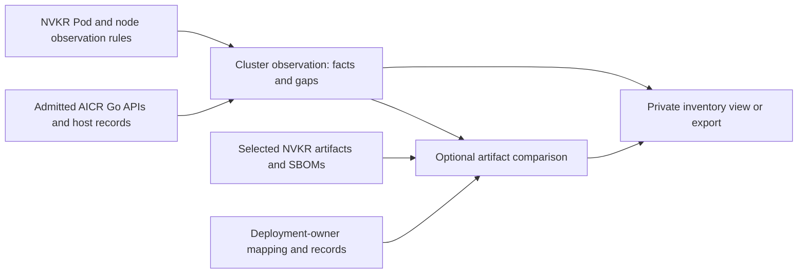

# Cluster observation and artifact attribution

**Status:** proposed design; no standalone collector or live acceptance.

**Updated:** 2026-11-03

[ADR-29](adr/0029-cluster-observation-and-artifact-attribution.md) owns the decision. This design covers
information gathering, Go API integration, descriptive comparison rules, examples and delivery prerequisites.
It allocates no command, wire schema, digest family or approved dependency version.

## User outcome

Show what is deployed in an existing cluster, where each fact came from and what could not be read.
Optionally compare the observation with selected NVKR artifacts and their SBOMs. A build baseline is not
required to collect information.

The scope is unsigned, descriptive diagnostics, lane none. Test execution, test-result interpretation,
signed runtime evidence, public/TestGrid publication, qualification and release-gate acceptance are separate
work. This design does not add a verdict parser, signer role or consumer trust protocol.

## Records and workflow

1. Admit an explicit kubeconfig, target, namespace/selector scope, required measurements and resource/time
   limits. If comparison is requested, freeze the caller's selected outputs, platforms, expected targets
   or counts, mapping and comparison profile before collection. These descriptive settings are distinct
   from the public Verification Policy used to authenticate a selected baseline.
2. Gather bounded API observations and any separately admitted installation or host records. Preserve
   raw runtime imageIDs and their digest kind; do not reduce them to names/tags. Record each request's
   scope, available resourceVersion, start/end time, objects/nodes and failed or omitted reads.
3. Produce a **cluster observation** containing facts and coverage only. It may be useful and complete
   for its requested information scope without proving artifact identity.
4. If requested, produce an **artifact comparison** from those facts and the exact selected baseline.
   Existing lifecycle owners issue any authenticated baseline receipt; a path, decoded SBOM, reporter
   digest or pass value is not one. An unverified baseline stays visibly unverified.
5. Display or privately export the observation and optional comparison, with sources and limits. Do not
   rewrite the publisher SBOM, a Build identity or a Release.

Deployment owners supply expected output-to-deployment mappings and applicable installation/boot records.
Their pinned declarations describe intent, not observed state. The [pin-set import](nvke-pin-set-usage.md)
may supply a read-only cross-check of existing build inputs; do not extend its catalog/lock data with
runtime topology or placement. Distinguish deployed outputs, contained libraries, build-only tools and
unused platforms; not every SBOM component is a separate workload. These remain downstream comparison inputs under
[ADR-19](adr/0019-clusterdefinition-and-provisioning-adapter-boundary.md).

## Go API integration

Use AICR Go libraries behind an NVKR adapter, not a second user-facing CLI. Pin and review the actual
module revision and linked dependency closure before implementation. Pin agent images separately by digest.
Current contribution policy directs AICR reuse through source adaptation; direct imports need an explicit
reviewed exception, permitted licenses and provenance/compatibility/security checks. If admission fails,
revisit the decision with owners. Do not silently substitute a CLI or copied collectors. No module or
executable pin is added by ADR-29.

| Source | Reuse and required work |
| --- | --- |
| Existing NVKR OCI rules | `pkg/nvkr/conformance/deployment.go` owns native-child selection and runtime-reference interpretation inside a strict execution gate. Extract shared pure identity classification there. Preserve all existing validate checks; do not call its `New`/`Produce` route or claim it already exposes an observation API. |
| AICR installed inventory | [Read](https://github.com/NVIDIA/aicr/blob/935e0746dc54da890a23c1ecca998244b3a25de7/pkg/inventory/read.go) / [ReadReleases](https://github.com/NVIDIA/aicr/blob/935e0746dc54da890a23c1ecca998244b3a25de7/pkg/inventory/releases.go) supply scoped component/release metadata. Current reads can require cluster-wide Secret access; see admission below. They do not prove original archive bytes. |
| Captured AICR input | [Client.LoadSnapshot](https://github.com/NVIDIA/aicr/blob/935e0746dc54da890a23c1ecca998244b3a25de7/pkg/client/v1/snapshot.go) consumes a bounded local capture. Read source bytes once, then retain only the permitted parsed projection and original byte digest/length; its returned facade does not retain `Raw`. Reject URL and ConfigMap inputs. |
| Opt-in AICR agent | [Client.CollectSnapshot](https://github.com/NVIDIA/aicr/blob/935e0746dc54da890a23c1ecca998244b3a25de7/pkg/client/v1/aicr.go#L2233) deploys a Job. Project permitted facts, target/node identities and gaps; do not persist `Snapshot.Raw`. Its hard-coded agent-log streaming to process stderr needs upstream request-scoped log control or reviewed containment before admission. Success proves neither complete collection nor cleanup. |
| Missing host/package information | The inspected AICR OS collector supplies OS/kernel configuration, not a complete installed-package or payload inventory. Select a reviewed upstream provider/extension before offering that capability. Do not claim a general node inventory from one agent's host facts. |

AICR inventory matching needs caller-supplied component/deployer scope; it is not automatic discovery of
every unrelated chart. Missing whole-scope discovery must remain a coverage gap until an admitted API
or provider supplies it.

The proposed operator-host route uses bounded in-process Kubernetes reads, shared with the AICR adapter
through its existing [GetKubeClientWithConfig](https://github.com/NVIDIA/aicr/blob/935e0746dc54da890a23c1ecca998244b3a25de7/pkg/k8s/client/client.go#L339)
owner after dependency admission. It needs GET of the kube-system namespace identity, LIST nodes and scoped
LIST Pods. This route extends ADR-18 §3's operator-host model with bounded context, resources and
owned resource cleanup. Its in-process transport does not inherit conformance's restricted subprocess
environment; the access section defines the separate ADR-29 controls. It has
no generated-CI lane, product/tools Release, suite inputs or disposable-cluster acknowledgement. Existing
conformance keeps its held-kubectl transport and its own full admission.
This is a proposed read-only extension of ADR-18's host model; it supplies no filesystem, network or privilege sandbox.

Share pure native-child/digest interpretation in conformance, rather than a second OCI join in the adapter.
For observation, keep a tagged PodSpec as requested-reference metadata; identity comes from a supported raw
runtime imageID and authenticated native platform child. Different runtime bytes are mismatched; an unsupported
digest kind is unverified; a missing required replica after a successful read is not observed. Failed reads
remain gaps. Preserve other items and partial facts. Existing `validate` additionally requires its exact
PodSpec reference, replica count, running/Ready state, IDs and restart checks; a matched identity cannot relax it.

Keep index, native-manifest and config digests distinct. Resolve the selected authenticated index to the
expected native child for the node platform. A requested reference naming that index is a matching request,
not proof of running bytes. If the supported runtime imageID names the same authenticated index, report
matched index-level identity and the expected child, without claiming independent native-child measurement.
A different observed native child is mismatched even when the requested index matches. A config digest
cannot substitute for either identity; unsupported or ambiguous forms remain unverified.

## Access, collection and privacy

Every live route runs without signing/publication credentials. Reuse the existing static kubeconfig admission
profile: one exact context, HTTPS with embedded CA and one embedded token or certificate/key pair. Reject
ambient lookup, exec/auth-provider plugins, external credential files and insecure TLS before client creation.
Pass the admitted capture to AICR at a fresh 0600 path in a private 0700 directory for each admission; its
client cache is path-keyed and unbounded, and retains the credential-bearing `rest.Config` after the file
is removed. Never rewrite/reuse that path for another target. Restrict this cached entry point to one-shot
CLI processes with one target admission. Join calls before removing owned credential files; residual cached
credentials live until process exit, so file removal is not memory erasure. Long-lived SDK live collection
requires an upstream uncached/config-taking or bounded, evicting client owner with an admitted credential
and transport lifetime. It is not enabled by this path workaround. Imported-file processing does not need
that live client. Exec-based EKS/GKE configurations require a separately reviewed profile; none is admitted here.

The in-process transport has explicit ADR-29 requirements rather than an inherited restricted environment:

- Use direct connections with an explicitly disabled transport proxy. Reject nonempty `HTTP_PROXY`,
  `HTTPS_PROXY`, `ALL_PROXY`, `NO_PROXY` and their lowercase forms, and kubeconfig proxy URLs before
  client construction. An explicit proxy needs separate admission; Kubernetes API proxy verbs remain excluded.
- Reject redirects. Freeze positive per-response byte, page/item, total-request and time budgets before
  reads, including error bodies and list pagination. Stream under those limits and close every response.
- Use a bounded request-owned warning handler that projects permitted diagnostics before retention. Never
  emit raw API warning text to process stderr or install a process-global handler.

The named AICR APIs do not by themselves establish these controls. Require upstream configuration/client
injection through the existing owner before enabling each affected read route, including inventory calls.
Reject an interface that cannot enforce the profile before network work; do not change process-global
environment or transport state around a library call. All live routes run without signing/publication credentials.
Live collection requires bounded get/list permissions for declared resources.
No ambient credential fallback, exec, attach, port-forward, proxy, Secret read or watch is enabled by default.
Record the actual verbs and scopes used. Unsupported requested capabilities fail with `engine-capability`
before collection or output. Admitted reads can still fail; retain their partial facts and coded failure
with incomplete coverage instead of presenting successful complete collection.

Current AICR Helm reads list Secrets across all namespaces; its ConfigMap and Argo Application reads are
also cluster-wide. Argo named-destination resolution can read cluster Secrets. Namespace-scoped Roles cannot
turn these current calls into namespace-scoped reads. Require separately admitted read scope, including
any Secret access, or an upstream namespace-aware API. Otherwise chart inventory is unavailable. Persist
only permitted decoded metadata/digests, not raw Secret objects or credential-bearing release values.

Agent/host collection is opt-in and separate from signing/publication credentials. Admission requires an
explicit target, kubeconfig, namespace and node selection, digest-pinned image, positive limits, explicit tolerations and a
service-account mode. Privilege is off unless separately admitted. An existing service account must match the
expected UID before and after collection and remain in existing-account mode, with no unexpected run-owned RBAC.
Current AICR treats a missing named account as a prefix for managed creation. Prevent that fallback with credentials
unable to create ServiceAccounts or RBAC, or require an upstream existing-only/expected-UID capability before enabling the mode.
Pre/post checks alone only detect a deletion race with broad credentials. Managed mode needs separate explicit
grants. Record UID-bound ownership of created resources; preserve shared resources.

At the inspected AICR revision, host filesystem/SystemD measurements require hostPID, hostNetwork, hostIPC,
root/privileged execution, `SYS_ADMIN`/`SYS_CHROOT` and host mounts. Restricted mode lacks those mounts;
its container-local OS readings must not be reported as node-host facts. Retain only Kubernetes readings in
that mode, mark host measurements not collected, and keep API NodeInfo clearly identified as an API source.

Require `Cleanup=true`, bounded stop/join and confirmation that all run-owned resources are gone, including
Jobs, RBAC and staging ConfigMaps. Preserve caller-owned output ConfigMaps and shared service accounts. AICR currently
logs cleanup errors while returning success. Its flag alone cannot establish cleanup: require an upstream
surfaced result or independent UID-bound verification before declaring complete collection. Until the
route is implemented and exercised with these controls, it remains unavailable before resource creation.
The pinned [agent collector](https://github.com/NVIDIA/aicr/blob/935e0746dc54da890a23c1ecca998244b3a25de7/pkg/snapshotter/agent.go#L362)
streams normal and failed-Job logs directly to process stderr. Require an upstream request-scoped writer or
suppression control, or reviewed containment, before enabling it. Do not redirect process-global stderr.

Imported AICR snapshots are reporter-asserted inputs, not fresh cluster measurements. Retain target UID
and collection times when present; mark unavailable identity/time as unknown and separately supplied
metadata as reporter-asserted. Do not invent missing fields or perform live reads during local import.
Live collection records the observed kube-system namespace UID, caller-selected context and interval.
Any expected UID must come from the caller independently of the capture. Object inventory, absence of extras and local timestamps are
observation-source claims, not proof against a dishonest reporter, compromised API/server or replay.

Keep observations private. Parse bounded raw bytes transiently using AICR's parser, then retain a reviewed
field-allowlisted projection, its projection/version description and, where permitted, the original byte
digest/length. Do not copy or durably retain raw snapshots. AICR's
[ClusterPolicy collector](https://github.com/NVIDIA/aicr/blob/935e0746dc54da890a23c1ecca998244b3a25de7/pkg/collector/k8s/policy.go#L120)
copies whole specs, including environment arrays, proxy and repository values that may carry credentials.
Exclude these and unknown fields before logging, export or durable capture; the projection is not byte-identical
to the raw snapshot. Never retain credentials, kubeconfigs, raw Secret/Pod payloads or provider/agent logs.
Permitted Secret reads stay transient inside the library. Sharing needs a separate field projection excluding
private endpoints/server identifiers and recording withheld fields. No public publication or freshness protocol is added.

## What can be compared?

| Class | Facts that remain useful without identity proof | Prerequisite for an exact artifact connection |
| --- | --- | --- |
| OCI workload image | Requested reference, raw imageID, digest kind, workload/container/node and native platform | Existing lifecycle baseline receipt and supported conformance native-manifest join. Preserve unsupported imageID forms as unverified. |
| Helm chart | Release/revision/status, chart name/version and available permitted metadata | Deployment-owner record tying exact archive and dependency digests to the installed release and allowed values/render inputs. Version agreement cannot reconstruct the archive. |
| OS image | Node OS/kernel/runtime/version/boot metadata | Deployment-owner disk-to-node boot/provisioning record and admitted build-side content evidence/measurements. A live mutable disk is not the original QCOW2 byte stream. |
| Package or host binary | Package/version metadata and separately supported file observations | Subject-bound package/file evidence, installed-path mapping and explicit configuration/generated-file/transformation rules. Names and versions alone are not installed-byte proof. |

The maintained [ADR-13 disk route](adr/0013-supply-chain-evidence.md) declares `nvkr:diskInspection` as
`not-performed`. Its ordinary CycloneDX projection is not a published installed-file baseline. Strict disk
inspection and narrower local package/material diagnostics have their own admission/receipt limits; this
decision does not exercise or widen them. General installed package/file attribution remains unverified
without a supported baseline. It does not prevent reporting observed OS or package metadata.

No supported deployment-owner installation/boot-record producer is established by this design. Before
claiming exact chart/disk attribution, name that owner, agree the record contract and verify its artifact,
install/node and configuration bindings through an admitted owner. Do not create an NVKR-owned installer
schema as a shortcut. Missing records permit useful inventory and negative comparisons, not invented positives.

Each comparison class needs an explicit rule for digest domain, permitted transformations and applicable
measurements. Where that rule is not yet admitted, the result is **unverified**, never matched. Version
agreement may be displayed as metadata agreement, not as an exact artifact match. Record build/acquired
identity, installation attribution and measured content as separate claims.

Use **matched**, **mismatched**, **not observed**, **unverified**, and **explicitly non-applicable** everywhere.
The comparison profile declares non-applicability before collection. Failed reads are gaps, not proof of absence. An overall
match requires every applicable required member to match with complete required coverage. The policy's
frozen scope and expected targets/counts cannot be narrowed to the reporter's successful subset. Retain
unknown software and unsupported joins. A recorded list remains a reporter/API observation, not independent
proof that it omitted nothing.

[Proposed ADR-28](adr/0028-multi-platform-executable-indexes.md) separates executable delivery from runnable
images. Image-volume consumption uses an OCI identity comparison and needs a supported native-child/mount
observation; existing container
imageID checks do not cover it automatically. Copied/repackaged content needs downstream lineage to its
source; extracted executables use package/file measurements. Until those joins are supported, report
unverified. Transporting bytes in an OCI index does not make them a running workload.

## Worked examples



### AICR fixture excerpt

This shortened excerpt preserves values from AICR's checked-in
[snapshot fixture](https://github.com/NVIDIA/aicr/blob/935e0746dc54da890a23c1ecca998244b3a25de7/pkg/operator/aicrjob/testdata/v1.0.0/snapshot-eks-amazonlinux.json).
It is a test fixture, not a fresh cluster capture or NVKE acceptance result:

```yaml
kind: Snapshot
apiVersion: aicr.run/v1
measurements:
  - type: K8s
    subtypes:
      - subtype: server
        data:
          version: v1.37.0
          platform: linux/arm64
      - subtype: image
        data:
          coredns: v1.14.6
          etcd: 3.7.0-0
  - type: OS
    subtypes:
      - subtype: release
        data:
          PRETTY_NAME: Amazon Linux 2023.9.20260901
  - type: SystemD
    subtypes:
      - subtype: kubelet.service
        data:
          ActiveState: active
          SubState: running
```

This supplies useful facts about versions, configuration and service state. The separate AICR Helm/Argo
inventory API supplies installed-release observations; it is not implicitly part of this snapshot excerpt.
Neither a reported version nor an active service joins those facts to an NVKR output's exact bytes.

The public [NodeSnapshotter](https://github.com/NVIDIA/aicr/blob/935e0746dc54da890a23c1ecca998244b3a25de7/pkg/snapshotter/snapshot.go)
coordinates local node collectors or opt-in agent-job execution. The caller must establish which nodes
were measured: cluster-wide Kubernetes facts do not make local host facts a measurement of every node.
A successful collection call also does not prove every collector succeeded: individual failures can be
logged and skipped. Where structured status is unavailable, retain unknown coverage or extend the upstream
interface; do not infer successful complete collection from the call returning without an error.

### Running image compared with a selected output

The following is proposed pseudodata, not a wire schema, real capture or executable command. Digest
placeholders stand for complete values and the digest domains remain explicit:

```yaml
selected:
  output: cwe
  platform: linux/arm64
  imageIndex: <index-I>
  nativeManifest: <native-A>
observed:
  source: kubernetes-api
  kubeSystemNamespaceUID: <observed-target-UID>
  podUID: <observed-Pod-UID>
  nodeUID: <observed-node-UID>
  requestedImage: registry.example/nvke-controller@sha256:<index-I>
  rawImageID: docker-pullable://registry.example/nvke-controller@sha256:<native-B>
  digestKind: native-manifest
comparison:
  outcome: mismatched
  reason: Native manifest B differs from selected native manifest A
```

The comparison owner consumes a receipt from existing lifecycle owners for the selected output/platform;
it does not authenticate a reporter-supplied digest. Preserve the original runtime imageID. An unsupported
runtime digest kind leaves identity unverified. The requested index I in this example does not mask the
observed wrong native child B. For a supported runtime imageID naming index I itself, the comparison instead
reports `matched` with identity level `index`, expected child A, and native-child measurement unavailable.
That is an index-level identity observation, not a claim that config, index and native digests are interchangeable.
A matching image manifest still does not measure writable
layers, mounts, configuration or process memory.

### Chart and host information without false identity claims

Reuse the AICR installed-release reader rather than another Helm decoder. It reads a subset of release
metadata and does not retain full values/rendered manifests in its decoded shape. A hypothetical report:

```text
Installed chart version: 0.22.0
Selected chart archive: C
Installation record connecting this release to archive C: unavailable
Artifact comparison: unverified
```

The release metadata is useful inventory. To claim archive attribution, the deployment owner must supply
an admitted record binding archive C and its dependencies to the exact release/revision and install inputs.
If chart configuration names the selected authenticated index I, select its expected child A for the node
platform. A runtime native manifest A matches; a runtime index I matches only at index level. A runtime
native manifest B that differs from A is mismatched, even with the correct requested index. Resource/configuration drift remains a
separate field comparison under an explicit rule.

Similarly, an observed OS release is not disk-image identity. An installed package version is not a
measurement of its executable files. Report both facts even when their corresponding artifact connection
is unverified. A missing required node is incomplete capture, not evidence that its software is absent.

## Delivery and acceptance

| Slice | Deliverable | Dependency and acceptance |
| --- | --- | --- |
| API observation | Proposed observation owner sharing NVKR's existing Pod/node identity rules | Real selected target, explicit access/scope, inventory without a build baseline; denied reads, wrong expected target, missing nodes and budgets remain explicit. No test run or API mutation. |
| Installed-release inventory | Admitted AICR Go reader integration | Import policy/dependency review and a bounded access contract. Exercise Helm and Argo permission cases, including named-destination Secret reads; retain permitted metadata only. |
| Host/package information | Separately admitted host provider or AICR extensions | Explicit agent/host admission and verified owned-resource cleanup, plus an actual package provider. Show useful real observations and denied/unsupported/cleanup-failure cases; do not describe one host as every node. |
| Artifact comparison | Optional supported joins against selected outputs | Lifecycle baseline receipts, existing OCI owner and deployment-owner records. Chart/disk positive claims wait for verified downstream records; installed-file positives wait for admitted build/host baselines. Demonstrate mismatches and unknown joins. |

For complete information-gathering support, exercise real observations and controlled metadata changes for
each of the four classes, plus its denied/missing-data cases. A required unavailable provider keeps that
collection slice partial. This does not require every observed artifact to have a provable build lineage.

Complete artifact attribution is a separate, stronger bar: each class needs a real matched positive, its
required negative cases and a controlled mismatch. An all-unverified or explicitly non-applicable class
cannot establish that capability. A caller may still receive a useful inventory while these joins remain
unimplemented. No live acceptance is established by this design or its examples.

## Follow-ups and ownership

The proposed `pkg/nvkr/observation` module owns request/profile admission, the frozen scope, AICR adapter,
observation records, comparison outcomes/coverage and descriptive serialization. `conformance` owns the
shared pure OCI classification and its unchanged strict execution gate; `lifecycle` authenticates optional
artifact baselines. CLI and admitted SDK routes delegate. The cached live route is one-shot CLI only until the upstream
client-lifetime boundary supports long-lived callers. Deployment owners retain placement and installation records.

Before implementation, assign named deciders and review the ADR-17 package map, ADR-18 host admission, pinned AICR dependency,
shared client/kubeconfig admission, log and field controls, namespace/Secret access and host/package provider.
These are proposed owners and refactors, not existing exported APIs. Wire formats and CLI presentation need
implementation review. No signer, test adapter, verdict protocol or qualification handoff is added.
