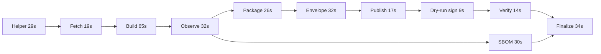

# Passing GitHub Run performance

Analysis of [Run 34419180257](https://github.com/njhensley/nke-recipes/actions/runs/34419180257), implementation
commit `c15e534bb9ea8d6955e4cd61cb57619241b67555`. Sources are the GitHub job/step timestamps, timestamped
job logs, and the generated workflow dependencies. The complete [timing table](evidence/2026-09-09-github-run-timings.csv)
is retained for comparison with later runs. This records the baseline before the utility-image, scheduling and finalizer-download improvements.

## Outcome

The run took **5m17s** from dispatch to its final metadata update; the final job completed one second earlier.
The main cost was repeatedly provisioning runners/containers and transporting outputs between small jobs.
The CLI build job took **65s**, about **21%** of total elapsed time. Its execution step took **48s**, including
image acquisition and source preparation. This is a single successful run with a warm helper compilation cache,
not a distribution of cold/warm timings. Signing was dry-run; these timings do not predict live signing latency.

## Job breakdown

Offsets are seconds after dispatch. Job times include setup and transport, not time waiting for dependencies.

| Job | Offset | Job duration | Execute step | Main explanation |
|---|---:|---:|---:|---|
| Bootstrap helper | 6–35 | 29s | 3s build | Go setup 16s; compilation cache hit |
| Fetch source | 39–58 | 19s | 4s | Private Git fetch is fast; source packaging/upload adds 6s |
| Build CLI | 61–126 | 65s | 48s | Source restore 6s; image pull 14.4s; post-image interval 28.8s |
| Observe terminal bytes | 130–162 | 32s | 20s | Almost entirely container/image startup |
| SBOM | 166–196 | 30s | 18s | Runs alongside executable packaging; not on the dependency-critical chain |
| Package executable | 166–192 | 26s | 19s | Almost entirely container/image startup |
| Package release envelope | 197–229 | 32s | 17s | Another fresh container/image pull |
| Publish GHCR | 232–249 | 17s | 5s | Registry upload is a small fraction of the run |
| Dry-run sign | 252–261 | 9s | <1s | Setup/transport dominates; no real signing occurs |
| Verify publication | 264–278 | 14s | 1s | Registry digest check plus simulated signature verification |
| Finalize Run | 282–316 | 34s | <1s | Sequential downloads and source extraction dominate |

GitHub's step timestamps have one-second resolution: zero-second entries mean less than a second at this
resolution, not no work. The post-image build interval includes container startup, compilation and output
verification; the logs do not separately measure pure compiler CPU time.

## What determines elapsed time

The dependency-critical chain is:

The finalizer actually depends on every job; the diagram suppresses the redundant edges. The ten jobs on the
critical chain account for **277s**. Dispatch, job handoffs and final status bookkeeping account for another
**40s**. SBOM overlaps executable packaging and finishes well before finalization becomes runnable; shortening
SBOM alone would not shorten this observed run. Aggregate job time is **307s**, which should not be confused
with wall time or rounded billable minutes.

## Repeated image acquisition is the clearest waste

The same digest-pinned full Go image is pulled independently by the build, terminal observation, SBOM,
executable packaging and envelope packaging jobs. Each runs on a fresh hosted runner.

| Job | Logged pull interval | Execute start to image manifest written | Time after image manifest until next step |
|---|---:|---:|---:|
| Build | 14.4s | 18.5s | 28.8s |
| Terminal observation | 14.9s | 19.4s | 0.3s |
| SBOM | 15.2s | 17.9s | 0.3s |
| Executable package | 15.0s | 17.7s | 1.5s |
| Release envelope | 15.0s | 16.9s | 0.3s |

The logged pull interval runs from Podman's `Trying to pull` message through `Writing manifest to image
destination`; it includes registry and local image-copy/unpack work, not pure network transfer. The execute
startup column additionally includes runtime initialization, and source preparation for the build.

The four utility jobs spend about **72 aggregate seconds** reaching a usable image, followed by only about
**2.4 aggregate seconds** before their next step. Three of those jobs lie on the critical chain, accounting for
about **54s** of startup/image work there. The helper is already a static binary; these jobs are not compiling Go.

## Artifact transport and finalization

Across the eleven jobs there are **38 download-action invocations**, **14 upload-action invocations** and
**11 checkouts**. Rounded step durations total **51s downloading**, **19s uploading** and **14s restoring**.
These are aggregate step times with some parallel overlap, so they cannot simply be subtracted from wall time.

Artifact logs report about **201 MB decimal** of compressed downloads, excluding container images and the Go
setup cache. Repeated helper downloads account for **124 MB**: the 12.4 MB helper archive is downloaded ten
times. The 21.6 MB source archive is downloaded twice, once for the build and again for finalization.

Finalization takes 34s although its actual finalization command takes less than one second. It invokes
download-artifact thirteen times (helper plus twelve carriers), spending 18s in download steps and another 7s
restoring the source tree. The generator restores every graph artifact sequentially, and
`ValidateHostedRestores` currently requires every planned carrier. Removing a restore without revising that
contract would break completeness checks. Batching/concurrent retrieval can preserve that contract.

## Optimization order

| Priority | Candidate change | Why it is worth testing | Boundary to preserve |
|---|---|---|---|
| 1 | Use a small digest-pinned utility image for observation/SBOM/packaging | Targets roughly 54s of observed critical-chain startup/image work; the full Go toolchain is unnecessary for these helper-only steps | Keep platform, filesystem and network isolation; verify the minimal image contains required runtime/filesystem facilities |
| 2 | Schedule related graph nodes as steps within fewer jobs | Eleven jobs produce ten mostly serial stages, repeated helper downloads, checkouts and image pulls; reusing a runner can reuse its image store | Keep logical graph nodes, byte checks and receipts; preserve source/build/publication credential boundaries and failed-Run finalization |
| 3 | Batch or concurrently download finalizer carriers | Thirteen sequential action invocations consume 18s before source extraction | Retain exact expected membership, per-producer outcomes and validation of restored bytes |
| 4 | Revisit whether finalization needs full source materialization | Avoiding the second source restore could remove its 7s extraction plus transfer | Establish the exact required evidence closure first; never substitute a path or caller assertion for required source evidence |
| 5 | Investigate build caching after orchestration improvements | Post-image build interval is about 29s; potential benefit is smaller than infrastructure overhead | Any cache reuse must preserve declared inputs, isolation and exact output checks |

The savings above identify measured work to target, not promised speedups. A smaller image still has startup
cost; grouping jobs and changing download topology have overlapping benefits. They must not be added together
as independent savings. The best first experiment is a smaller utility image with the same job graph, followed
by stage grouping and transfer batching measured independently.

Prebuilding the helper is a low priority for this run: its compilation took only 3s thanks to an existing
approximately 128 MiB Go cache. Its 16s setup step included downloading Go 1.27.1 and restoring that cache.
Similarly, private-source authentication/fetch (4s) and actual GHCR publication (5s) were not bottlenecks.

## Implemented comparison

[Run 34422660746](https://github.com/njhensley/nke-recipes/actions/runs/34422660746) passed all nine jobs
on commit `6954dfc`, including real signature/provenance verification and complete pipeline-attested Run
finalization. The [step timings](evidence/2026-09-10-github-signed-run-timings.csv) use the same timestamp
method as the baseline.

| Measurement | Baseline dry-run signing | Improved real signing |
|---|---:|---:|
| Dispatch through final metadata update | 5m17s | 4m12s |
| Hosted jobs | 11 | 9 |
| Download-action invocations | 38 | 20 |
| Checkout invocations | 11 | 9 |
| Utility work along the critical chain | 90s across three jobs | 26s in one job, also including SBOM |
| Finalization job | 34s | 22s |
| Signing job | 9s, simulated | 19s, real |
| Verification job | 14s, simulated signature checks | 13s, real |
| CLI build job | 65s | 72s |

The successful run is **65s faster (20.5%)**, despite acquiring and executing real cosign. The new 14s
cosign-acquisition job overlaps source/build preparation. The complete finalizer carrier batch took 4s;
source extraction still took 7s, and remains required by the current completeness contract. The first utility
execution took 5s; the remaining three executions completed in about 2s combined at step timestamp resolution.

This combines the minimal image, job grouping and batched downloads in one experiment, so their individual
savings cannot be isolated or added. Runner/registry variation also matters: the immediately preceding
attempt's utility job took 18s and signing took 30s, but that attempt failed canonical-record finalization and
is not the successful comparison. The current bottleneck is now the 72s CLI build job, followed by scheduling,
transport and real signing. Further changes should be measured against this signed baseline.
