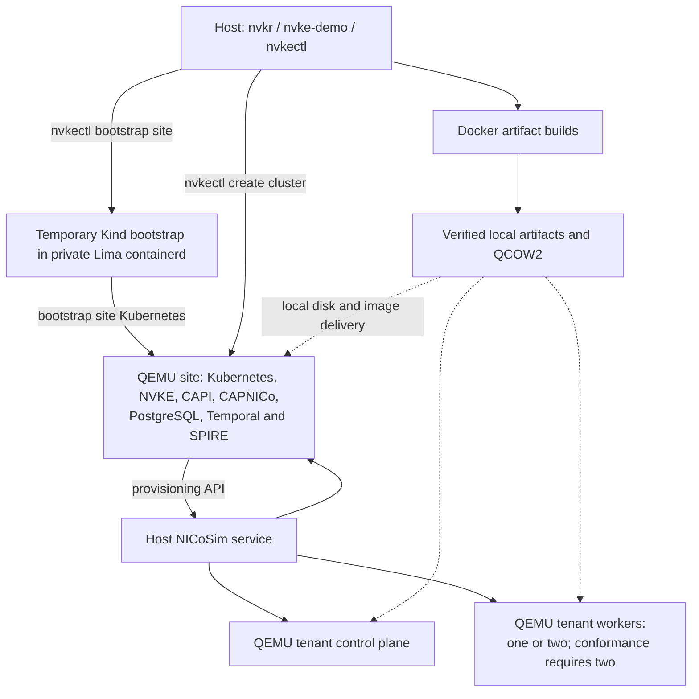

# Build and run NVKE locally

## Native Linux and Mac path

The Go demo runs `nvkr`, `nvke-demo`, `nvkectl` and NICoSim on the execution
host. NICoSim manages real QEMU guests from the selected local QCOW2:
one Kubernetes site, one tenant control plane and, by default, one tenant worker
for ordinary runs. `run.tenantWorkers: 2` requests two workers without selecting
conformance. Conformance defaults to and requires two workers in the same worker
pool: three tenant guests and four QEMU guests in total on either host.
The permanent NVKE site stack runs in the site guest. Kind is a temporary
bootstrap cluster, removed before tenant provisioning.



| Host | CLI and simulator | Kubernetes guest runtime |
| --- | --- | --- |
| Ubuntu ARM64 | Native Linux executables | QEMU/KVM through session libvirt |
| Apple Silicon Mac | Native Darwin executables | Host QEMU with explicit TCG for the selected 64K image, and vmnet |

Both hosts use Docker for artifact builds and a separate private Lima
containerd backend for temporary Kind bootstrap. Mac operators run the commands
directly in macOS; no SSH into a Linux execution VM or Colima host is required.
The CLI owns the temporary backend's start, readiness, stop and join. It shares
only writable bootstrap staging and read-only selected image directories,
forwards SPIRE port 30081 to the observed demo gateway, and removes that backend
before provisioning tenant guests. It does not adopt existing instances or mount
the simulator state/QCOW directory into Lima.

`build` creates an artifact Run and native-tool Run. `run` consumes explicitly
selected completed Runs. `e2e` calls those same stages in sequence. NVKR owns
builds, acquisition, observation and artifact verification; NVKE owns bootstrap,
site deployment and tenant operations. Both hosts derive the Kubernetes version
from the selected NVKE source’s shipped site-spec template. The current source
selects 1.36.3; site package installation, bootstrap, tenant creation, node checks
and conformance use that selection. The conformance Definition selects the
matching 1.36.3 suite image and tools.

Site installation adds a controller startup probe through the source installer's
Helm extension point so migrations can finish before HTTP liveness checks start.
Its allowance follows the remaining operation budget; see the
[implementation and evidence limits](adr/reconciliation.md#local-arm64-demo-presentation).

The native path remains a local diagnostic.
A complete fresh Mac/Linux build, deployment and cleanup result has not yet been
established for this candidate. See [current implementation and evidence](adr/reconciliation.md)
and [remaining source-build gaps](full-nvke-source-build.md).

## 1. Choose your Linux execution host

Use a dedicated trusted Ubuntu ARM64 host with usable KVM and sufficient native
storage for source builds, OCI outputs, the QCOW2 and guest overlays. The native
workflow allocates **6 CPUs / 12 GiB to the site and 6 CPUs / 12 GiB to each
tenant**: 36 GiB with one tenant worker or 48 GiB with two workers, before host,
QEMU and Docker overhead. The separate temporary bootstrap backend uses four
CPUs, 6 GiB RAM and a 20-GiB disk.
Build containers and image staging need additional capacity.

Native deployment checks the peak guest memory plus 4 GiB of additional
host/QEMU headroom before an E2E build and again before creating VMs. It checks
the additional tenant demand again before each tenant creation on a retained
site. These observations reserve nothing. Guest vCPUs are time-shared; the
capacity check requires enough host CPUs for the largest guest, rather than
claiming one physical CPU for every configured vCPU.

An explicit demo configuration may set the shared memory profile for both
hosts. For example, the following `run` fields select a 12-GiB site and 6 GiB
for each tenant VM, with one control plane and two workers but no conformance
suite, requiring 34 GiB available for the four-guest phase including
the declared headroom:

```yaml
run:
  tenantWorkers: 2
  conformance: false
  resources:
    siteMemoryGiB: 12
    tenantMemoryGiB: 6
    headroomMiB: 4096
```

This is a sizing example, not a verified smaller-profile runtime result.
Merge it into the existing version-1 demo configuration with its required
build/run selections. All three resource fields are required when overriding
the defaults. `tenantWorkers` accepts only 1 or 2; omission or zero retains one
worker ordinarily and two with conformance. Explicitly selecting one worker with
conformance is rejected before work. Worker count changes neither the selected
artifacts nor source pins; the ordinary 32-output Run supplies this deployment.

The Linux artifact preflight checks eight CPUs, 10 GiB available RAM and 64 GiB
free workspace. These are stage-specific advisory checks, not reserved resources
or proof that the complete workflow fits. `--jobs` limits concurrent ready
operations; it is not a CPU/RAM reservation or aggregate container memory cap.
The former Kind-site recommendation of 24 GiB does not cover this native topology.

Inspect the actual host, storage, Docker capacity and existing workloads before
launching. Keep unrelated machines, VMs, containers and networks intact. Local
source admission requires Git 2.38 or later. Check KVM in the same login session
that will launch the CLI:

```sh
uname -m
git --version
df -h .
virsh -c qemu:///session list --all
ls -l /dev/kvm
bash -c 'exec 3<>/dev/kvm && echo "KVM read/write open OK"'
```

The CLI independently admits KVM and the selected runtime. Missing access is an
administrator prerequisite; do not run the entire demo as root or silently fall
back to software emulation.

## 2. Install prerequisites on the Ubuntu execution host

Install Docker Engine and Buildx from one compatible package source; follow
[Docker's Ubuntu installation guide](https://docs.docker.com/engine/install/ubuntu/).
For Ubuntu's `docker.io`, the plugin package is `docker-buildx`; Docker CE uses
`docker-buildx-plugin`. Do not mix those repositories. Docker access grants
root-level privileges. Verify both commands before preparing artifacts:

```sh
docker version
docker buildx version
```

The Linux native runtime also requires Bash, Git, jq, GNU coreutils/timeout,
Python 3.12+, OpenSSH, curl, OpenSSL, QEMU/firmware, session libvirt, cloud image
utilities, software TPM tools, dnsmasq, iptables/iproute2 and capability tools.
On an Ubuntu installation with the appropriate package repositories, the runtime
prerequisite package selection is:

```sh
sudo apt-get update
sudo apt-get install -y --no-install-recommends \
  git make gcc libc6-dev jq coreutils python3 openssh-client bash curl openssl \
  libvirt-daemon-system libvirt-clients qemu-system-arm qemu-utils \
  qemu-efi-aarch64 cloud-image-utils swtpm swtpm-tools gnutls-bin ipxe-qemu \
  dnsmasq-base iptables iproute2 libcap2-bin e2fsprogs kmod
```

The CLI refuses conflicting resources and overlapping networks; it does not
install those packages or delete an existing libvirt session. Linux bootstrap
additionally requires the source-built Lima `f47461e` distribution and matched
helpers. Follow the [public source installation procedure](native-linux-bootstrap.md#install-from-public-source-on-ubuntu-arm64)
once, keeping its installation directory on `PATH` in the terminal used below.
That candidate's binary vulnerability findings and bounded pilot scope remain
visible there; a backend-only pilot is not full native runtime acceptance.

Linux network setup uses the existing scoped bridge, DNS/DHCP, firewall and
capability journal owners. Keep the host privileged-port policy unchanged and
do not grant file capabilities to the demo executable. The privileged port probe
requires a root/current-user-owned executable and protected ancestor directories.
The native path does not derive forwarding authority from Docker's Kind subnet.

An interactive Linux command authenticates at sudo's initial prompt before the
dashboard/build, then refreshes that session through bounded non-interactive
checks. The prompt has a two-minute deadline. Passwords go directly to sudo;
deployment and cleanup do not prompt mid-run. The demo changes no sudoers policy.
Timestamp reuse follows the host's full sudo policy, not a demo-only credential.
Do not add a separate `sudo -v` or pipe the interactive command's streams.

Redirected or unattended execution requires administrator approval for the actual
non-interactive wrappers. Its initial probe is:

```sh
sudo -n -k timeout --signal=TERM --kill-after=5 25 true
```

With a command, `-k` ignores cached credentials for that invocation without
clearing the timestamp; `-n` forbids prompting. Passing this probe does not grant
later commands or override command-specific policy. Failure stops the workflow.
See the upstream [sudo manual](https://raw.githubusercontent.com/sudo-project/sudo/main/docs/sudo.man.in).

### Additional macOS setup

For the native Mac workflow, install:

- Apple Silicon macOS, the exact Go SDK from `.go-version`, and Clang/Apple SDK.
- Docker with Buildx and a selected Docker context using a local Unix socket, Git and jq.
- Homebrew Bash, Python 3, QEMU and GNU coreutils on `PATH`, including `g`-prefixed commands.
- A seed ISO builder on `PATH`: `cloud-localds`, `mkisofs` or `genisoimage`.
  Homebrew `cdrtools` supplies `mkisofs`. The CLI checks this prerequisite before deployment work; it does not install the tool.
- Homebrew `swtpm` and its installed `libtpms` dependency. The Mac site uses a real software TPM through the supported NICoSim QEMU executable override; NVKE sources stay unchanged. These dynamically linked dependencies remain installed on the host.
- The matched vmnet client/helper from the [shared native catalog](../inputs/catalogs/tools/native/README.md), installed at the paths required there. Private tool extraction alone does not install these prerequisites.
- Packer **1.15.4** and the installed QEMU plugin **1.1.6**. `packer plugins installed`
  must identify `packer-plugin-qemu_v1.1.6_x5.0_darwin_arm64` and its sibling
  `_SHA256SUM` file. BUILD discovers and captures this installation; it does not install it.
  Use the [pinned prerequisite acquisition steps](../inputs/definitions/demo/native-mac-tools/README.md#prepare-installed-packer-prerequisites).
- Lima **2.2.1** and `nerdctl.lima` for the owned temporary bootstrap backend.

`qemu-img` and `qemu-system-aarch64` must resolve to the same installation prefix.
Its `share/qemu` must contain `edk2-aarch64-code.fd`, `edk2-arm-vars.fd`,
`efi-virtio.rom`, `vgabios-virtio.bin` and `keymaps/en-us`. BUILD captures those
selected tools/data through NVKR. Installed dynamic libraries and the Apple SDK
remain trusted host dependencies; a Clang version probe does not validate the
entire SDK or its linking behavior.

The verified vmnet helper reports Apple's shared subnet. The demo holds that
interface through joined guest/service cleanup; API, disk HTTP, callbacks and
Lima forwarding use its observed gateway. It does not rewrite Apple's network
configuration or bind the simulator API to every host interface.

For address discovery, Mac also requires the system `sqlite3` command with JSON
support. The adapter reads only its private NICo database and the kernel's
neighbor records, then supplies observed bindings through NICo's existing
address-file interface. It does not change Apple's DHCP service or write to the
simulator database. Initial discovery requires one matching address. After NICo
records the primary address, additional aliases cannot replace it; the adapter
supplies it only while it remains observed for the same MAC. Missing observations
remain pending; malformed or ambiguous initial bindings stop the attempt. Actual
API, node and workload checks establish runtime readiness separately. Private site serial logs also retain initial link, address, route and netplan
state, followed by kernel network-change notifications during bootstrap.

The separate [focused Linux artifact launcher](local-development.md#explicit-legacy-colima-build-route)
retains an explicit existing-Colima route for component builds. Its OS/all lanes
require execution inside native Linux storage. That legacy build option is not
the native Mac demo and does not provide current three-VM deployment acceptance.

## 3. Bootstrap the demo command

Build the two Go CLIs from the same reviewed checkout with the version in
`.go-version` on `PATH`:

```sh
cat .go-version
GOTOOLCHAIN=local make build demo
bin/nvkr --version
bin/nvke-demo e2e --help
```

`make build` produces `bin/nvkr`; `make demo` produces `bin/nvke-demo`.
The normal Mac build discovers `nvkr` beside `nvke-demo`, prepares its installed
native dependencies through existing NVKR owners, and builds the selected Linux
utility image through Docker Buildx. Mac CGO tools bind the measured installed
Go SDK and Clang; Linux uses the same producer's static source build.
The Linux artifact launcher can also bootstrap its binaries through its pinned
Go container; its focused commands belong in [local development](local-development.md).

The first invocation fetches the pinned source objects from the canonical URLs
in the selected catalogs. Source authorization must work on the execution host.
When supplying local NVKE source objects, set `--nvke-clone` to an absolute Git
repository containing the catalog's pinned objects. Only committed pinned
objects are admitted. Other private repositories can use invocation-local Git
`insteadOf` redirects to absolute
local repositories; source commit/tree checks still apply. At most 16 entries
are admitted, and the NVKE clone option needs two free entries. No credential or
source rewrite is inherited by deployment. See [source access](local-development.md#start-from-a-clean-machine).
This is not an offline mode: declared artifact and registry acquisitions still
need their endpoints.

## 4. Build and run the demo

Choose a fresh attempt and output directory for each invocation. With the host
prerequisites installed and on `PATH`, run these commands from the NVKR checkout
on Ubuntu ARM64. This builds fresh artifact and tool Runs, creates the site and
three tenant VMs, checks workload/DNS, runs conformance and retains the cluster:

```sh
mkdir -p .nvkr
bin/nvke-demo e2e --repo "$PWD" \
  --attempt demo-01 --out "$PWD/.nvkr/demo-01" \
  --jobs 8 --conformance
```

NVIDIA OVN and Linux KVM are defaults. These commands select the catalogs'
canonical source URLs and fresh Runs, without local source overrides or existing
artifact paths. Before another
deployment on the same host, use the exact `cleanup --session` command printed
by the previous retained demo; an existing demo network is not adopted or deleted
by a new invocation. Add `--walkthrough` for read-only cluster observations or
`--cleanup` to request deletion after acceptance.

On Mac, use explicit TCG for the selected 64K image:

```sh
bin/nvke-demo e2e --repo "$PWD" \
  --attempt native-demo-01 --out "$PWD/.nvkr/native-demo-01" \
  --jobs 2 --accelerator tcg --walkthrough
```

Add `--nvke-clone /absolute/path/to/nvke` when supplying local source objects.
`--config demos/local-nvke.yaml` is optional; explicit changed flags override its
placeholders. Keep the artifact attempt, native-tool attempt and output paths
fresh. Deleting one directory does not clean resources or make an old attempt new.

NVIDIA OVN is the default. Both hosts retain the selected NVKE source's ARM64
`linux-nvidia-64k` kernel. Linux requires KVM. Explicit Mac `--accelerator tcg`
uses the standard QEMU `max` CPU and is slower than hardware virtualization.
Default Mac build preparation gives the Ubuntu installer a three-hour wait for
SSH, including installation and reboot. This limit does not predict completion
time. Explicitly prepared inputs own their selected Packer timeout.
The adapter replaces only NICoSim's fixed accelerator and CPU operands; its
firmware, disk, network and software TPM remain selected by the same workflow.
The current Mac's HVF feature register reports no 64K translation-granule support,
so the default HVF selection cannot run this image. HVF remains available for
independently compatible images; there is no automatic fallback or kernel
substitution. Device probes alone do not establish guest boot or full acceptance.

The site uses the source-selected ARM64 MachineImage boot script with the
current local disk URL. NICoSim owns its parsing, image boot and DHCP identity
registration; the URL itself is not content authentication.

Before site or tenant agents start, the adapter imports the selected named OVN
image by native manifest digest and projects the matching chart's digest settings.
The image bundled in the OS package is not used as proof of that separate output.
Conformance still requires exact runtime manifest observations before and after
the suite. A runtime exposing only a config ID fails that check.

The NVIDIA projection also preserves the pinned NVKE package's
`global.enablePodHostPort=true` setting for VM nodes. This selects OVN's native
HostPort controller for the shared-gateway, full-mode nodes; this lane uses the
OVN CNI without a chained `portmap` plugin. It must have only one HostPort owner.

The shared workflow:

1. NVKR builds/acquires the Definition's named outputs, including Debian package
   materials, the QCOW2 and runtime images, then builds/verifies native host and
   site companion tools. A failed required output prevents deployment.
2. The host NICoSim service starts the site guest. Host `nvkectl generate sitespec`
   and `nvkectl bootstrap site` use temporary Kind to bootstrap that guest's Kubernetes.
3. Host commands install CAPI providers and the source-selected NVKE stack into
   the site guest, then remove Kind and stop/join the private bootstrap backend.
4. Host `nvkectl create cluster` requests a tenant. CAPNICo calls NICoSim, which
   starts its control-plane and worker QEMU guests.
5. After every requested tenant node is Ready, the demo checks each node's actual
   host `cloud-init status --format=json` without wait mode through a temporary per-node Pod
   with a recursively read-only host mount. It requires clean `done` status,
   command exit zero and zero restarts, with unchanged tenant/node boot identities.
   This independent gate precedes DNS rollouts and the unchanged zero-retry
   workload/DNS check; optional bounded API, node and all-namespace pod observations follow.
6. With `--conformance`, the same fresh tenant then runs the selected conformance
   suite before cleanup. Ready nodes alone do not establish cloud-init or suite success.
7. With `--cleanup`, natural tenant deletion and joined owned cleanup must finish
   before success. Without it, `run` and `e2e` return after successful checks
   and retain the environment in an independent service owner. They print its
   exact `status --session` and `cleanup --session` commands after restoring the
   terminal. Leaving their TUI does not request cleanup.

Runtime images are verified local OCI outputs. The adapter imports bootstrap
archives into Kind's containerd and delivers guest archives through owned local
HTTP/containerd. Tenant startup installs baked packages and verifies the local
workload image through CRI before starting the NVKE agent. These local aliases
are not additional registry downloads; source/material acquisition, Kind's node
image and provider acquisition retain their declared network dependencies.

To deploy completed outputs without rebuilding, use their exact Run paths:

```sh
bin/nvke-demo run --artifacts-run /absolute/path/to/artifact-run \
  --tools-run /absolute/path/to/native-tool-run --nvkr /absolute/path/to/nvkr \
  --out /absolute/path/to/fresh-demo --network ovn --walkthrough --cleanup
```

This is a separate deployment invocation, not a continuous fresh-build recording.
Every selected artifact or tool Run must be a complete local execution with its
original `compile-inputs.json` and `.runner/plan.json`, produced by input-capturing
execution (`run local --capture-inputs-root=.`). The demo asks lifecycle to replay
those inputs and validate the frozen Run bindings before selecting outputs.
A standalone `lifecycle.json`, a noncanonical record, a different evidence lane or
an unfinished disk commit is refused. Rebuild older uncaptured Runs; editing their
records does not supply the missing capture. Delivery separately verifies the
selected payload bytes.
Explicit `--definition`, `--environment` and `--nvkr` build selections also remain
available. Those repository-contained inputs must already bind their native
dependencies; local signing/publication requests are refused on that path.
The separate Linux qualification rehearsal is described in
[local development](local-development.md#rehearse-local-m3-qualification).

### Explicit upstream OVN alternative

Use `--network upstream-ovn` on the same `e2e` or `run` command to select the
matched upstream disk, profiles, image and chart. The default remains NVIDIA OVN;
there is no silent supplier fallback. Its maintained Definition is
[arm64-upstream-local-kvm.json](../inputs/definitions/demo/arm64-upstream-local-kvm.json).
The upstream source is `d6a3812d1bc1c36bf24c7eda0e86e9b13d84907d` / v1.4.0.
Its distinct catalog baseline is not moved by the native NVIDIA update.
Opposite-mode inputs are refused; an upstream result does not validate NVIDIA OVN.

The [October 11 evidence](evidence/local-upstream-ovn-2026-10-11.md) records a
successful older Kind-site invocation at `71b356f5`. It does not establish
acceptance of this native three-VM workflow or a later revision.

### TCG and Calico diagnostics

The explicit slow artifact-build alternative remains:

```sh
bash scripts/nvke-full-arm64-local.sh --build-accelerator tcg \
  diagnostic-tcg-01 2 all
```

Add `--network upstream-ovn` before the attempt for the matched upstream
selection. These TCG Definitions use the refreshed NVKE `v0.22.0` product pins
while retaining their separate build and network selections.
For the maintained native Mac workflow, `--accelerator tcg` explicitly selects
software execution for the existing 64K image; it does not select these historical
Definitions or change source pins. Native Linux still requires KVM. Do not edit
the TCG catalog in place to simulate a KVM selection; use the maintained inputs.

`kind-calico` remains a build-only diagnostic selection. **`run` and `e2e` reject
`kind-calico`** because deployment requires matched OVN disk/profiles. The old
full Kind-site workflow has been removed; temporary Kind bootstrap remains part
of NVKE's source-owned host workflow. Neither Calico nor upstream is NVIDIA-fork acceptance.

## Conformance on the fresh tenant

Add `--conformance` to native Mac or Ubuntu ARM64 `e2e`. Both use the same
38-output Definition and source pins: the ordinary 32 plus Linux and Darwin
Hydrophone/kubectl outputs, the matching Linux ARM64 Kubernetes v1.36.3
conformance image and BusyBox. Each host executes its native tools; the suite
pods run in the same fresh Linux tenant. The kubectl source is v1.36.3 with the
catalog's declared dependency updates, built using Go 1.27.2. It reports
`v1.36.3-dirty`; see the [conformance producer](../definitions/kubernetes-conformance-arm64/README.md)
for the exact source and dependency transformations.

Conformance requires exactly one Ready control plane and two Ready schedulable
workers in one worker pool. The per-node host cloud-init gate checks all three;
OVN must have one selected node pod on each. After workload/DNS success, the demo calls `nvkr validate` against that same tenant. It binds the observed OVN image to the
held artifact and checks before/after deployment identities. Original JUnit is
retained under `runtime/conformance`; `runtime/conformance-output.json` describes
the capture. Run capture uses a private `runtime/conformance-tmp` directory on
the attempt output filesystem, retaining the factory's disk-backing and headroom
checks instead of inheriting a host `/tmp` that may be memory-backed. Harness
failure, partial/missing capture or identity change prevents success. With
`--cleanup`, errors still lead to owned cleanup. Without it, a joined conformance
failure makes `run` and `e2e` return the original failed outcome while their
independent owner retains the cluster for debugging. Leaving the presenter
cancels deployment work and preserves its owned resources; it never requests
tenant deletion. If handoff cannot be confirmed within the bounded reconciliation
wait, the command fails and prints the original session for inspection. Only the
explicit cleanup command releases the retained owner's teardown holds. Unknown
or unjoined work still preserves dependent controls.

Mac local diagnostics use private Mach-O snapshots with byte checks before and
after commands; Linux retains sealed executable descriptors. Mac pathname
execution does not provide the Linux guarantee against a hostile same-user
process. Published validation and signing retain Linux admission.
Prepared/local-signing combinations are refused.
Conformance shares the operation deadline; selecting it gives `e2e` a 12-hour
work ceiling, including the preceding build and deployment.
The complete native demo plus conformance remains externally unverified.
Original JUnit owns the results; this does not issue a signed qualification
verdict or upload to TestGrid. See [external test output](external-test-output-contract.md).

## Presentation and timeouts

Interactive output defaults to a dashboard; `--plain`, redirected output and
`--verbose` use scrolling output. The inner NVKR command's `--ui=plain` feeds
that outer dashboard. `--walkthrough` explains authored catalog/Definition/
Environment inputs before the dashboard, then shows bounded read-only `/readyz`,
node and pod observations after workload/DNS and before cleanup. It never reruns
the workload to create success. Public tables omit private names, addresses and
provider payloads. Replayed post-terminal snapshots are historical observations.

The native site checklist follows its actual guest, prepared-package handoff,
NVKE bootstrap, Cluster API, site-stack, SPIFFE-authentication and API-query
boundaries. A completed command marks only its own row; the site becomes complete
only when its owning setup finishes. The temporary bootstrap Kind cluster is not
shown as the site. Requested conformance has its own pending, running, passed or
failed phase. A failed suite retained for debugging remains failed; cleanup stays
pending until explicit cleanup requests and joins it.

Tenant rows report one control plane and the requested workers separately. CAPI
role/instance bindings are joined to the private NICo inventory, without exposing
instance names. NICo instance status and the NicoMachine infrastructure provider’s Ready field
remain separate from CAPI Machine readiness and Kubernetes node readiness. Console size/growth comes only from the existing safe metadata reader under
that exact simulator instance. Unsafe or unavailable console files stay unknown.
Linux process state uses only its already admitted libvirt backend and existing
held-domain observer. Mac process state remains explicitly unobserved; NICo Ready
does not establish a running QEMU process. Snapshots carry their own age, and a
failed refresh clears stale provider observations. These are presentation-only
observations, not qualification evidence.

| Key | Action |
| --- | --- |
| Tab | Change focused pane |
| Up / Down, Enter during builds | Select an operation, toggle details |
| Escape | Close details or dismiss confirmation |
| a during builds | Return to shared activity and automatic selection |
| PgUp / PgDn, End | Scroll activity, return to live activity |
| q / Ctrl+C | Request cancellation confirmation; y/Y confirms |
| f while canceling, then y/Y | Force exit 130 without joining cleanup; resources may remain |

The initial sudo prompt and plain/verbose output use signal cancellation without
that dialog. Normal cancellation waits for owned work and cleanup. Renderer or
terminal failures restore the terminal while preserving owner joining and failure.
An operation count, heartbeat, Packer output or growing console file is diagnostic
activity; none establishes guest health, artifact completion or an ETA.

| Ceiling | Scope |
| --- | --- |
| Eight hours; 12 with conformance | `e2e` work context |
| Inherits the caller deadline; six-hour fallback for an unbounded Go caller | Artifact build, including preparation and packaging |
| 60 minutes in the native NVIDIA producer | Packer SSH wait, inside the build deadline |
| 60 minutes by default; `--timeout 300..7200` seconds | Tenant provisioning |
| One hour, including a 45-minute disappearance wait | Independent tenant cleanup |
| Eight minutes | Subsequent owned host-runtime cleanup |

The earliest active deadline wins; `--timeout` changes tenant provisioning only.
Payload downloads, image imports, bundle verification/extraction, compilation,
site startup, DNS rollout, smoke completion and the conformance wrapper inherit
the operation deadline instead of imposing shorter fixed workload cutoffs. The
child NVKR CLI receives the same absolute deadline, including through bootstrap
shell invocations, without changing the selected Definition or Environment. The
retained owner carries that same deadline across the process boundary. Guest
preparation receives the absolute deadline and terminates its process group when
it expires. Go callers rendering guest startup must supply a deadline. Connection
and API probes, identity proof validity, child joining and cleanup retain their
own finite limits. Authored producer/Packer settings and pinned upstream scripts
can still impose their separately declared limits; this does not alter NVKE.
Silence alone is not grounds to restart. Build failures name their retained private
log; raw public build output is capped at 8 MiB. Private installer, guest console,
panic and provider logs must stay off the shared screen.

## 5. Recognize success

For a full continuous demonstration, require the same fresh Run's complete
required outputs, exact consumed bytes, a real site and every requested tenant
node (one control plane plus the selected one or two workers), the unchanged
zero-retry workload/DNS result, natural tenant deletion, joined owned cleanup and
natural exit zero. Current native cleanup success prints:

```text
PASS: native site and tenant checks, natural tenant deletion and joined owned cleanup completed.
```

Artifact completion, a separate deployment replay, a guest-only check or a stitched
video does not establish that continuous result. Failed original recordings remain
failed. Local outputs and reports are not signed Releases or qualification verdicts.

Native output retains verified assets and the private `runtime` directory,
including site/tenant kubeconfigs and observations. Artifact records remain at
`.nvkr/runs/<attempt>/lifecycle.json`; native-tool records remain under
`.nvkr/native-tools/runs/<attempt>`. Use only kubeconfig/tool paths from that
invocation for read-only inspection while that environment remains running:

```sh
"$KUBECTL" --kubeconfig "$SITE_CONFIG" --request-timeout=10s get nodes
"$KUBECTL" --kubeconfig "$SITE_CONFIG" --request-timeout=10s get pods -A
"$KUBECTL" --kubeconfig "$TENANT_CONFIG" --request-timeout=10s get nodes
"$KUBECTL" --kubeconfig "$TENANT_CONFIG" --request-timeout=10s get pods -A
```

Keep those locators and their contents private. A site API snapshot refers to the
QEMU site; Kind is no longer its management runtime.

### Retained deployment and actual cluster access

Default native `run`/`e2e` invocations and existing legacy retained sessions
print their private service-owner selector. Keep the exact executable, `SESSION`, workspace and
access assignments issued by the original owner. Its authenticated controls are:

```sh
"$DEMO" status --session "$SESSION"
"$DEMO" cleanup --session "$SESSION"
```

The Linux owner is authenticated using its connected kernel pidfd. macOS uses
its original process audit token and a kernel exit observation; this requires a
CGO build with the public macOS SDK. Unsupported builds fail before deployment
work. Session JSON is a locator and cannot authorize process adoption or signaling.
With interactive authentication, the owner keeps its original terminal context
through startup privilege admission. An unattended owner starts in an independent
process session so loss of the frontend process group cannot terminate it during
startup. Both paths require the authenticated held-state handoff before the CLI
returns successfully; process independence does not establish cluster readiness.

New demos issue their shared bootstrap/SPIRE upstream CA for 3,650 days, following
NVKE's local E2E CA convention. This finite lifetime has no automatic root renewal.
It does not extend certificates in existing retained environments; inspect the
original CA's expiry before relying on a long-retained environment.

`status` performs fresh read-only checks when Ready access exists; owner liveness
or an old Ready timestamp alone does not establish cluster health. Use that
session's printed kubectl and discovered Temporal UI instructions. Do not infer
a browser endpoint or port from a different run.

`cleanup` requests natural tenant deletion and joined service teardown; network
restoration follows only after owner exit. It has an 82-minute foreground wait
budget. If that foreground wait expires, cleanup may still be running in the
owner; observe the same owner before another action. A returned failed teardown
names private `owner-return.log` and `owner-error.log`, does not restore controls
or claim cleanup, and is not retried automatically. Unknown/unjoined ownership
keeps the original owner resident. Preserve its original session and journal.

## Failure inspection and recovery

Inspect the exact invocation's failed phase and retained private diagnostics.
Capture/diagnostic failure does not turn the original operation into success.
Native failure collection preserves bounded site/tenant API and guest evidence
before deletion; it does not retry provisioning or workload checks.

Site preparation forwards `nvke-agent.service` and `spire-agent.service` stdout/stderr
to the guest journal and console through logging-only unit drop-ins. Their output
is available to the existing private serial capture, subject to journal filtering.
This adds failure visibility; it does not establish or repair a failure cause.

For Linux network recovery, `restore --work` accepts only the original private
journal after its owned producers are idle. It restores recorded host-network
controls; it does not delete a tenant, VM, container or Packer observer. See
[network recovery](nvkr-to-nvke-demo.md#recover-network-controls-after-a-crash).
Missing processes, stale records or elapsed time do not prove joined cleanup.
Deleting old folders is not resource cleanup. No global prune or unrelated
VM/network removal is part of this procedure.

An unjoined OS-build observer retains its dependent container/work volume and
identity workspace. When available, its private
`diagnostics/packer/run-*/observer-retained.json` identifies those resources.
Select the exact record from the failed attempt, not a timestamp wildcard;
compare labels, mounts, image/material binding and original process ownership
before recovery. That record is inspection data, not deletion authorization.
Do not prune resources while their owners/runtime clients remain live.
Cross-process automatic Packer orphan recovery is not implemented.

## Repeat through the opt-in native E2E test

`TestEndToEnd` invokes the normal `bin/nvke-demo e2e` CLI with fresh paths,
NVIDIA OVN, conformance and cleanup on native Mac/Ubuntu ARM64. Both hosts use
the 14-hour wrapper budget, including two hours beyond the CLI work deadline.
Ordinary tests skip this real build/deployment operation.
The binary and checkout must come from the same reviewed source revision.

```sh
export NVKR_NVKE_E2E=1
export NVKR_NVKE_E2E_REPO="$(pwd -P)"
export NVKR_NVKE_E2E_OUT="$PWD/.nvkr/native-test-01"
export NVKR_NVKE_E2E_ATTEMPT=native-test-01
# Optional: NVKR_NVKE_E2E_BINARY selects the same-revision CLI at another path.
GOTOOLCHAIN=local go test ./internal/nvkedemo -run '^TestEndToEnd$' -count=1 -timeout 16h
```

This test launches the CLI non-interactively. It cannot accept sudo passwords;
Linux requires the documented unattended administrator policy, not a temporary
`sudo -v` cache. Mac still requires its installed native/vmnet prerequisites.
The test wrapper leaves two hours beyond the CLI's own work deadline for
independently bounded diagnostics and joined cleanup.
Its normal CLI invocation is test wiring, not evidence that a fresh complete
Mac or Ubuntu invocation has passed.

### Reuse a native site from Go tests

Go tests in NVKE or a separate customer module can import `pkg/nvkr/demo` and call
`demo.WithSite` with the same descriptive native configuration and
completed artifact/tool Runs used by the CLI. This provisional diagnostic facade
delegates to the existing owner; it adds no NVKR lifecycle or qualification API.
This starts the site once. `Site.CreateTenant` creates one tenant and runs
the existing node, host cloud-init and single workload/DNS checks; its private
kubeconfig is then available for additional Go tests. `Config.TenantWorkers: 2`
requests one control plane and two workers independently of suite selection.
Select `Config.Conformance` before opening the site to admit the conformance
tool outputs; it requires two workers.

For a combined product Run and its matching native-tools Run, the explicit
selection is:

```go
import "github.com/dsx-ai-factory/nvkr/pkg/nvkr/demo"

cfg := demo.Config{
    Repository: repo,
    NVKR: filepath.Join(repo, "bin", "nvkr"),
    DemoExecutable: filepath.Join(repo, "bin", "nvke-demo"),
    Runs: demo.RunInputs{
        OS: productRun, Components: productRun, Site: productRun,
        Profiles: productRun, Providers: productRun, Runtime: productRun,
        Tools: toolsRun, HostTools: toolsRun,
    },
    Out: freshSiteOutput, Network: "ovn", Conformance: true,
    Accelerator: selectedHostAccelerator,
}
```

The test supplies those paths from its explicit test configuration, using the
same reviewed executable revision and native accelerator as the CLI. There is
no repository acquisition or hidden rebuild in this deployment-only API.
It consumes completed Run paths explicitly; the downstream combined build/tools
helpers remain internal and are not added to this provisional public surface.

The following callback can be passed from a Go test after loading its explicit
deployment configuration. `reports` must be an existing directory on a filesystem
admitted for Run capture; every suite output path below must be fresh.

```go
func exerciseTenants(ctx context.Context, cfg demo.Config, reports string) error {
    return demo.WithSite(ctx, cfg, func(ctx context.Context, site *demo.Site) error {
        for _, name := range []string{"first-tenant", "second-tenant"} {
            tenant, err := site.CreateTenant(ctx, name)
            if err != nil {
                return err
            }
            // tenant.Kubeconfig(ctx) supplies private API access for other tests.
            if err := tenant.RunConformance(ctx, filepath.Join(reports, name)); err != nil {
                return err
            }
            if err := tenant.Delete(ctx); err != nil {
                return err
            }
        }
        return nil
    })
}
```

`RunConformance` returns the suite outcome without deleting the tenant. A caller
can inspect that tenant and explicitly run another suite into a fresh output
directory. `Delete` waits for owned NVKE deletion while leaving the site running
for the next tenant. Only one tenant can be active at a time; concurrent method
calls serialize. Returning from the callback, failure, cancellation or a test
fatal exit invokes the existing owned teardown. There is no detached owner:
site/tenant handles stop working when their scope ends, and escaped handles
cannot restart or remove resources. Unjoined work remains unsafe across return,
panic or a test fatal exit and follows the existing resource-preservation rules.
The same host controls and matching existing `nvkr` and `nvke-demo` helper
executables required by the CLI are required here. Supplying a Go test executable
instead of that helper does not implement its fixed dispatch protocol. This is
Go-callable embedding, not binary-free embedding. `Cleanup:false` does not detach
the library scope: to debug a failed suite, keep the callback open while inspecting
its tenant; returning starts owned cleanup. Producer runtime/runner client options
do not replace this native owner’s explicit prerequisites or configuration. The API has controlled subprocess and
race-test coverage; a real site-reuse test remains externally unverified.

## Private site identity operation helper

The shared site-startup tool catalog builds a fixed Linux ARM64 helper for
execution in an existing admitted NVKE controller container. `pkg/nvkr/siteidentity` owns its
mTLS probe, upstream SPIRE reconfiguration and authenticated fresh-peer observation;
the executable only adapts bounded standard input/output and coded errors.
Both native host selections consume the same Linux ARM64 helper through the
shared site-startup tool output. It is built from catalog-selected source;
the normal startup owner invokes it in its existing admitted controller container.
Building the helper alone
does not deploy, import SPIRE policy or repair a site.

It uses the upstream generated NodeAgent client and the existing controller CSI
workload identity. No arbitrary script, credential, socket relay, downloader or
new Pod is accepted. The request describes selected endpoints and identities.
Those descriptions must come from the native owner's admitted artifacts and source contract; the
helper does not grant trust to caller-supplied paths or membership. Its generated
client is resolved to the same stock NVKE v0.22.0 source.

The helper reports remote completion independently from its process exit:

| Completion | Meaning |
| --- | --- |
| `not-started` | No mutating RPC was dispatched. Probe-only requests retain this state. |
| `joined-failure` | Reconfiguration returned applied/unchanged, but the caller context or subsequent identity proof failed. |
| `joined-success` | Source-owned reconfiguration, exact endpoint status and fresh authenticated peer proof succeeded. |
| `unknown` | An accepted terminal remote response is unavailable. Retain dependencies and do not automatically retry. |

A missing or malformed result is also unknown to the native caller, even if a
local helper or kubectl process exited. Output capability is admitted before
identity or remote work. Input is bounded to 16 KiB with a 10-second read deadline;
output delivery has a 2-second deadline. Cancellation before dispatch prevents
mutation. The executable consumes its inherited directional pipes and adopts
private nonblocking descriptors before these deadline checks. Direct Go callers
retain the existing borrowed, pollable-file contract.
The helper delegates mutation to NVKE's `ReconfigureSpireAgent`, which updates
the configuration and boot environment, restarts SPIRE and waits for an SVID.
It drains that RPC for 210 seconds despite caller cancellation. A failed outcome
or missing response remains `unknown`: the upstream systemd runner can own work
after its client ends. `GetSpireAgentStatus` must then confirm the exact permanent
endpoint, applied configuration and usable host SVID. NVKR implements neither
the guest configuration rewrite nor a replacement shell operation.

The upstream Workload API picker selects the admitted caller on every update.
Certificate renewal may change its bytes; another default identity is refused.

Fresh peer proof requires the same SPIFFE and boot identities, a different
certificate serial, issuance within 60 seconds before dispatch and more than
60 seconds of validity at observation. It records certificate metadata only.
The helper result alone does not authorize bootstrap removal. Before creating
VMs, the native owner requires `nerdctl` and the helper. It recompiles completed
tool and OS Runs from their captured inputs and requires their helper and SPIRE
package producers to retain unmodified source. Older tool Runs missing these
members must be rebuilt from the updated native inputs.

After deployment and before stopping temporary bootstrap, that owner imports
the original source-exported host policy without replacement. It observes the
exact controller/CSI context, permanent registration, controller-derived TPM
allowlist, new TPM agent and fresh same-boot host certificate.
Only the complete native operation issues its private bootstrap-stop receipt.

A joined handoff failure retains bootstrap and site under the independent owner
when cleanup is not selected; the foreground command returns its failure and
prints the existing session controls. Unknown remote completion preserves dependencies
and refuses an automatic retry. The Go scoped API retains its documented
callback lifetime and joined cleanup rules. The TUI reports the handoff as a
site stage; a site failure does not complete tenant or conformance checks.
The earlier three-member helper Run exercised the preceding shell implementation;
it does not validate this source-owned RPC revision. Fresh integrated Mac and Ubuntu
acceptance of the reduced helper remains externally unverified.

## Where the NVKE versions come from

The shared native NVIDIA selection uses stock NVKE `v0.22.0` at commit
[`400c24fb`](https://github.com/dsx-ai-factory/nvke/commit/400c24fb6465b042be883d6b62472528520d6291)
and tree `f3afc02f5c92f4aacda3a1655836a91bef093bfe` for all NVKE product sources
below. NVKR verifies the pinned commit and tree; NVIDIA OVN retains its separate pin.

| Part | Selected source | Owning input |
| --- | --- | --- |
| Native host CLI, installer and NICoSim | `v0.22.0` / `400c24fb` | [Shared tools lock](../inputs/catalogs/tools/native/pins.lock.yaml) |
| Site CLI/controller/charts and provisioned provider | `v0.22.0` / `400c24fb` | [Native site lock](../inputs/catalogs/nvke/native-site-arm64/pins.lock.yaml) |
| OS, agent and kubeadm | `v0.22.0` / `400c24fb` | [Shared release OS lock](../inputs/catalogs/node-images/release/pins.lock.yaml) |
| Profiles and runbooks | `v0.22.0` / `400c24fb` | [Native profiles lock](../inputs/catalogs/controller-profiles/native-nvidia-arm64/pins.lock.yaml) |
| Upstream SPIRE/TPM agent packaging | `v0.22.0` / `400c24fb` | [Shared release OS lock](../inputs/catalogs/node-images/release/pins.lock.yaml) |
| NVIDIA OVN image/chart | [`8af51273`](https://github.com/dsx-ai-factory/ovn-kubernetes/commit/8af51273d52dfa07454435d18d37230e582d797a), 2.4.2 | [Native NVIDIA overlay](../inputs/catalogs/node-images/variants/native-nvidia.json) |

Both hosts use these same source selections. SPIRE packaging and its startup
renderer come from the same NVKE `v0.22.0` source as the OS, CLI and controller.
The source-owned lock pins public SPIRE 1.14.1 and TPM plugin 1.9.0 archives.
The package revision is `1.14.1+tpm1.9.0-4`; no DSX binary is downloaded or
included by that producer.
Tenant nodes use join-token attestation and the site uses TPM. This package does
not provide the plugin for `dsxImds` attestation.

The [implementation and evidence ledger](adr/reconciliation.md#local-arm64-demo-presentation)
owns the exact Ubuntu conformance result, completed cleanup, failed Mac attempt
and limits of each recorded revision. Earlier retained-artifact diagnostics used
a two-node tenant and do not establish the current four-guest conformance topology.

Native NVIDIA Definitions select 32 outputs, or 38 with conformance. Package
producers inspect actual Debian `Package`/`Architecture` metadata, and the disk
uses NVKE's renamed Packer build/material schema and QCOW2 output. Changed package
bytes require a fresh disk build. Maintained release, upstream and TCG product
selections also use NVKE `v0.22.0`; their third-party pins and historical runtime
evidence remain separate. The independent `nvke-nightly-arm64` and
`nvke-nightly-upstream-ovn-arm64` test harnesses in
[nightly-profiles.json](../inputs/testing/nightly-profiles.json) remain pinned to
[`b4f90e2c`](https://github.com/dsx-ai-factory/nvke/commit/b4f90e2c4fc4ed3d07efc18a22066a7e0b9b99c8)
because `v0.22.0` omits their reviewed candidate entrypoint.

The native VM recipe stages `dhcp-identifier: mac` for both hosts through NVKE's
existing image-input composer. This makes DHCPv4 use the NIC MAC rather than an
interface-dependent client identifier when NVKE moves networking to its OVS
bridge. The pinned NVKE checkout stays unchanged. This input change requires a
fresh image build; complete runtime validation remains pending.

For an actual attempt, its Plan and Run own exact source/output identities.
Update pins with `nvkr catalog pin`, then review matching installer interfaces,
profiles, OS overlays and predecessor digests. A base-lock change alone does not
update an overlay. Run repository checks and fresh complete runtime validation
before claiming acceptance of the changed selection.
