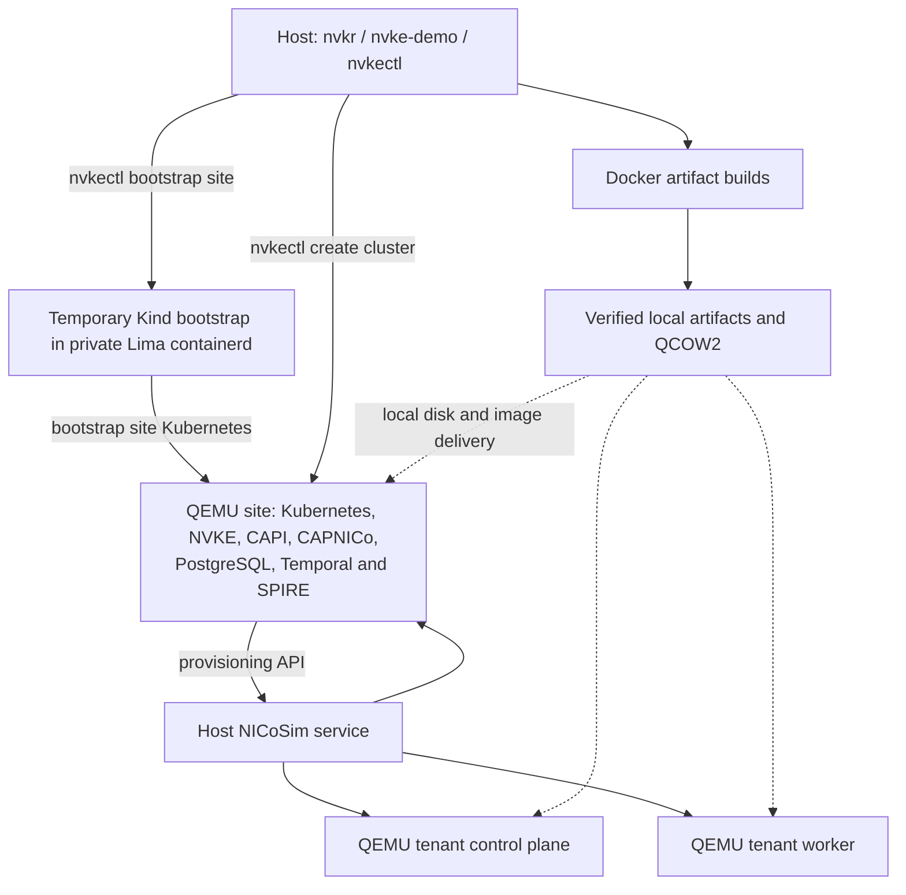

# Build and run NVKE locally

## Native Linux and Mac path

The Go demo runs `nvkr`, `nvke-demo`, `nvkectl` and NICoSim on the execution
host. NICoSim manages three real QEMU guests from the selected local QCOW2:
one Kubernetes site, one tenant control plane and one tenant worker.
The permanent NVKE site stack runs in the site guest. Kind is a temporary
bootstrap cluster, removed before tenant provisioning.



| Host | CLI and simulator | Kubernetes guest runtime |
| --- | --- | --- |
| Ubuntu ARM64 | Native Linux executables | QEMU/KVM through session libvirt |
| Apple Silicon Mac | Native Darwin executables | Host QEMU/HVF and vmnet |

Both hosts use Docker for artifact builds and a separate private Lima
containerd backend for temporary Kind bootstrap. Mac operators run the commands
directly in macOS; no SSH into a Linux execution VM or Colima host is required.
The CLI owns the temporary backend's start, readiness, stop and join. It shares
only writable bootstrap staging and read-only selected image directories,
forwards SPIRE port 30081 to the observed demo gateway, and removes that backend
before provisioning tenant guests. It does not adopt existing instances or mount
the simulator state/QCOW directory into Lima.

`build` creates an artifact Run and native-tool Run. `run` consumes explicitly
selected completed Runs. `e2e` calls those same stages in sequence. NVKR owns
builds, acquisition, observation and artifact verification; NVKE owns bootstrap,
site deployment and tenant operations. The native path remains a local diagnostic.
A complete fresh Mac/Linux build, deployment and cleanup result has not yet been
established for this candidate. See [current implementation and evidence](adr/reconciliation.md)
and [remaining source-build gaps](full-nvke-source-build.md).

## 1. Choose your Linux execution host

Use a dedicated trusted Ubuntu ARM64 host with usable KVM and sufficient native
storage for source builds, OCI outputs, the QCOW2 and guest overlays. The native
workflow allocates **4 CPUs / 12 GiB to the site and 6 CPUs / 12 GiB to each
tenant**: 36 GiB for the three Kubernetes guests, before host overhead. The
separate temporary bootstrap backend uses four CPUs, 6 GiB RAM and a 20-GiB disk.
Build containers and image staging need additional capacity.

The Linux artifact preflight checks eight CPUs, 10 GiB available RAM and 64 GiB
free workspace. These are stage-specific advisory checks, not reserved resources
or proof that the complete workflow fits. `--jobs` limits concurrent ready
operations; it is not a CPU/RAM reservation or aggregate container memory cap.
The former Kind-site recommendation of 24 GiB does not cover this native topology.

Inspect the actual host, storage, Docker capacity and existing workloads before
launching. Keep unrelated machines, VMs, containers and networks intact. Local
source admission requires Git 2.38 or later. Check KVM in the same login session
that will launch the CLI:

```sh
uname -m
git --version
df -h .
virsh -c qemu:///session list --all
ls -l /dev/kvm
bash -c 'exec 3<>/dev/kvm && echo "KVM read/write open OK"'
```

The CLI independently admits KVM and the selected runtime. Missing access is an
administrator prerequisite; do not run the entire demo as root or silently fall
back to software emulation.

## 2. Install prerequisites on the Ubuntu execution host

Install Docker Engine and Buildx from one compatible package source; follow
[Docker's Ubuntu installation guide](https://docs.docker.com/engine/install/ubuntu/).
For Ubuntu's `docker.io`, the plugin package is `docker-buildx`; Docker CE uses
`docker-buildx-plugin`. Do not mix those repositories. Docker access grants
root-level privileges. Verify both commands before preparing artifacts:

```sh
docker version
docker buildx version
```

The Linux native runtime also requires Bash, Git, jq, GNU coreutils/timeout,
Python 3.12+, OpenSSH, curl, OpenSSL, QEMU/firmware, session libvirt, cloud image
utilities, software TPM tools, dnsmasq, iptables/iproute2 and capability tools.
On an Ubuntu installation with the appropriate package repositories, the runtime
prerequisite package selection is:

```sh
sudo apt-get update
sudo apt-get install -y --no-install-recommends \
  git jq coreutils python3 openssh-client bash curl openssl \
  libvirt-daemon-system libvirt-clients qemu-system-arm qemu-utils \
  qemu-efi-aarch64 cloud-image-utils swtpm swtpm-tools gnutls-bin ipxe-qemu \
  dnsmasq-base iptables iproute2 libcap2-bin e2fsprogs kmod
```

The CLI refuses conflicting resources and overlapping networks; it does not
install those packages or delete an existing libvirt session. Linux bootstrap
additionally requires the reviewed source-built Lima `f47461e` distribution and
matched helpers described in [native Linux bootstrap](native-linux-bootstrap.md).
That candidate's binary vulnerability findings and bounded pilot scope remain
visible there; a backend-only pilot is not full native runtime acceptance.

Linux network setup uses the existing scoped bridge, DNS/DHCP, firewall and
capability journal owners. Keep the host privileged-port policy unchanged and
do not grant file capabilities to the demo executable. The privileged port probe
requires a root/current-user-owned executable and protected ancestor directories.
The native path does not derive forwarding authority from Docker's Kind subnet.

An interactive Linux command authenticates at sudo's initial prompt before the
dashboard/build, then refreshes that session through bounded non-interactive
checks. The prompt has a two-minute deadline. Passwords go directly to sudo;
deployment and cleanup do not prompt mid-run. The demo changes no sudoers policy.
Timestamp reuse follows the host's full sudo policy, not a demo-only credential.
Do not add a separate `sudo -v` or pipe the interactive command's streams.

Redirected or unattended execution requires administrator approval for the actual
non-interactive wrappers. Its initial probe is:

```sh
sudo -n -k timeout --signal=TERM --kill-after=5 25 true
```

With a command, `-k` ignores cached credentials for that invocation without
clearing the timestamp; `-n` forbids prompting. Passing this probe does not grant
later commands or override command-specific policy. Failure stops the workflow.
See the upstream [sudo manual](https://raw.githubusercontent.com/sudo-project/sudo/main/docs/sudo.man.in).

### Additional macOS setup

For the native Mac workflow, install:

- Apple Silicon macOS with HVF, the exact Go SDK from `.go-version`, and Clang/Apple SDK.
- Docker with Buildx reachable through `/var/run/docker.sock`, Git and jq.
- Homebrew Bash, Python 3, QEMU and GNU coreutils on `PATH`, including `g`-prefixed commands.
- Packer **1.15.4** and the installed QEMU plugin **1.1.6**. `packer plugins installed`
  must identify `packer-plugin-qemu_v1.1.6_x5.0_darwin_arm64` and its sibling
  `_SHA256SUM` file. BUILD discovers and captures this installation; it does not install it.
  Use the [pinned prerequisite acquisition steps](../inputs/definitions/demo/native-mac-tools/README.md#prepare-installed-packer-prerequisites).
- Lima **2.2.1** and `nerdctl.lima` for the owned temporary bootstrap backend.

`qemu-img` and `qemu-system-aarch64` must resolve to the same installation prefix.
Its `share/qemu` must contain `edk2-aarch64-code.fd`, `edk2-arm-vars.fd`,
`efi-virtio.rom`, `vgabios-virtio.bin` and `keymaps/en-us`. BUILD captures those
selected tools/data through NVKR. Installed dynamic libraries and the Apple SDK
remain trusted host dependencies; a Clang version probe does not validate the
entire SDK or its linking behavior.

The verified vmnet helper reports Apple's shared subnet. The demo holds that
interface through joined guest/service cleanup; API, disk HTTP, callbacks and
Lima forwarding use its observed gateway. It does not rewrite Apple's network
configuration or bind the simulator API to every host interface.

The separate [focused Linux artifact launcher](local-development.md#explicit-legacy-colima-build-route)
retains an explicit existing-Colima route for component builds. Its OS/all lanes
require execution inside native Linux storage. That legacy build option is not
the native Mac demo and does not provide current three-VM deployment acceptance.

## 3. Bootstrap the demo command

Build the two Go CLIs from the same reviewed checkout with the version in
`.go-version` on `PATH`:

```sh
cat .go-version
GOTOOLCHAIN=local make build demo
bin/nvkr --version
bin/nvke-demo e2e --help
```

`make build` produces `bin/nvkr`; `make demo` produces `bin/nvke-demo`.
The normal Mac build discovers `nvkr` beside `nvke-demo`, prepares its installed
native dependencies through existing NVKR owners, and builds the selected Linux
utility image through Docker Buildx. Mac CGO tools bind the measured installed
Go SDK and Clang; Linux uses the same producer's static source build.
The Linux artifact launcher can also bootstrap its binaries through its pinned
Go container; its focused commands belong in [local development](local-development.md).

Source authorization must work on the execution host. Set `--nvke-clone` to an
absolute local Git repository containing the catalog's pinned objects when using
local NVKE sources. Only committed pinned objects are admitted. Other private
repositories can use invocation-local Git `insteadOf` redirects to absolute
local repositories; source commit/tree checks still apply. At most 16 entries
are admitted, and the NVKE clone option needs two free entries. No credential or
source rewrite is inherited by deployment. See [source access](local-development.md#start-from-a-clean-machine).
This is not an offline mode: declared artifact and registry acquisitions still
need their endpoints.

## 4. Build and run the demo

Choose a fresh attempt and output directory for each invocation:

```sh
bin/nvke-demo e2e --repo "$PWD" \
  --attempt native-demo-01 --out "$PWD/.nvkr/native-demo-01" \
  --jobs 2 --network ovn --walkthrough --cleanup
```

Add `--nvke-clone /absolute/path/to/nvke` when supplying local source objects.
`--config demos/local-nvke.yaml` is optional; explicit changed flags override its
placeholders. Keep the artifact attempt, native-tool attempt and output paths
fresh. Deleting one directory does not clean resources or make an old attempt new.

NVIDIA OVN is the default. The normal Linux build requires KVM; Mac uses HVF.
Normal Mac preparation explicitly selects NVKE's supported `linux-generic`
kernel override, while Linux retains its ARM64 `linux-nvidia-64k` default.
The Plan records that platform-specific selection; shared source pins are
unchanged. Do not replace a pin with `main` or `latest` to force compatibility.

The site uses the source-selected ARM64 MachineImage boot script with the
current local disk URL. NICoSim owns its parsing, image boot and DHCP identity
registration; the URL itself is not content authentication.

Before site or tenant agents start, the adapter imports the selected named OVN
image by native manifest digest and projects the matching chart's digest settings.
The image bundled in the OS package is not used as proof of that separate output.
Conformance still requires exact runtime manifest observations before and after
the suite. A runtime exposing only a config ID fails that check.

The shared workflow:

1. NVKR builds/acquires the Definition's named outputs, including Debian package
   materials, the QCOW2 and runtime images, then builds/verifies native host and
   site companion tools. A failed required output prevents deployment.
2. The host NICoSim service starts the site guest. Host `nvkectl generate sitespec`
   and `nvkectl bootstrap site` use temporary Kind to bootstrap that guest's Kubernetes.
3. Host commands install CAPI providers and the source-selected NVKE stack into
   the site guest, then remove Kind and stop/join the private bootstrap backend.
4. Host `nvkectl create cluster` requests a tenant. CAPNICo calls NICoSim, which
   starts its control-plane and worker QEMU guests.
5. The demo waits for the real nodes and DNS rollouts, submits the unchanged
   zero-retry workload/DNS check, and optionally shows bounded site/tenant API,
   node and all-namespace pod observations.
6. With `--cleanup`, natural tenant deletion and joined owned cleanup must finish
   before success. Without it, the environment stays in this foreground command;
   Ctrl-C requests cleanup. Current `run`, `e2e` and `native` do not detach a session.

Runtime images are verified local OCI outputs. The adapter imports bootstrap
archives into Kind's containerd and delivers guest archives through owned local
HTTP/containerd. Tenant startup installs baked packages and verifies the local
workload image through CRI before starting the NVKE agent. These local aliases
are not additional registry downloads; source/material acquisition, Kind's node
image and provider acquisition retain their declared network dependencies.

To deploy completed outputs without rebuilding, use their exact Run paths:

```sh
bin/nvke-demo run --artifacts-run /absolute/path/to/artifact-run \
  --tools-run /absolute/path/to/native-tool-run --nvkr /absolute/path/to/nvkr \
  --out /absolute/path/to/fresh-demo --network ovn --walkthrough --cleanup
```

This is a separate deployment invocation, not a continuous fresh-build recording.
Explicit `--definition`, `--environment` and `--nvkr` build selections also remain
available. Those repository-contained inputs must already bind their native
dependencies; local signing/publication requests are refused on that path.
The separate Linux qualification rehearsal is described in
[local development](local-development.md#rehearse-local-m3-qualification).

### Explicit upstream OVN alternative

Use `--network upstream-ovn` on the same `e2e` or `run` command to select the
matched upstream disk, profiles, image and chart. The default remains NVIDIA OVN;
there is no silent supplier fallback. Its maintained Definition is
[arm64-upstream-local-kvm.json](../inputs/definitions/demo/arm64-upstream-local-kvm.json).
The upstream source is `d6a3812d1bc1c36bf24c7eda0e86e9b13d84907d` / v1.4.0.
Its distinct catalog baseline is not moved by the native NVIDIA update.
Opposite-mode inputs are refused; an upstream result does not validate NVIDIA OVN.

The [October 11 evidence](evidence/local-upstream-ovn-2026-10-11.md) records a
successful older Kind-site invocation at `71b356f5`. It does not establish
acceptance of this native three-VM workflow or a later revision.

### TCG and Calico diagnostics

The explicit slow artifact-build alternative remains:

```sh
bash scripts/nvke-full-arm64-local.sh --build-accelerator tcg \
  diagnostic-tcg-01 2 all
```

Add `--network upstream-ovn` before the attempt for the matched upstream
selection. The historical TCG Definitions retain their own source baselines.
TCG artifact support does not enable TCG in the current native deploy command,
which admits only Linux KVM or Mac HVF. Do not edit the TCG catalog in place to
simulate a KVM selection; use the maintained KVM inputs instead.

`kind-calico` remains a legacy Kind-site diagnostic: Kind's default CNI at the
site and Calico 3.30.1 in the tenant. Its tenant admission requires Calico-node
and DNS rollouts before the same zero-retry workload. **Current native `run` and
`e2e` reject `kind-calico`** because that site requires matched OVN disk/profiles.
Existing legacy sessions and their original compatible tools retain their status
and cleanup path below. Neither Calico nor upstream is NVIDIA-fork acceptance.

## Conformance on the fresh tenant

Add `--conformance` to native Mac or Ubuntu ARM64 `e2e`. Both use the same
38-output Definition and source pins: the ordinary 32 plus Linux and Darwin
Hydrophone/kubectl outputs, the matching Linux ARM64 Kubernetes v1.34.2
conformance image and BusyBox. Each host executes its native tools; the suite
pods run in the same fresh Linux tenant. The kubectl source
is v1.34.12 with declared dependency updates, built using Go 1.27.2.

After two Ready tenant nodes and workload/DNS success, the demo calls
`nvkr validate` against that same tenant. It binds the observed OVN image to the
held artifact and checks before/after deployment identities. Original JUnit is
retained under `runtime/conformance`; `runtime/conformance-output.json` describes
the capture. Harness failure, partial/missing capture or identity change prevents
success. Owned cleanup still runs after errors.

Mac local diagnostics use private Mach-O snapshots with byte checks before and
after commands; Linux retains sealed executable descriptors. Mac pathname
execution does not provide the Linux guarantee against a hostile same-user
process. Published validation and signing retain Linux admission.
Prepared/local-signing combinations are refused.
The suite has a four-hour ceiling and increases the `e2e` work ceiling to 12 hours.
The complete native demo plus conformance remains externally unverified.
Original JUnit owns the results; this does not issue a signed qualification
verdict or upload to TestGrid. See [external test output](external-test-output-contract.md).

## Presentation and timeouts

Interactive output defaults to a dashboard; `--plain`, redirected output and
`--verbose` use scrolling output. The inner NVKR command's `--ui=plain` feeds
that outer dashboard. `--walkthrough` explains authored catalog/Definition/
Environment inputs before the dashboard, then shows bounded read-only `/readyz`,
node and pod observations after workload/DNS and before cleanup. It never reruns
the workload to create success. Public tables omit private names, addresses and
provider payloads. Replayed post-terminal snapshots are historical observations.

| Key | Action |
| --- | --- |
| Tab | Change focused pane |
| Up / Down, Enter during builds | Select an operation, toggle details |
| Escape | Close details or dismiss confirmation |
| a during builds | Return to shared activity and automatic selection |
| PgUp / PgDn, End | Scroll activity, return to live activity |
| q / Ctrl+C | Request cancellation confirmation; y/Y confirms |
| f while canceling, then y/Y | Force exit 130 without joining cleanup; resources may remain |

The initial sudo prompt and plain/verbose output use signal cancellation without
that dialog. Normal cancellation waits for owned work and cleanup. Renderer or
terminal failures restore the terminal while preserving owner joining and failure.
An operation count, heartbeat, Packer output or growing console file is diagnostic
activity; none establishes guest health, artifact completion or an ETA.

| Ceiling | Scope |
| --- | --- |
| Eight hours; 12 with conformance | `e2e` work context |
| Six hours | Artifact build, including preparation and packaging |
| 60 minutes in the native NVIDIA producer | Packer SSH wait, inside the build deadline |
| 60 minutes by default; `--timeout 300..7200` seconds | Tenant provisioning |
| One hour, including a 45-minute disappearance wait | Independent tenant cleanup |
| Eight minutes | Subsequent owned host-runtime cleanup |

The earliest active deadline wins; `--timeout` changes tenant provisioning only.
Silence alone is not grounds to restart. Build failures name their retained private
log; raw public build output is capped at 8 MiB. Private installer, guest console,
panic and provider logs must stay off the shared screen.

## 5. Recognize success

For a full continuous demonstration, require the same fresh Run's complete
required outputs, exact consumed bytes, real site/two tenant nodes, the unchanged
zero-retry workload/DNS result, natural tenant deletion, joined owned cleanup and
natural exit zero. Current native cleanup success prints:

```text
PASS: native site and tenant checks, natural tenant deletion and joined owned cleanup completed.
```

Artifact completion, a separate deployment replay, a guest-only check or a stitched
video does not establish that continuous result. Failed original recordings remain
failed. Local outputs and reports are not signed Releases or qualification verdicts.

Native output retains verified assets and the private `runtime` directory,
including site/tenant kubeconfigs and observations. Artifact records remain at
`.nvkr/runs/<attempt>/lifecycle.json`; native-tool records remain under
`.nvkr/native-tools/runs/<attempt>`. Use only kubeconfig/tool paths from that
invocation for read-only inspection while the foreground environment is running:

```sh
"$KUBECTL" --kubeconfig "$SITE_CONFIG" --request-timeout=10s get nodes
"$KUBECTL" --kubeconfig "$SITE_CONFIG" --request-timeout=10s get pods -A
"$KUBECTL" --kubeconfig "$TENANT_CONFIG" --request-timeout=10s get nodes
"$KUBECTL" --kubeconfig "$TENANT_CONFIG" --request-timeout=10s get pods -A
```

Keep those locators and their contents private. A site API snapshot refers to the
QEMU site; Kind is no longer its management runtime.

### Retained deployment and actual cluster access

This section applies to **existing legacy Kind-site sessions**, not new native
`run`/`e2e` invocations. Keep the exact executable, `SESSION`, workspace and
access assignments issued by the original owner. Its authenticated controls are:

```sh
"$DEMO" status --session "$SESSION"
"$DEMO" cleanup --session "$SESSION"
```

`status` performs fresh read-only checks when Ready access exists; owner liveness
or an old Ready timestamp alone does not establish cluster health. Use that
session's printed kubectl and discovered Temporal UI instructions. Do not infer
a browser endpoint or port from a different run.

`cleanup` requests natural tenant deletion and joined service teardown; network
restoration follows only after owner exit. It has an 82-minute foreground wait
budget. If that foreground wait expires, cleanup may still be running in the
owner; observe the same owner before another action. A returned failed teardown
names private `owner-return.log` and `owner-error.log`, does not restore controls
or claim cleanup, and is not retried automatically. Unknown/unjoined ownership
keeps the original owner resident. Preserve its original session and journal.

## Failure inspection and recovery

Inspect the exact invocation's failed phase and retained private diagnostics.
Capture/diagnostic failure does not turn the original operation into success.
Native failure collection preserves bounded site/tenant API and guest evidence
before deletion; it does not retry provisioning or workload checks.

Site preparation forwards `nvke-agent.service` and `spire-agent.service` stdout/stderr
to the guest journal and console through logging-only unit drop-ins. Their output
is available to the existing private serial capture, subject to journal filtering.
This adds failure visibility; it does not establish or repair a failure cause.

For Linux network recovery, `restore --work` accepts only the original private
journal after its owned producers are idle. It restores recorded host-network
controls; it does not delete a tenant, VM, container or Packer observer. See
[network recovery](nvkr-to-nvke-demo.md#recover-network-controls-after-a-crash).
Missing processes, stale records or elapsed time do not prove joined cleanup.
Deleting old folders is not resource cleanup. No global prune or unrelated
VM/network removal is part of this procedure.

An unjoined OS-build observer retains its dependent container/work volume and
identity workspace. When available, its private
`diagnostics/packer/run-*/observer-retained.json` identifies those resources.
Select the exact record from the failed attempt, not a timestamp wildcard;
compare labels, mounts, image/material binding and original process ownership
before recovery. That record is inspection data, not deletion authorization.
Do not prune resources while their owners/runtime clients remain live.
Cross-process automatic Packer orphan recovery is not implemented.

## Repeat through the opt-in native E2E test

`TestEndToEnd` invokes the normal `bin/nvke-demo e2e` CLI with fresh paths,
NVIDIA OVN, conformance and cleanup on native Mac/Ubuntu ARM64. Both hosts use
the 14-hour wrapper budget, including two hours beyond the CLI work deadline.
Ordinary tests skip this real build/deployment operation.
The binary and checkout must come from the same reviewed source revision.

```sh
export NVKR_NVKE_E2E=1
export NVKR_NVKE_E2E_REPO="$(pwd -P)"
export NVKR_NVKE_E2E_OUT="$PWD/.nvkr/native-test-01"
export NVKR_NVKE_E2E_ATTEMPT=native-test-01
# Optional: NVKR_NVKE_E2E_BINARY selects the same-revision CLI at another path.
GOTOOLCHAIN=local go test ./internal/nvkedemo -run '^TestEndToEnd$' -count=1 -timeout 16h
```

This test launches the CLI non-interactively. It cannot accept sudo passwords;
Linux requires the documented unattended administrator policy, not a temporary
`sudo -v` cache. Mac still requires its installed native/vmnet prerequisites.
The test wrapper leaves two hours beyond the CLI's own work deadline for
independently bounded diagnostics and joined cleanup.
Its normal CLI invocation is test wiring, not evidence that a fresh complete
Mac or Ubuntu invocation has passed.

## Where the NVKE versions come from

The shared native NVIDIA selection uses the sources below. NVKR verifies the
pinned commit and tree; they are not represented as one tagged NVKE release.

| Part | Selected source | Owning input |
| --- | --- | --- |
| Native host CLI, installer and NICoSim | [`400c24fb`](https://github.com/dsx-ai-factory/nvke/commit/400c24fb6465b042be883d6b62472528520d6291) | [Shared tools lock](../inputs/catalogs/tools/native/pins.lock.yaml) |
| Site CLI/controller/charts and provisioned provider | `400c24fb` | [Native site lock](../inputs/catalogs/nvke/native-site-arm64/pins.lock.yaml) |
| OS, agent and kubeadm | `400c24fb` | [Native OS lock](../inputs/catalogs/node-images/native-arm64/pins.lock.yaml) |
| Profiles and runbooks | `400c24fb` | [Native profiles lock](../inputs/catalogs/controller-profiles/native-nvidia-arm64/pins.lock.yaml) |
| Explicit SPIRE packaging exception | [`726f7694`](https://github.com/dsx-ai-factory/nvke/commit/726f76944404e1106626b8333d3576bdf67b575b) | Native OS lock; missing DSX input tracked in [NVKE #1641](https://github.com/dsx-ai-factory/nvke/issues/1641) |
| NVIDIA OVN image/chart | [`8af51273`](https://github.com/dsx-ai-factory/ovn-kubernetes/commit/8af51273d52dfa07454435d18d37230e582d797a), 2.4.2 | [Native NVIDIA overlay](../inputs/catalogs/node-images/variants/native-nvidia.json) |

Native NVIDIA Definitions select 32 outputs, or 38 with conformance. Package
producers inspect actual Debian `Package`/`Architecture` metadata, and the disk
uses NVKE's renamed Packer build/material schema and QCOW2 output. Changed package
bytes require a fresh disk build. Release, upstream, historical TCG and hosted
nightly inputs retain their own catalog baselines and evidence.

For an actual attempt, its Plan and Run own exact source/output identities.
Update pins with `nvkr catalog pin`, then review matching installer interfaces,
profiles, OS overlays and predecessor digests. A base-lock change alone does not
update an overlay. Run repository checks and fresh complete runtime validation
before claiming acceptance of the changed selection.
