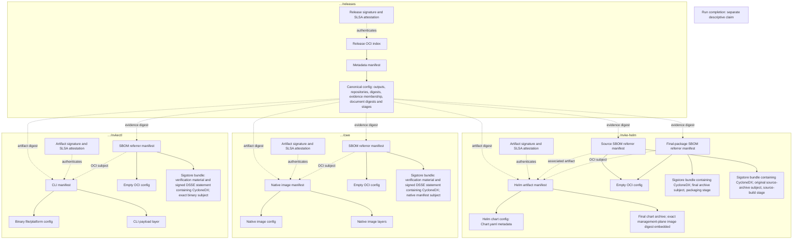

# One authenticated release entry point, independently consumable artifacts

The release index and its metadata live in `<publication.repositoryPrefix>/releases`. Deliverables and their
SBOM attestations live in sibling repositories named after the Definition outputs. For NVKE these are
`<publication.repositoryPrefix>/nvkectl`, `…/cwe`, and `…/nvke-helm`.

## Required publication transports

The Environment can explicitly select OCI with `publication.transports: [oci]`. Omitting `transports`
preserves the existing OCI behavior and authored identity. The existing `repositoryPrefix` and credential
settings still apply to this route; output repositories remain compiler-derived.

The recognized APT-only selection is `[apt]`, and both transports are selected as `[apt, oci]` in that
sorted order. Every selected route is required. Direct APT publication is not implemented: either selection
currently returns `engine-capability` before catalog, generation or execution work, without an OCI fallback.
APT-only does not require OCI settings to report this capability gap. A local unsigned APT layout or its OCI
upload does not satisfy a request for a signed, installable APT repository.

## OCI representation

Omitting `publication.ociRepresentation` preserves the existing artifact format. Explicit `artifact-v1`
uses that format while binding the authored selection into the Environment and Plan identity.
To select the alternative NVKR wrapper format before packaging and signing, add this field to the
existing publication settings:

```yaml
publication:
  ociRepresentation: nvkr-compatible-v1
```

This changes newly constructed NVKR wrappers and records the choice in the immutable root index.
Helm archives, native images, disks and imported manifests retain applicable exact payload bytes and
formats. New signed evidence retains the standard Sigstore envelope; affected identities and attestations
are recomputed before signing. It does not guarantee acceptance of every member by every registry.
Compatible raw SBOM wrappers use a truthful NVKR config type; clients filtering only for CycloneDX
`artifactType` may not discover them. NVKR still checks complete root-bound evidence and subjects.
Use an updated NVKR consumer for this explicit profile. Existing pinned publications are not rewritten,
and a registry rejection never automatically changes this selection.

For a Helm publication to a registry that rejects unknown NVKR config media types, select the narrower
standard Helm profile instead:

```yaml
publication:
  ociRepresentation: helm-standard-v1
```

It emits a standard Helm chart manifest without custom `artifactType`, preserving the original chart
archive and Helm config. Raw Helm evidence and publication metadata use separate manifests with canonical
binding records carried under `application/octet-stream`; NVKR validates their logical types and exact
subject bindings. Signed SBOMs and Cosign artifacts keep their standard signed envelopes, which the registry
must also accept. Other output families and imported manifests retain their existing formats, so mixed
publication acceptance requires separate validation. Raw evidence discovery by CycloneDX type alone is not
supported in this profile; NVKR uses exact root membership.

Omission and explicit `artifact-v1` preserve existing construction. Existing pinned publications and release
identities are unchanged. Selecting `helm-standard-v1` creates new affected manifest, evidence-subject and
publication identities before signing; it does not rewrite an old release. Install an updated NVKR reader
before consuming the new profile. Local interoperability checks exercise stock Helm pull/show/template
and compare archive bytes; they do not establish live GitLab or hosted signing acceptance.

## Registry diagnostics

Publication observes the existing client's requests and reports the actual failing operation:
base API check, blob upload, manifest upload, evidence attachment, referrer discovery or readback.
HTTP status and structured registry error codes determine the error class and recommended next action.
Authentication refusal is distinct from an unsupported operation; `MANIFEST_INVALID` does not establish
which manifest field was rejected. DNS and certificate failures retain typed causes without displaying
credential-bearing URLs. Permanent refusals do not trigger an alternate manifest upload.

For a separate read-only base check, use the internal diagnostic adapter:

```sh
bin/nvkr factory registry-check --repository registry.example/product
```

The JSON report distinguishes the observed Distribution V2 API family, the optional advertised
`registry/2.0` header, and the exact OCI specification version, which remains unknown. A base response does
not prove push permission, artifact-type acceptance, referrer support or complete publication acceptance.
Normal publish traffic can add observations of successful upload or referrer responses; those observations
are descriptive and do not certify conformance. The check uses the publication credential pair
`NVKR_REGISTRY_USER` and `NVKR_CREDENTIAL` when both are set, otherwise the existing ambient registry
credential owner. A half-set pair is a usage error before network I/O. `--anonymous` overrides both
sources; `--plain-http` explicitly selects HTTP for a local registry. The report identifies the selected
source as `explicit`, `ambient` or `anonymous`, never a credential value. To diagnose a CI refusal, run
with the same scoped credential that publication uses; a different personal Docker login tests another identity.
Network requests have a 15-second bound; ambient credential-helper behavior remains with the existing
credential owner. The diagnostic issues no test uploads or cleanup requests. Proxy HTML and missing
endpoints produce endpoint guidance rather than a guessed older protocol or silent downgrade.
Missing V2 endpoints and unclassified protocol failures following a successful HTML/proxy base response
use non-retryable `invalid-catalog` (16). Explicit HTTP refusals, transient responses and missing digest
readback keep their established classifications.
The pinned client used by the read-only check discards structured bodies on HTTP 404. For that status,
the check reports endpoint configuration without inferring authorization or unsupported-operation details;
an existing publication failure can expose those details through its own structured diagnostics.
Publication preserves caller deadlines. Without one, full-layout and disk pushes have a 30-minute
deadline; metadata-root publication has a 20-minute deadline. A timeout requires reconciling partial
uploads and uncertain tag changes before retrying the same identified bytes.
Metadata-root publication first checks its members in a read-only phase. A timeout there identifies the
member and reports that no upload was attempted; upload uncertainty applies after the write phase begins.

## Troubleshoot Helm and registry rejections

For GitLab or another registry reporting `MANIFEST_INVALID` or `unknown media type` during a Helm push,
first inspect the failed operation and run the [read-only registry check](#registry-diagnostics).
The base API version does not establish whether that registry accepts a particular artifact format.

| Error or observation | Next action |
|---|---|
| Authentication/authorization refusal (`401` or `403`) | Check the configured credential and permissions for the exact repository. |
| Timeout, throttling (`408` or `429`) or server failure (`5xx`) | Reconcile partial uploads and uncertain tag changes, then retry transient failures with the same identified bytes. |
| `MANIFEST_INVALID` or another permanent manifest rejection | Check the manifest media type and repository policy. This code alone does not identify the incompatible field. |
| Explicit `UNSUPPORTED` diagnostic | Check the refused operation and select an admitted alternative before constructing a new publication. |
| Digest, size or readback mismatch | Investigate the exact bytes and expected digest; do not accept or rewrite mismatched artifacts. |
| HTML response or missing base endpoint | Check the registry endpoint and proxy routing; an older supported protocol has not been established. |

When the rejected format involves NVKR's optional custom `artifactType`, review the
[explicit compatible representation](#oci-representation). For Helm it retains the chart archive and real
Helm config while constructing a wrapper without that optional field. Choose it in the Environment before
planning, packaging and signing; regenerate the Plan and workflow with the updated Environment as described
in [pipeline generation](generate-pipeline.md). The new wrapper has its own digest and evidence bindings.
Existing pinned publications are preserved. Required signed profiles and complete membership remain mandatory;
the compatible setting cannot make a registry accept every imported or signed format.

## Required S3 copy

To copy every selected artifact and its original evidence to S3, use an Environment with
`apiVersion: nvkr.dev/environment/v2` and add a destination beneath the existing `publication` settings:

```yaml
publication:
  credentialRef: github:GITHUB_TOKEN
  repositoryPrefix: ghcr.io/example/product
  objectStores:
    - name: artifacts
      provider: s3
      s3:
        region: us-east-1
        bucket: example-artifact-bucket
        prefix: product/artifacts
        expectedBucketOwner: "123456789012"
        roleRef: github:ARTIFACT_PUBLISH_ROLE_ARN
```

Keep the original signing identity, pinned cosign selection and hosted execution settings. Set the protected
workflow variable `ARTIFACT_PUBLISH_ROLE_ARN` in `nvkr-release` to the operator-provisioned workload role. The publisher obtains
a short-lived AWS session from GitHub OIDC; credentials are never authored in the Environment. Configure
role trust for audience `sts.amazonaws.com`, the exact repository and protected release Environment subject,
and the default-branch ref. The legacy subject is `repo:OWNER/REPO:environment:nvkr-release`; the immutable
form is `repo:OWNER@OWNER_ID/REPO@REPOSITORY_ID:environment:nvkr-release`. Match the actual configured subject.
In role trust, require the exact `token.actions.githubusercontent.com:repository_id`, `:repository_owner_id`,
`:ref` and `:environment` condition keys alongside `:aud` and `:sub`; AWS maps these directly, without
customizing the GitHub subject. The linked contract gives the complete condition-key names and example;
protect deployment branches, reviewers and workflow changes. Signing jobs can share that Environment and
OIDC permission, so this trusts the release context rather than isolating a single generated job. See
[the role-trust contract and official setup links](https://github.com/dsx-ai-factory/nvkr/blob/main/docs/adr/0020-artifact-publication-and-target-configuration.md#s3-file-delivery-contract).
Its prefix-scoped permissions are `s3:PutObject`, `s3:GetObject`, `s3:GetObjectVersion`,
`s3:AbortMultipartUpload` and `s3:ListMultipartUploadParts`. Independent consumers use separate read-only
credentials with `s3:GetObject` and, for versioned locators, `s3:GetObjectVersion`. A denied version read
fails without falling back to current bytes. For general-purpose SSE-KMS buckets with a customer-managed
key, the writer also needs `kms:GenerateDataKey` and `kms:Decrypt` on that key; read-only consumers need
`kms:Decrypt`. The role and key policy must authorize these uses. See [SSE-KMS permissions](https://docs.aws.amazon.com/AmazonS3/latest/userguide/UsingKMSEncryption.html).
A generic registry secret keeps its original grants; select a
scoped `GITHUB_TOKEN` or separate read credential for read-only source access. Custom S3-compatible HTTPS
endpoints and `addressing: path` are explicit
options; provider compatibility must be tested separately.

The generated S3 publication step follows the original signature and verification steps. Its failure fails
the Run. It copies the existing artifacts, signatures, provenance and SBOM bundles without changing their
subjects. Every object receives a complete pinned readback before the final immutable transport inventory
is written. The job records that exact inventory locator. Raw QCOW2 bytes are available at their digest blob
key, with the original output name and payload binding in the inventory.

Optional `transfer` fields on the destination are `maxObjectBytes`, `maxTotalBytes`, `maxObjects` and
`operationTimeoutSeconds`; defaults are 64 GiB, 256 GiB, 8192 and 1200 seconds. A total-only budget lowers the
omitted per-object default to that total when smaller; explicitly inconsistent limits remain invalid.
The complete inventory must fit before any upload, including its worst-case provider-pin encoding. The inventory
is bounded at 128 MiB, with retained proof bundles bounded at 8 MiB each and 16 MiB combined. Object-count ceilings also share
these independent byte limits. The operation timeout is at most 3509 seconds, leaving 60 seconds for
cleanup plus 30 seconds of clock skew and one second of expiry precision within a one-hour workload session.
A temporary session must cover
both deadlines; insufficient lifetime fails before writes. SDK callers use the same publication owner and
byte-provider interface. A consumer restores
the original closure and verifies every original proof and exact input/output binding under its own policy;
an inventory, ETag or S3 metadata alone is not authenticity evidence. See the
[consumer API and implementation boundary](https://github.com/dsx-ai-factory/nvkr/blob/main/docs/adr/reconciliation/object-store-publication.md#object-store-publication).

This is artifact publication. Serving an APT repository, extracting a new boot-file format, booting a disk,
installing a package and qualifying a release retain their separate contracts and acceptance evidence.

## Registry graph

Solid arrows are OCI descriptors within a repository. Dashed metadata arrows bind exact sibling locations
and manifest digests; they are not cross-repository OCI descriptors. Signature attachments are external to
what they sign.



## Why each wrapper exists

The release index remains one release signature target. An index has no config, so one metadata manifest
carries its canonical config. That config alone owns output names, sibling repository locators, exact
manifest identities, build bindings, and evidence membership. No deliverable or SBOM payload
is copied into the release repository, and no separate lifecycle-binding object is published.

The CLI retains its file/platform config for extraction. The management-plane image (`cwe`) retains its native manifest, config and layers.
Helm has one artifact manifest, its real Chart.yaml-derived config, and one chart-archive layer — a
standards-conformant Helm OCI chart, without a nested publication root.

Each SBOM has one standard OCI referrer manifest with an empty config and one Sigstore v0.3 bundle layer.
The bundle contains the signed in-toto statement, CycloneDX predicate, certificate/key verification material
and transparency evidence. The raw CycloneDX document is not published separately. The OCI manifest provides
registry discovery and transport; the bundle supplies the SBOM's own cryptographic authentication. There is
no additional signature on the SBOM wrapper and no redundant SLSA attestation about the SBOM wrapper.

Evidence shared by multiple output projections belongs to the first sorted output membership's repository.
Other memberships reference that same exact bundle through the release. Independent referrer discovery is
available at the owning output; this avoids pretending that one OCI subject can name multiple repositories.
The maintained CLI, management-plane image and Helm outputs each own their evidence, with two distinct inventories for Helm.

## Signing and publication order

1. Build and observe outputs, generate private raw SBOMs, bind Helm to the exact management-plane image, and prepare the
   complete local release closure.
2. Create and verify a CycloneDX attestation for each SBOM's exact subject. Replace the private raw evidence
   with the verified bundles, then derive the final release metadata and index digest.
3. Publish deliverables first, their SBOM bundles next, and the release index last. Verify served manifest
   digests at the owning repositories.
4. Sign and attest each deliverable manifest, then the release index. SLSA predicates describe the producing
   Run; signing operations do not claim new builds.
5. Authenticate the root, retrieve the complete distributed closure, verify all deliverable signatures and
   provenance, and independently verify every SBOM bundle before writing successful hosted verification.

For `publication.mode: per-output-v1`, steps 1–5 run independently for each named output. Each route also
publishes an internal signed metadata root at `<prefix>/releases-<output>`, bound to the full Plan and current
workflow run attempt. Aggregate assembly verifies these roots, exact production predicates and SBOM bundles,
checks the frozen output set, and publishes only the combined release metadata at `<prefix>/releases`.
Aggregate verification and finalization fetch manifests/configs and evidence, never payload layers. The
finalizer restores six carriers (metadata, reference, signing record, predicate, verification record and cosign),
and still requires every provider job to succeed. Metadata readers reject extra blobs and enforce a 512 MiB
control/evidence limit per root. Each output's full payload validation remains in its own publication route;
independent consumers retain full payload validation under `artifact-publication` scope. The separate
`authenticity` scope authenticates root/output signatures, provenance and required SBOM bundles using the
metadata/evidence closure, and explicitly leaves payload integrity unchecked. This mode is GitHub-only and requires production cosign
signing. Assembly and finalization receive registry-read access without OIDC or package-write permission.

The SBOM-attestation job uses the same protected workflow identity and issuer as artifact signing. It needs
OIDC access but no registry credentials. Artifact publication/signing retain their existing scoped registry
access. These effects are not an atomic remote transaction: failure can leave payloads or partial evidence;
no rollback or cross-run resume is claimed.

Dry-run and local development can retain raw SBOM preparation layouts. They do not create signed bundles.
Production publication and the authenticated Release consumer reject raw preparation evidence. Production
SBOM creation uses pinned cosign `attest-blob --new-bundle-format --type cyclonedx --hash …`; the adapter then
runs `verify-blob-attestation` with the exact digest, configured identity and issuer, and normal transparency
verification. No production verification bypass is enabled.

## Subjects and evidence scope

OCI `subject` associates an evidence manifest with a deliverable for discovery. The signed statement's subject
is the precise thing inventoried: a CLI binary, the native management-plane image manifest, the original Helm source archive,
or the final bound Helm archive. These can be different digests and are not interchangeable.

The CycloneDX predicate retains the covered stage and scanner input. Release metadata binds the canonical
document digest, exact bundle blob and manifest digests, subject kind/digest, stage, and sorted output membership.
The consumer checks the signed statement's subject and reconstructs the exact canonical document before
checking those bindings. Helm source evidence cannot satisfy the final-package slot.

The release signature authenticates evidence membership and exact bytes through metadata. Individual artifact
signatures authenticate their deliverables; SBOM bundle signatures authenticate their subject-bound inventories.
Neither standalone check establishes complete release membership. Run completion remains a separate descriptive
claim, and none of these checks establishes qualified reproduction, vulnerability clearance, or deployment acceptance.

## Independent consumption

Use a trusted cosign installation and an externally selected workflow identity/issuer. Artifact signatures and
SLSA attestations are standard Sigstore v0.3 bundles under the cosign 3.1.3 contract. Select each required
predicate explicitly at the deliverable's exact manifest reference:

```sh
cosign verify-attestation --type https://sigstore.dev/cosign/sign/v1 \
  --certificate-identity 'https://github.com/dsx-ai-factory/nvkr/.github/workflows/nvkr-run.yml@refs/heads/main' \
  --certificate-oidc-issuer 'https://token.actions.githubusercontent.com' "$ARTIFACT_REF"
cosign verify-attestation --type slsaprovenance1 \
  --certificate-identity 'https://github.com/dsx-ai-factory/nvkr/.github/workflows/nvkr-run.yml@refs/heads/main' \
  --certificate-oidc-issuer 'https://token.actions.githubusercontent.com' "$ARTIFACT_REF"
```

Discover SBOM bundles through OCI referrers, or select their exact manifest digests from an authenticated
release. Fetch the single `application/vnd.dev.sigstore.bundle.v0.3+json` layer and verify it independently:

```sh
cosign verify-blob-attestation --bundle sbom.bundle.json --type cyclonedx \
  --digest "$EXPECTED_SUBJECT_SHA256_HEX" --digestAlg sha256 \
  --certificate-identity 'https://github.com/dsx-ai-factory/nvkr/.github/workflows/nvkr-run.yml@refs/heads/main' \
  --certificate-oidc-issuer 'https://token.actions.githubusercontent.com'
```

The expected digest comes from independently checked bytes or authenticated release metadata, not from blindly
trusting the downloaded bundle. For the management-plane image it is the native manifest digest; for CLI/Helm it is the specific binary
or archive digest. Referrer discovery alone establishes no trust. The registry adapter uses the standard
referrers API or the library's OCI fallback index; discovery indexes are not additional SBOM documents.

The NVKR adapter downloads only the required signature and provenance bundles, verifies their exact bytes with
`verify-blob-attestation`, and derives identity from the embedded certificate after successful verification.
It does not copy the artifact or fall back to legacy attachments. Existing legacy signatures/provenance must
be reissued as bundles before the updated consumer can accept them.

For qualification, select the independent qualifier identity from the reviewed policy. The following
shows the example qualifier path; it must match the actual approved workflow, and must differ from the
builder identity used above:

```sh
cosign verify-attestation --type https://nvkr.dev/qualification-evidence/v2 \
  --certificate-identity 'https://github.com/dsx-ai-factory/nvkr/.github/workflows/nvkr-qualify.yml@refs/heads/main' \
  --certificate-oidc-issuer 'https://token.actions.githubusercontent.com' "$ARTIFACT_REF"
```

Use an exact `repository@sha256:...` reference for every selected output. A valid cosign result authenticates
the attestation's signature, identity and subject; it does not implement NVKR's complete-set semantics.
Independent acceptance must also:

1. Authenticate the producer publication and derive the complete selected output set from its original,
   checked Definition/Plan, rather than from whichever attachments happen to be present.
2. Require the strict `nvkr.dev/qualification-evidence/v2` record for every exact subject under the separately
   trusted qualifier identity and issuer. Reject absent, malformed, duplicate/ambiguous or mismatched records.
3. Check the complete record binds the intended source Run and attempt, input identities, qualifier invocation
   and independently selected policy. Require all selected output verdicts and complete applicable smoke
   evidence to pass. An external suite marked `not-evaluated` supplies no passing result.
4. Require the same complete successful evidence across the entire selected set. Reject missing outputs,
   different subjects, different final qualification invocations or differing complete records, even if
   individual signatures pass. One complete record may retain authenticated original producer or worker
   attempts from permitted same-run retries.
   Earlier attachments left by a failed publication do not prove completion.

Retain the exact Run/artifact references and positive and controlled-failure verification transcript for
hosted acceptance. The commands and contract tests are not that transcript. There is no general release
authorization command in this stack; verifying one attachment cannot grant it. Current qualification
acceptance gaps remain in [reconciliation](https://github.com/dsx-ai-factory/nvkr/blob/main/docs/adr/reconciliation/m3-mvp-scope-and-acceptance-boundary.md#m3-mvp-scope-and-acceptance-boundary).

## Validation boundary

Contract tests in [delivery](https://github.com/dsx-ai-factory/nvkr/tree/main/pkg/nvkr/delivery), [signing](https://github.com/dsx-ai-factory/nvkr/tree/main/pkg/nvkr/sign) and
[factory](https://github.com/dsx-ai-factory/nvkr/tree/main/pkg/nvkr/factory) cover missing, substituted, duplicate and unbound evidence, wrong subjects
and stages, failed signing/verification, raw-evidence rejection, isolated repositories and failed fetches.
Legacy finalization compares restored raw SBOM handoffs and final Helm package inspection; per-output
finalization authenticates exact document bindings through signed metadata and independently verifies bundles.

The [recorded hosted candidate](https://github.com/dsx-ai-factory/nvkr/blob/a187d6b702cbc1a70452760c606c2c4de1ed6618/docs/evidence/2026-10-06-team-demo-pipeline.md) completed hosted publication,
signing, verification and finalization for 34 outputs, including both native disks. It used an explicitly
admitted validation branch and `build-provenance-v1` disk evidence. This does not establish main-only
execution, independent full-payload disk consumption, strict disk inspection or qualification. Current
support and remaining acceptance are owned by [reconciliation](https://github.com/dsx-ai-factory/nvkr/blob/main/docs/adr/reconciliation/README.md).

Earlier [hosted release history](https://github.com/dsx-ai-factory/nvkr/blob/a187d6b702cbc1a70452760c606c2c4de1ed6618/docs/evidence/hosted-release-history.md#cosign-bundle-discovery) retains
the mixed-attestation discovery incident and its exact cosign interoperability limits. Historical
layouts and unsigned loopback replays do not establish acceptance of the current publication format.

See the pinned [cosign attestation options](https://github.com/sigstore/cosign/blob/v3.1.3/cmd/cosign/cli/options/attest_blob.go)
and [verification options](https://github.com/sigstore/cosign/blob/v3.1.3/cmd/cosign/cli/options/verify.go) for the adapter's command contract.
