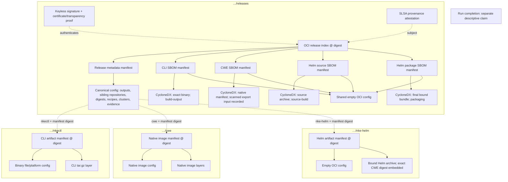

# One authenticated release entry point, separate artifact repositories

The release index and its evidence live in `<publication.repositoryPrefix>/releases`. Each deliverable lives
once in a sibling repository named after the Definition output. For NKE, the prefix is
`ghcr.io/nvidia/nke-recipes` and the artifact repositories are `nkectl`, `cwe`, and `nke-helm`.

## Registry graph

Solid edges are standard OCI descriptors within one repository. Dashed metadata edges bind a sibling
repository name and exact manifest digest; they are not OCI index descriptors across repositories.

## Why each wrapper exists

The release OCI index gives one signature target and standard traversal of its metadata and SBOMs. An index
has no config field, so one metadata manifest carries the canonical release config. That config is the sole
semantic owner of output names, repository locators, exact descriptors, recipe/cluster relationships and evidence
membership. It does not duplicate deliverables inside the release repository. OCI descriptors cannot select
other repositories, so the consumer explicitly follows the signed metadata bindings and verifies those bytes.

Repository locators are canonical sibling names, resolved relative to the selected release repository namespace.
They cannot contain paths, tags, URLs or credentials. This supports relocating a complete release namespace
without changing artifact bytes, and prevents metadata from redirecting credentials to another host or namespace.
Each output has one distinct repository; overlap with the release repository fails before publication.

The CLI manifest retains its file/platform config for safe extraction. CWE retains its native manifest,
config and layers unchanged, directly pullable from `…/cwe@sha256:…`. Helm has one artifact manifest, empty
config and final archive layer, with no nested NKD publication root. The small empty config exists in each
repository where OCI requires it; this is not duplicate product publication. Every SBOM document appears once,
in `…/releases`. Per-recipe indexes remain internal handoffs. No separate lifecycle-binding object is published.

## Publication and authentication

One packaging handoff contains the complete local closure for validation. Its OCI index contains metadata and
evidence descriptors; deliverable blobs in local storage are reached through metadata bindings. The publisher
validates everything before network writes, uploads each deliverable to its own repository, verifies its served
manifest digest, and publishes the release index last. A failure can leave uploaded payloads; no rollback is
claimed. Signing and attestation still target only the release index and run after publication.

The root signature covers evidence bytes through OCI descriptors and deliverable identities through signed
metadata. A successful signature alone does not prove those deliverables were retrieved. The consumer first
authenticates the root, then fetches each bound repository/digest and validates its manifest/config/layers and
SBOM membership before exposing a verified Release. Missing, denied, substituted or incomplete remote payloads
leave no accepted local closure. Hosted pull-back verification performs the same full retrieval before writing
a successful verification record. Child signatures are not required by this policy; direct image pulls alone
are not release authentication.

Signature/attestation attachments stay outside their subject to avoid circular identities. Run completion is a
separate descriptive record and is not signed merely because its referenced release is signed. This scope does
not grant qualified execution, vulnerability clearance or deployment acceptance.

## Evidence accounting and validation

Every SBOM has exact subject kind/digest, stage, raw document digest, typed identity and sorted output membership.
CLI evidence covers the built binary. CWE evidence targets its native manifest and records the scanned export
input. Helm source and final-package inventories are separate claims; the latter follows image binding and
checksum refresh. Shared build evidence across output projections has one document with multiple memberships.

Construction and consumption reject missing, duplicate, substituted and unbound evidence. The finalizer
compares published documents with validated handoffs and the final package inventory. Tests also check isolated
repository storage, namespace restrictions, root/output collisions, and missing/denied/substituted remote output
manifests. GitHub still transports one full packaging handoff and uses one signing route; the 28 internal
handoff artifacts are not 28 products.

## Local validation

The separate-repository rehearsal published the actual downloaded NVIDIA deliverables into a loopback registry
and pulled the complete release back. The release reference was
`localhost:5000/nkd-separated-rehearsal/releases@sha256:35232ed384a2bc7d1bfdecfda8238086d0e0e341de85602e064c145c3aac2fc2`.
Its index contained five direct manifests: release metadata and four SBOMs. Each output manifest was available
in its own repository and returned HTTP 404 in the release repository. Recovered CLI and bound Helm archive
bytes retained their original digests; the chart retained the exact CWE image digest.

This was local, unsigned publication of existing payloads, not a new source build or hosted execution.
The full local gate and uncached tests passed after updating to upstream main at `23d1641`, with 70.5%
race-test coverage. Generated-workflow consistency also passed. A new authorized GitHub/GHCR run is needed
to establish hosted signing, repository permissions and finalization for this layout.
