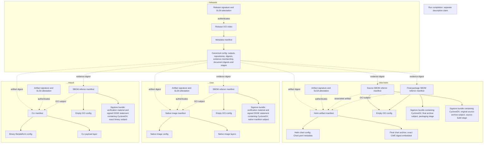

# One authenticated release entry point, independently consumable artifacts

The release index and its metadata live in `<publication.repositoryPrefix>/releases`. Deliverables and their
SBOM attestations live in sibling repositories named after the Definition outputs. For NKE these are
`ghcr.io/nvidia/nke-recipes/nkectl`, `…/cwe`, and `…/nke-helm`.

## Registry graph

Solid arrows are OCI descriptors within a repository. Dashed metadata arrows bind exact sibling locations
and manifest digests; they are not cross-repository OCI descriptors. Signature attachments are external to
what they sign.



## Why each wrapper exists

The release index remains one release signature target. An index has no config, so one metadata manifest
carries its canonical config. That config alone owns output names, sibling repository locators, exact
manifest identities, build bindings, and evidence membership. No deliverable or SBOM payload
is copied into the release repository, and no separate lifecycle-binding object is published.

The CLI retains its file/platform config for extraction. CWE retains its native manifest, config and layers.
Helm has one artifact manifest, its real Chart.yaml-derived config, and one chart-archive layer — a
standards-conformant Helm OCI chart, without a nested publication root.

Each SBOM has one standard OCI referrer manifest with an empty config and one Sigstore v0.3 bundle layer.
The bundle contains the signed in-toto statement, CycloneDX predicate, certificate/key verification material
and transparency evidence. The raw CycloneDX document is not published separately. The OCI manifest provides
registry discovery and transport; the bundle supplies the SBOM's own cryptographic authentication. There is
no additional signature on the SBOM wrapper and no redundant SLSA attestation about the SBOM wrapper.

Evidence shared by multiple output projections belongs to the first sorted output membership's repository.
Other memberships reference that same exact bundle through the release. Independent referrer discovery is
available at the owning output; this avoids pretending that one OCI subject can name multiple repositories.
The maintained CLI/CWE/Helm outputs each own their evidence, with two distinct inventories for Helm.

## Signing and publication order

1. Build and observe outputs, generate private raw SBOMs, bind Helm to the exact CWE image, and prepare the
   complete local release closure.
2. Create and verify a CycloneDX attestation for each SBOM's exact subject. Replace the private raw evidence
   with the verified bundles, then derive the final release metadata and index digest.
3. Publish deliverables first, their SBOM bundles next, and the release index last. Verify served manifest
   digests at the owning repositories.
4. Sign and attest each deliverable manifest, then the release index. SLSA predicates describe the producing
   Run; signing operations do not claim new builds.
5. Authenticate the root, retrieve the complete distributed closure, verify all deliverable signatures and
   provenance, and independently verify every SBOM bundle before writing successful hosted verification.

For `publication.mode: per-output-v1`, steps 1–5 run independently for each named output. Each route also
publishes an internal signed metadata root at `<prefix>/releases-<output>`, bound to the full Plan and current
workflow run attempt. Aggregate assembly verifies these roots, exact production predicates and SBOM bundles,
checks the frozen output set, and publishes only the combined release metadata at `<prefix>/releases`.
Aggregate verification and finalization fetch manifests/configs and evidence, never payload layers. The
finalizer restores six carriers (metadata, reference, signing record, predicate, verification record and cosign),
and still requires every provider job to succeed. Metadata readers reject extra blobs and enforce a 512 MiB
control/evidence limit per root. Each output's full payload validation remains in its own publication route;
independent consumers retain full payload validation. This mode is GitHub-only and requires production cosign
signing. Assembly and finalization receive registry-read access without OIDC or package-write permission.

The SBOM-attestation job uses the same protected workflow identity and issuer as artifact signing. It needs
OIDC access but no registry credentials. Artifact publication/signing retain their existing scoped registry
access. These effects are not an atomic remote transaction: failure can leave payloads or partial evidence;
no rollback or cross-run resume is claimed.

Dry-run and local development can retain raw SBOM preparation layouts. They do not create signed bundles.
Production publication and the authenticated Release consumer reject raw preparation evidence. Production
SBOM creation uses pinned cosign `attest-blob --new-bundle-format --type cyclonedx --hash …`; the adapter then
runs `verify-blob-attestation` with the exact digest, configured identity and issuer, and normal transparency
verification. No production verification bypass is enabled.

## Subjects and evidence scope

OCI `subject` associates an evidence manifest with a deliverable for discovery. The signed statement's subject
is the precise thing inventoried: a CLI binary, the native CWE image manifest, the original Helm source archive,
or the final bound Helm archive. These can be different digests and are not interchangeable.

The CycloneDX predicate retains the covered stage and scanner input. Release metadata binds the canonical
document digest, exact bundle blob and manifest digests, subject kind/digest, stage, and sorted output membership.
The consumer checks the signed statement's subject and reconstructs the exact canonical document before
checking those bindings. Helm source evidence cannot satisfy the final-package slot.

The release signature authenticates evidence membership and exact bytes through metadata. Individual artifact
signatures authenticate their deliverables; SBOM bundle signatures authenticate their subject-bound inventories.
Neither standalone check establishes complete release membership. Run completion remains a separate descriptive
claim, and none of these checks establishes qualified reproduction, vulnerability clearance, or deployment acceptance.

## Independent consumption

Use a trusted cosign installation and an externally selected workflow identity/issuer. Artifact signatures and
SLSA attestations are standard Sigstore v0.3 bundles under the cosign 3.1.3 contract. Select each required
predicate explicitly at the deliverable's exact manifest reference:

```sh
cosign verify-attestation --type https://sigstore.dev/cosign/sign/v1 \
  --certificate-identity 'https://github.com/NVIDIA/nke-recipes/.github/workflows/nkd-run.yml@refs/heads/main' \
  --certificate-oidc-issuer 'https://token.actions.githubusercontent.com' "$ARTIFACT_REF"
cosign verify-attestation --type slsaprovenance1 \
  --certificate-identity 'https://github.com/NVIDIA/nke-recipes/.github/workflows/nkd-run.yml@refs/heads/main' \
  --certificate-oidc-issuer 'https://token.actions.githubusercontent.com' "$ARTIFACT_REF"
```

Discover SBOM bundles through OCI referrers, or select their exact manifest digests from an authenticated
release. Fetch the single `application/vnd.dev.sigstore.bundle.v0.3+json` layer and verify it independently:

```sh
cosign verify-blob-attestation --bundle sbom.bundle.json --type cyclonedx \
  --digest "$EXPECTED_SUBJECT_SHA256_HEX" --digestAlg sha256 \
  --certificate-identity 'https://github.com/NVIDIA/nke-recipes/.github/workflows/nkd-run.yml@refs/heads/main' \
  --certificate-oidc-issuer 'https://token.actions.githubusercontent.com'
```

The expected digest comes from independently checked bytes or authenticated release metadata, not from blindly
trusting the downloaded bundle. For CWE it is the native manifest digest; for CLI/Helm it is the specific binary
or archive digest. Referrer discovery alone establishes no trust. The registry adapter uses the standard
referrers API or the library's OCI fallback index; discovery indexes are not additional SBOM documents.

The NKD adapter downloads only the required signature and provenance bundles, verifies their exact bytes with
`verify-blob-attestation`, and derives identity from the embedded certificate after successful verification.
It does not copy the artifact or fall back to legacy attachments. Existing legacy signatures/provenance must
be reissued as bundles before the updated consumer can accept them.

## Validation boundary

Contract tests in [delivery](../pkg/nkd/delivery/), [signing](../pkg/nkd/sign/) and
[factory](../pkg/nkd/factory/) cover missing, substituted, duplicate and unbound evidence, wrong subjects
and stages, failed signing/verification, raw-evidence rejection, isolated repositories and failed fetches.
Legacy finalization compares restored raw SBOM handoffs and final Helm package inspection; per-output
finalization authenticates exact document bindings through signed metadata and independently verifies bundles.

The [recorded M2 candidate](https://github.com/dsx-ai-factory/nke-recipes/blob/a187d6b702cbc1a70452760c606c2c4de1ed6618/docs/evidence/2026-10-06-team-demo-pipeline.md) completed hosted publication,
signing, verification and finalization for 34 outputs, including both native disks. It used an explicitly
admitted validation branch and `build-provenance-v1` disk evidence. This does not establish main-only
execution, independent full-payload disk consumption, strict disk inspection or qualification. Current
support and remaining acceptance are owned by [reconciliation](adr/reconciliation.md).

Earlier [hosted release history](https://github.com/dsx-ai-factory/nke-recipes/blob/a187d6b702cbc1a70452760c606c2c4de1ed6618/docs/evidence/hosted-release-history.md#cosign-bundle-discovery) retains
the mixed-attestation discovery incident and its exact cosign interoperability limits. Historical
layouts and unsigned loopback replays do not establish acceptance of the current publication format.

See the pinned [cosign attestation options](https://github.com/sigstore/cosign/blob/v3.1.3/cmd/cosign/cli/options/attest_blob.go)
and [verification options](https://github.com/sigstore/cosign/blob/v3.1.3/cmd/cosign/cli/options/verify.go) for the adapter's command contract.
