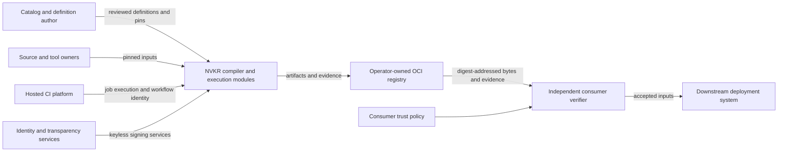
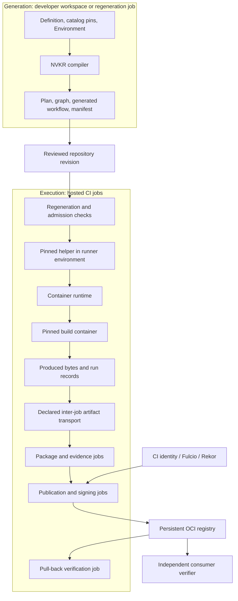
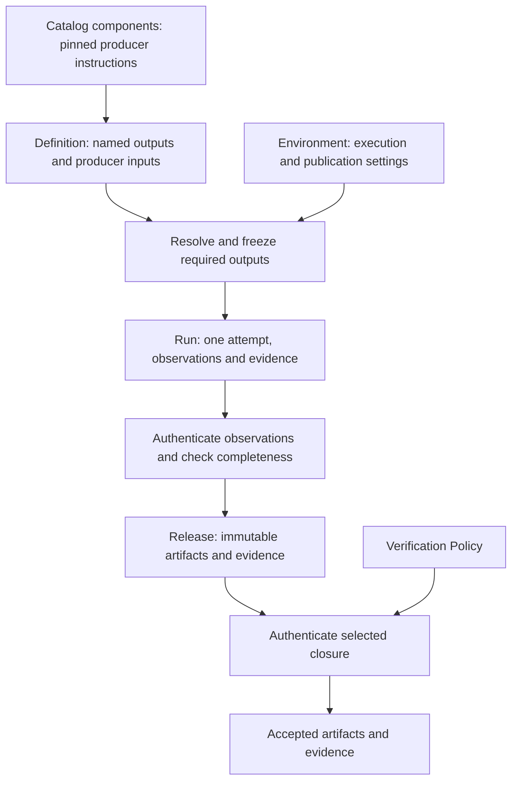
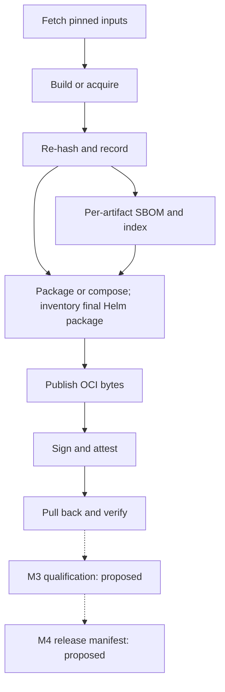
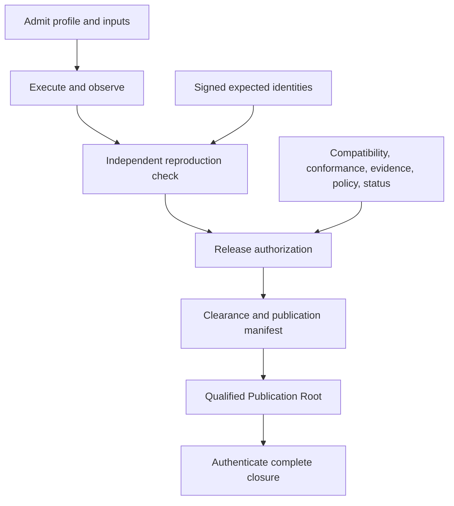
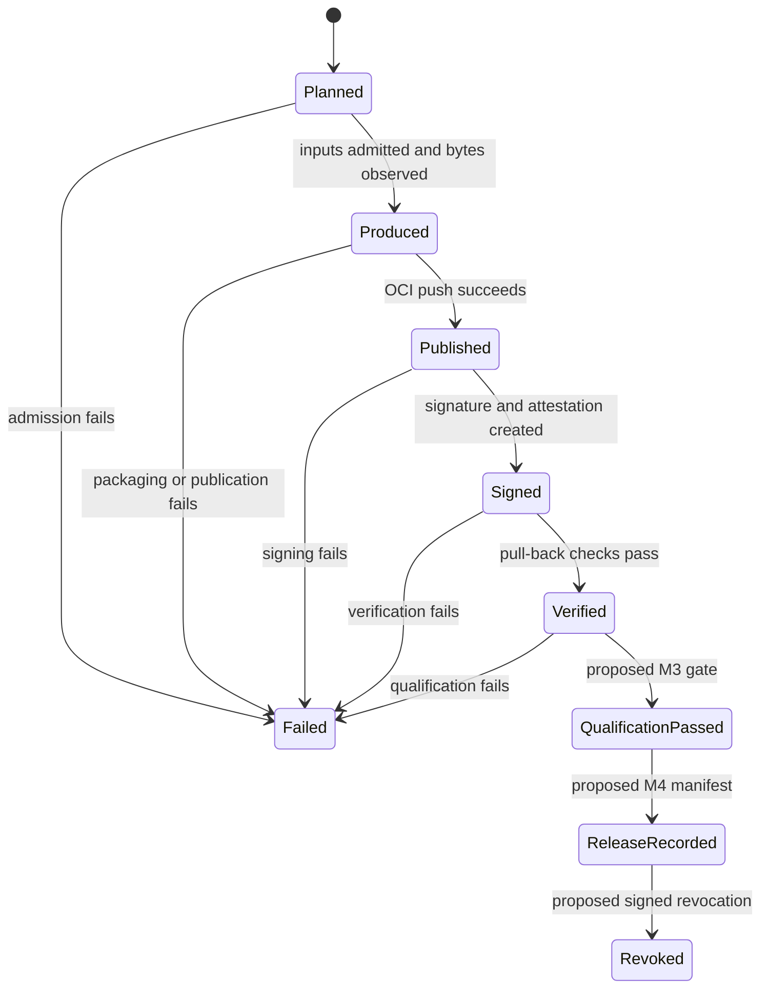

# NVKR (NVIDIA Kubernetes Definition) — Software Architecture & Design Document

## PLC-L1: Basic PLC: Software Architecture and Design Document

- **Revision:** 2026-10-07 — current lifecycle, native disk route and evidence boundaries
- **Status:** Draft; ADR-01 through ADR-22 pending named-decider ratification
- **Review scope:** shared definition architecture, v1 artifact delivery, and the separate qualified release contract

> [!NOTE]
> This document explains the system and the reasons for its boundaries. The [ADRs](adr/) govern design;
> [reconciliation](adr/reconciliation.md) records implementation and evidence. Proposed ADRs are the engineering
> baseline pending ratification, not organizational approval.
> Public lifecycle ownership is defined in [ADR-17](adr/0017-cli-sdk-foundation-and-package-topology.md).
> The current ADRs state the qualified and pipeline-attested contracts directly; [milestones](milestones.md)
> define v1 acceptance. Registration and full v1 release automation remain deferred; deployment topology and cluster qualification are outside NVKR.
> **[INPUT NEEDED]** identifies an unresolved decision or an owner-supplied deployment parameter.

# Introduction {#introduction}

## Purpose and Scope {#purpose-and-scope}

NVKR turns a product Definition into a Run and a Release of immutable artifacts and evidence. Its Go CLI,
`nvkr`, resolves pinned inputs, generates the pipelines that produce artifacts, and connects their bytes to
verifiable evidence. NVKE is the v1 customer: NVIDIA runs the generated pipeline and delivers signed OCI artifacts
that a consumer can verify independently.

This SADD is for implementers, release engineers, and architecture/security reviewers. It explains which parts
of NVKR run where, the objects they exchange, the trust boundaries they enforce, and the behavior required when
work fails. Shared structure comes first; the v1 and qualified contracts are then described separately.
Implementation status is summarized once under Current support boundary.

NVKR supports two different evidence contracts. They share resolution and identity primitives, but require
separate acceptance decisions:

| Concern | v1 delivery — `pipeline-attested` | Qualified release — `qualified` |
|---|---|---|
| Producer and consumer | NVIDIA's hosted workflow produces artifacts; consumers verify the published digest | Publisher provides signed expected identities; an operator reproduces and verifies in its own environment |
| Claim | Production by a named workflow with signed SLSA v1 production provenance; ADR-16 §5 targets SLSA Build L2 | Exact-byte reproduction of each named claim subject within a signed builder profile, supported by authenticated execution observations |
| Execution | Generic GitHub-hosted native AMD64/ARM64 producer execution plus ADR-18's explicit native KVM ARC disk route; declared hermetic, wrapped, or acquired source lane | Profile-bounded execution with authenticated runtime and terminal receipts; unsupported providers fail closed |
| Publication | Signed artifact bytes in OCI; planned build/evidence qualification and release manifest | Operator-owned publication of a complete cleared release through the Publication Root protocol |
| Consumer policy | Keyless build identity and issuer; separate qualification identity for the planned M3 gate | Trusted roles, reproduction, compatibility, conformance, evidence, policy, and fresh status |
| Outside the lane | Reproduction, clearance, air gap, cluster-scoped qualification, registration | No relaxation from a v1 signature or a v1 qualification verdict |

A third tier, `static-unqualified`, describes plans and development runs without authenticated producer evidence.
Dry-run signing stays in that tier. Selecting a signing mode or rendering a workflow does not itself prove that
an artifact was signed. `pipeline-attested` never satisfies a gate requiring `qualified` evidence (ADR-16 §5).

The tool and its catalogs are separate products: the tool owns resolution and verification rules; catalogs
provide reusable component producers and pins, including tool releases and GitHub actions.
Generated Runs bind action commits from the catalog; compatible action updates need a lock bump and workflow
regeneration without rebuilding the generator. Definitions declare named deliverable outputs once.
NVKR does not operate a registry, provision clusters, or manage fleet lifecycle. External owners provide source
access, registry retention, runtime conformance, and deployment policy. Downstream systems consume accepted
artifact references and own their deployment descriptions (ADR-19/20).
A separately authored repository test coordinator may schedule project producer
Runs and invoke an external suite in a separate runtime job (ADR-16). That
downstream job owns temporary test resources and cleanup. Its unsigned runtime
reports do not add qualification authority to the artifact-verification core.

## Assumptions {#assumptions}

These assumptions are subject to the current ADRs and milestone acceptance criteria.

- Source owners provide retrievable pinned commits, trees, toolchains, and acquired artifact digests. A pin
  establishes an expected identity; the fetch boundary must still check the bytes (ADR-22).
- v1 has a networked hosted runner, reachable OCI registry, source mirror, and identity/transparency services.
  Private NVKE inputs are materialized through a mirror with vendored dependencies (ADR-18 §8).
- Workflow ownership, branch protection, and protected publication environments are security controls in v1.
  The consumer trusts the named producer and qualification identities under an explicit issuer policy.
- Qualified reproduction assumes inputs can be normalized and the execution environment admitted against a
  signed profile. Operators provide the independent conformance evidence and trust policy (ADR-07/08/16).
- Qualified offline operation requires the retained input/evidence closure and pinned trust material; it is a
  separate deployment contract, not a property inherited by the networked v1 workflow (ADR-15).

## Constraints {#constraints}

The following invariants apply across the architecture unless the lane comparison explicitly narrows them.
Detailed receipt protocols and schemas remain in their owning ADRs.

| Invariant | Architectural consequence | Authority |
|---|---|---|
| Structured identity is canonical and typed | Use the canonical codec and frozen digest families. Build identity excludes transport, observation times, and host-specific values | ADR-01/02 |
| Inputs and generated execution are immutable | Pin source and tool bytes; regenerate workflows from the same inputs and reject drift before execution | ADR-21/22 |
| Descriptions are not authority | A parsed document, path, digest string, or boolean must be authenticated by the owning module before it can authorize work | ADR-05/16/17 |
| Capabilities precede work | Unsupported platforms, engines, tools, and lanes return coded errors before the affected input/output work | ADR-03/17/18 |
| Artifact graphs are closed | Every executable boundary validates declared inputs, outputs, and dependencies; downstream nodes consume the intended producer results | ADR-18/21 |
| Observation and verification have distinct purposes | A run record describes produced bytes; verification authenticates the relevant subject and policy independently | ADR-04/07/09 |
| Credentials are transport configuration | Secrets are referenced, never embedded in definitions or artifacts; build phases cannot inherit publication credentials | ADR-20/18 |
| Evidence cannot be strengthened by relabeling | Source lane, evidence tier, and signer role retain their meanings at every consumer boundary | ADR-09/16 |
| Blocking work has an owner | Context, bounded I/O, cancellation, and child-process stop/join belong to the invoking module | ADR-17 |

Qualified-only constraints include signed builder-profile admission, exact-byte reproduction, independent release
gates, authenticated status freshness, and durable authority commits. The qualified flow below describes where
those obligations enter; a v1 run cannot satisfy them by sharing the same package implementation.

## Dependencies {#dependencies}

| Owner | Dependency supplied | Impact if absent |
|---|---|---|
| Source/build owner | Pinned buildable source, vendored inputs where required, toolchain and build entrypoint | The affected component cannot be produced |
| CI/release engineering | Hosted runner configuration, workflow ownership, fetch access, protected environment | The intended production workflow cannot be admitted or accepted |
| Registry owner | OCI storage, access policy, retention, immutable-tag enforcement for planned releases | Publication or subsequent verification cannot complete |
| Identity services and product security | Keyless identity issuance, transparency service, disclosure approval | No live keyless acceptance; approval precedes the first signed run containing NVKE bytes |
| Consumer/operator | Trusted identities, issuer policy, retained references; qualified-lane policies and conformance | Evidence cannot be interpreted as authorization |
| Downstream teams | Provisioning projection and proposed qualification/registration handoffs | Those integrations remain capability-gated |

Service owners and concrete limits are **[INPUT NEEDED]** where listed under Future Work. NVKR consumes these
services; their availability is not supplied by the CLI.

## Definitions, Acronyms, Abbreviations {#definitions}

The [domain vocabulary](../CONTEXT.md) defines six high-level public objects:

| Object | Meaning |
|---|---|
| Definition | Authored product intent: named outputs, direct producer selections and target platforms and packaging |
| Environment | Separately selected runner routes and execution classes, destinations, credential references, and signing settings |
| Run | One attempt against frozen requirements, with progress, observed artifacts, evidence, and failures |
| Artifact | Immutable executable, image, chart, or packaged bytes |
| Release | Immutable selected artifacts and evidence accessible through one pinned reference |
| Verification Policy | Consumer requirements for acceptable identities, evidence, and lifecycle state |

A binary bundle is an Artifact format. Deployment topology and node placement are downstream concerns,
without another NVKR authored object or generated realization.

The internal records appear where needed to explain trust: plans describe admitted execution; Inventory and
ReleaseSet represent required and realized qualified membership; ValidationVectors carry signed reproduction
expectations; clearance authorizes exact qualified contents; publication roots carry the transport closure.
These remain typed and inspectable. Normal callers do not construct and connect them manually.

Source lane describes how bytes were obtained: `hermetic-build`, `wrapped-build`, or `acquired`. Evidence tier
describes the claim attached to those bytes. Neither is a synonym for artifact format or release status.
Evidence is subject-scoped: an independently reproduced component, an exact digest-verified acquisition, and a
content-validated aggregate may coexist in one build graph without collapsing into one verdict. Stronger input
evidence remains visible but never upgrades the aggregate that consumed it.

## References {#references}

| Reference | Use |
|---|---|
| [ADR set](adr/) and [reconciliation](adr/reconciliation.md) | Design decisions, maturity, evidence, and unresolved critiques |
| [v1 milestones](milestones.md) and [epic specification](epics-v1-spec.md) | M1–M4 product acceptance |
| [Domain vocabulary](../CONTEXT.md) and [ADR-17](adr/0017-cli-sdk-foundation-and-package-topology.md) | Public object meanings and lifecycle contracts |
| [Contribution guide](../CONTRIBUTING.md) and [development guide](../DEVELOPMENT.md) | Repository verification and engineering workflow |

# Architectural Details {#architectural-details}

## High-level architecture

NVKR has a compilation phase and an execution phase. Compilation closes a product definition over exact build
and tool inputs, constructs an artifact dependency graph, and renders it for an admitted execution environment.
Execution materializes those inputs, produces packages and evidence, and publishes according to the selected
lane. Verification connects an observed or retrieved subject to its expected identity and trust policy.

### System context

This view shows v1 delivery. In the qualified lane, the publisher supplies signed expected identities and the
operator independently reproduces before release authorization. In both cases the downstream deployment system
owns provisioning and fleet behavior.

### Execution and deployment

The graph describes logical dependencies; it does not require one job per logical node in every lane. Ordinary
factory nodes exchange declared artifacts through provider transport. The native ARC disk group keeps the
original producer and held disk open through disk-evidence packaging. Declared carriers then transport the
package and evidence to separate generic hosted publication, signing and verification jobs, each with its own
credential boundary (ADR-18/20). Fused large-output wrapped publication and verification remain deferred (ADR-10).

| Boundary | Data and responsibility | Trust or persistence rule |
|---|---|---|
| Repository → compiler | Definition, catalog selection, pins, Environment | Validate the complete input model; secrets remain references |
| Compiler → committed bundle | Canonical plan, graph, provider files and manifest | Same inputs regenerate the owned files exactly; an editable workflow is not the source of truth |
| Runner helper → build container | Declared sources, pinned toolchain and allowed environment | Runtime performs isolation; build code receives only the capabilities permitted by its source lane |
| Job → next job | Exact declared artifact edges and run records | Provider storage transports bytes; presence in storage is not verification |
| Publisher → registry | OCI content followed by signatures and attestations | Remote writes can be visible before the whole run succeeds |
| Registry → verifier | Digest-selected manifest and associated evidence | Recompute identity and enforce signer/issuer policy |

Runner workspaces and provider job artifacts are execution storage, not the release authority. Retention of
published bytes and evidence belongs to the registry owner. The local factory runner executes the same logical
graph for development, with local workspaces and optional publication; it cannot establish hosted-workflow identity.

### Object relationships and identity

The arrows are admission and verification boundaries. A failed or incomplete Run cannot create a usable Release.
A signing dry-run creates no authenticated production claim. Release consumption requires an explicit policy;
its pinned reference locates bytes and grants no authority by itself.

Verification Policy also states the acceptance scope. Authenticity verifies signed release membership,
root/output signatures and production provenance, and required SBOM bundles without retrieving artifact
payload layers. Artifact-publication verification additionally checks the selected payload bytes. Full v1 release acceptance adds the
separate qualification verdicts, identity, membership, and revocation requirements. Qualified acceptance retains
its own authorization and lifecycle checks. An unavailable scope fails explicitly; it never falls back to
weaker verification. The returned capability applies only to its exact reference and policy. Authenticity
returns a distinct capability that records unchecked payload integrity and cannot authorize payload export
or exact-input receipts.

Each named output supplies its selection and format once. One compiler accepts admitted Definition and
Environment values and returns a complete Plan, including the original input identities. It derives standard package envelopes,
publication routes, and required output slots, then joins independently observed bytes into those slots.
Required membership exists before execution, so omitting a failed output cannot make a partial run complete.
Specialized byte-changing transformations remain explicit product intent.

The compiler derives each output's graph from its exact selected components and concrete
target. `nvkr.build` identifies the logical projection of that validated graph. Output names, packaging and execution settings remain bound by their owning records. Equal Build
Digests do not merge producer jobs, restore results, observations or evidence across named outputs.

A `disk-image` named output explicitly selects one root producer with validated disk-image metadata and every
component in that root's transitive material closure. Resolution rejects a missing or second disk root, an
incomplete closure, or unrelated selected components. Its output format is checked directly; no deployment
classification is required. The catalog's `vm-image` builder capability binds the disk metadata, the root producer form, its
exact source-owned command or Packer project, build name, and variable bindings, the artifact path, and a complete
generic build-runner request with resources, eligible host platform, KVM policy, and timeout. Required KVM needs
an eligible host with the resolved guest architecture; VM toolchain pins require an exact entry for the eligible
host platform, whose selection is part of Build identity. A Packer producer may bind a source-owned material-manifest
schema and one producer-visible kind for every declared input. That exact projection is part of Build identity and
cannot alter the authenticated material bytes, component, architecture, digest or deterministic staged path. The
NVKE OS producer owns its embedded contents. IR/Plan lowering binds the exact source and material producers and
projects the root QCOW2 without binary-bundle packaging. A process-local held-QCOW2 observer has contract coverage
for exact delivery bytes and producer/Plan bindings; it grants no execution authority or qualified reproduction
verdict. Production VM execution and held-result population use the separately admitted native ARC route;
direct producer selection does not introduce independently built OS layers. The narrower candidate uses exact
live producer/material evidence and reports inspection as not performed, satisfying the M2 disk-evidence floor.
M2 still requires the remaining delivery and consumer gates. ADR-13's strict mode requires a full inventory
reconciling traced materials with read-only inspection of each native AMD64 and ARM64 disk; these are M3
qualification requirements under Ilya Kislenko's October 7 scope decision. That composition claim does not
establish NVKE-owned runtime correctness.
It also does not establish disk reproduction. The exact QCOW2 digest names the delivered artifact; matching
material identities and inspected contents establish a controlled, content-validated rebuild. Only an
independent exact comparison of ADR-14's qualified canonical disk subject may establish `Reproduced`.

The Run Plan embeds the admitted authored inputs and each output’s executable graph. Producer scheduling
records carry exact output/node references; container, network, platform and execution-class settings live
only in the referenced instruction. Rendering and local execution resolve those references through the same
operation. Lifecycle owns attempts and persistence without constructing another compiler-input document or
completing a returned Plan.

A named Artifact keeps its payload digest across Run and Release views. The enclosing publication root has a
separate identity. Release content binds the exact named payload membership, and the outer publication carries
that content with its output and evidence bindings. Using the outer root as one of its own
content members would create a circular identity and is forbidden.

Release navigation validates the bounded metadata and evidence closure and projects derived output references,
declared config platforms, component subjects and evidence memberships into readable or diagram views. It
downloads no artifact payload layers and accepts complete or metadata-only local layouts without reading
payload bytes. Locators derive from the supplied root namespace; the detached description makes no
registry-availability claim. Selecting an output changes the presentation only after all metadata is checked.
These views explicitly label metadata inspection, leave payloads, signatures and consumer policy unverified,
and cannot restore a live verification capability. Artifact-publication verification retains its full payload
and policy checks; authenticity applies signature/evidence policy to the metadata closure.
[Release navigation](release-navigation.md) documents the registry and local entry points and
their validation scope.

Release export and JSON browsing share the versioned `nvkr.dev/release-description/v1` read model.
The immutable publication reference supplies every artifact and evidence record; a cached layout may
provide the same exact metadata closure. Export retains all named outputs and platforms, including aggregate
image-index identity and child membership. Checked config metadata supplies native platforms and chart
versions; output-bound source SBOM properties describe each source repository/commit without inventing a
Git tag or a release-wide source pin. Publisher-declared qualification remains separate from metadata
inspection scope and the explicit checks not performed. No Plan, mapping, platform selection, producer
workspace, new identity or serialized verification capability is introduced. Consumers own role mapping,
source compatibility, installation formats and offline completeness. Unpublished packages remain Run
artifacts; this interface describes publications and does not assemble a release from a local workspace.

Delivery owns a held runnable OCI index capability with explicit Linux AMD64/ARM64 child membership,
unchanged native manifest/config/layer bytes and atomic no-replace layout emission. Definition v5 can declare
one image output with a sorted finite platform set; the compiler freezes a native Build, result and SBOM use
for every member and derives a separate logical aggregate Build Digest. Run completeness and publication
metadata retain that exact membership. Helm binds the complete index digest. Native image bytes and native
IR identity are unchanged. Contract tests cover these joins; they do not establish native dual-architecture
hosted execution, registry services, signing or operational release acceptance (ADR-11/12/16/20).

| Identity or record | Owner and purpose | Boundary |
|---|---|---|
| Definition | Product author → definition admission → compiler | Named output intent; the single product-authoring input |
| Generated build graph | Compiler → executor | Full validated graph retains transport and execution settings; its logical projection supplies Build Digest |
| Environment | Environment owner → compiler/executor | Runner routes, execution-class inventory, transport, and signing settings; changes may alter prepared execution |
| Execution plan and graph | Compiler → renderer/executor | Closed inputs, required outputs, dependencies, and generator identity |
| Generated execution bundle | Renderer → CI | Exact executable files and commit manifest, distinct from build identity |
| Run observations | Executor → completeness/evidence owners | Exact observed bytes and attempt state; serialized records remain descriptions |
| Artifact | Producer/packager → consumer | Exact blob or OCI bytes, separate from logical build identity |
| Release content and evidence | Release/transport owners → verifier | Noncircular exact content subject and typed proof closure |
| Authenticated receipts | Owning verifier → authorized operation | Bound to exact subjects, roles, and policy; cannot be recreated by parsing |

All structured identities use ADR-01's canonical codec and named digest families. The codec uses its specified
integer-only numeric profile; an arbitrary JSON serialization is not an identity implementation. Raw SHA-256
remains appropriate for exact blob integrity. These distinctions explain why one build can produce different
run evidence without changing Build Digest. `nvkr.recipe` is reserved and never minted;
historical `nkd.recipe` identities remain unsupported and unchanged. Definition v5, catalog v3, IR v4 and Run plan/artifact graph v5 readers reject old shapes; signed bytes are not converted.
Compiler-handoff and execution-settings digest families remain reserved after removal. Production SLSA
build-type `/v2` parameters bind the original Definition and Environment identities directly.

## Module topology

The module boundary follows ownership of invariants. Commands present inputs and errors; the SDK delegates to
the lifecycle owner and the same domain modules. Migrating existing command-layer orchestration is tracked
in reconciliation; a facade alone does not discharge that debt.

| Responsibility | Owning modules under `pkg/nvkr` | Boundary |
|---|---|---|
| Canonical identity and resolution | `canonical`, `ir`, `target`, `catalog`, `buildgraph` | Authenticate and normalize inputs into deterministic logical identities; catalog owns source/artifact pin maintenance and its lock transaction |
| Execution requirements | `execution` | Own reusable per-step runner request shape; grant no runner capability |
| Authored input admission | `definition` | Strictly decode and validate Definition/Environment, own their canonical identity and independent copies |
| Public lifecycle | `lifecycle` | Freeze attempts from complete plans, persist outcomes, expose Run and Release views; delegate authority |
| Compilation and execution | `factory` | Compile authored inputs into complete plans; render and execute the same operations with one producer instruction; observe typed payloads against exact planned producers |
| Plan inspection | `planview` | Validate through factory, retain immutable descriptive snapshots, render linked graphs and compare named Plan fields without granting execution or evidence authority |
| Producer execution and qualified graph protocols | `pipeline` | Shared producer launcher, graph admission, runtime observations, terminal receipts, and provider transport |
| Trust and signing | `trust`, `sign`, `profile` | Authenticate documents, tools, signer policies, and execution profiles |
| Evidence | `attest`, `sbom`, `provenance`, `vuln` | Validate evidence shape and subject binding |
| Packaging and transport | `assemble`, `delivery` | Artifact representation and OCI publication/closure |
| Release authority and durable status | `release`, `status` | Status owns diagnostic checkpoint acceptance and high-water persistence; qualified release authorization, trusted time and publication remain deferred |
| Public adaptation | `errors`; `client/v1` and `cmd/nvkr` outside this tree | Stable error mapping, read surfaces, SDK and CLI |

The purity guard lives in `internal/architecture` as a repository test, not a domain module.

The factory stack and the ADR-18 authoritative single-build emitter are separate adapters. ADR-18 permits the
factory's v1 production claim without a qualified provider execution receipt (ADR-18 §8). It does not unfreeze the
single-build emitter or grant that adapter authority by analogy.

## ADR index & traceability

This index locates design responsibility. Per-ADR maturity and remaining acceptance evidence live in
[reconciliation](adr/reconciliation.md), avoiding a second detailed status ledger here.

| ADR | Design responsibility | Main view in this SADD |
|---|---|---|
| 01 | Canonical serialization and typed identities | Object relationships and identity |
| 02 | IR purity | Constraints; worked example |
| 03 | Coded errors | Error Handling |
| 04 | Signing and verification | Lane comparison; Security Design |
| 05 | Authenticated trust objects | Qualified flow |
| 06 | Immutable publication and fresh status | State Machine; recovery |
| 07 | Reproduction identity and builder profile | Qualified flow |
| 08 | Reproducibility and bake-off | Test Automation |
| 09 | Reproduction and production provenance | Data Flow |
| 10 | Builder types | Qualified flow |
| 11 | Direct producer selection and build graph derivation | Object relationships |
| 12 | Target platforms | Configuration Data |
| 13 | Subject-bound supply-chain evidence | Data Flow; SBOM output |
| 14 | Canonical disk and derived delivery | Qualified flow |
| 15 | Air-gap closure and activation | Recovery; availability |
| 16 | Release gates and digest-first selection | Qualified flow; State Machine |
| 17 | Public lifecycle, module boundaries and bounded I/O | Module topology; quality scenarios |
| 18 | Execution graph and CI adapters | Deployment; module topology |
| 19 | Artifact membership and downstream deployment ownership | Object relationships; qualified flow |
| 20 | Environment, publication and deferred registration | Interfaces; recovery |
| 21 | Definition selection and generated-bundle maintenance | Compilation and drift |
| 22 | Pins, lock contract, explicit derived pin sets | Configuration Data; worked example |

### Architecture drivers and validation

The table maps the main review concerns to mechanisms and acceptance activities. It is an architectural
coverage map, not a claim that every architectural capability is implemented. M1–M4 acceptance remains in the
milestone specification.

| Driver | Mechanism and view | Validation needed |
|---|---|---|
| Stable, reviewable definitions | Canonical identities, locked inputs, generated bundle | Golden identities; differential pin/destination tests; byte-exact regeneration |
| M1 source-built delivery | Build → package → publish → sign → verify | Hosted NVKE CLI run and independent cosign verification |
| M2 artifact breadth | Multiple build targets, acquired inputs, compositions, proposed wrapped job | Each scoped artifact/variant delivered; large-output execution exercise |
| M3 build/evidence qualification | Separate signer and subject-bound verdicts | Positive gate plus tamper, missing evidence, and wrong-pin negatives |
| M4 release cadence | Immutable manifest and channel discovery | Re-run, concurrent-run and interrupted-publication exercises |
| Qualified reproduction and authorization | Profile, independent evidence, clearance, status | Two-environment reproduction; exact receipt and complete-release negatives |
| Integrity under interruption | Owned I/O, explicit durable commit boundaries | Cancellation and recovery scenarios below |

## Current support boundary

[Reconciliation](adr/reconciliation.md) owns the current support matrix. Local immutable attempts,
Plan/graph inspection, GitHub generation, metadata-only release navigation and the scoped
`pipeline-attested` consumers for `authenticity` and `artifact-publication` are implemented. Authenticity
does not check artifact payload integrity or grant qualification; its contract tests establish no external
registry or signing-service acceptance. Local unencrypted direct-Packer
execution retains exact QCOW2 bytes; local disk publication remains closed.

The [recorded M2 candidate](https://github.com/dsx-ai-factory/nvkr/blob/a187d6b702cbc1a70452760c606c2c4de1ed6618/docs/evidence/2026-10-06-team-demo-pipeline.md) completed generated hosted delivery,
signing, verification and finalization for all 34 outputs, including AMD64 and ARM64 disks. It used the
explicit native ARC route, a validation-branch signing exception and `build-provenance-v1` disk evidence
that records deferred inspection. This establishes candidate delivery for those exact inputs, not
main-only execution, independent full-payload disk consumption, strict inventory/reconciliation,
organizational approval or complete M1–M4 acceptance.

Full v1 release qualification/tag automation, qualified release authorization and air-gap execution
remain unavailable. M3 owns full disk inventory and material-to-filesystem reconciliation. Subject-bound
producer evidence, diagnostic installed-package inspection and full inspected evidence retain separate
contracts. Passing tests or historical operational success cannot be transferred to another source,
schema, policy or output.

# Design Details {#design-details}

## Design Alternatives {#design-alternatives}

| Choice | Reason for selection | Cost or limit | ADR |
|---|---|---|---|
| Six public objects with generated internal relationships | Removes repeated authoring and caller-built receipt graphs while retaining typed trust boundaries | Requires compiler/verifier ownership | 17 |
| Compile definitions into a graph rather than maintain hand-written CI | One reviewed model controls dependency and transport validation; regeneration makes changes inspectable | Compiler and provider adapters become security-sensitive infrastructure | 18/21 |
| Separate build identity from environment and publication | A destination change does not change what is being built | Plan, bundle, artifact and evidence identities must remain distinct | 01/02/20 |
| Name the v1 evidence tier explicitly | Hosted production can ship without claiming reproduction | Trust shifts to workflow ownership and the hosted platform | 16 |
| Run pinned source entrypoints for wrapped builds | Commit, tree and toolchain remain explicit inputs | External build behavior and declared privilege remain producer risks; fused execution needs its own implementation | 10 |
| Keyless cosign for v1 | Consumer acceptance uses standard signature and attestation verification against a workflow identity | Online identity/transparency dependencies and permanent disclosure; no qualified clearance | 04 |
| Independent qualified verification and gates | A build defect cannot supply all of its own release authorization | Separate roles, policies, evidence and operational services are required | 04/16 |
| Content-addressed OCI publication | Consumers select immutable bytes through standard transport | Multi-object publication is not a single atomic remote transaction | 06/20 |
| Per-component builder types and canonical RAW disks | Preserve a defined reproduction boundary across toolchains and delivery envelopes | Qualified Nix and several disk-production adapters remain unavailable | 10/14 |

## Static Design {#static-design}

### Configuration Data {#configuration-data}

The component catalog separates authored source declarations from machine-resolved lock entries. A lock binds
tag, commit, tree hash, source date epoch and acquired artifact pins; it feeds build identity. `tagPrefix`
selects independently tagged modules in a monorepo. Outputs select exact components and supported target
platforms. Artifact kinds and producer metadata govern format admission directly (ADR-11/12/22).

A Definition selects producers and output-affecting settings directly on named outputs. An Environment supplies
runtime settings, runner routes and execution classes, publication namespace, credential references, and signing
identity/issuer policy. The compiler derives routine packaging and routes. Regeneration records the exact
Definition and Environment input paths.
Changing an Environment can change prepared execution and generated bytes without changing a resolved build graph;
output-affecting build inputs remain bound to the identity they affect (ADR-17 §1).

The qualified lane additionally consumes signed builder profiles, immutable promotion and evidence policies,
and an operator trust store. It generates the exact Inventory compatibility form only after authenticated
binding of the requirements frozen before execution. Trust precedence is explicit: CLI policy overrides operator
store, while catalog identities remain advisory. External utilities are subprocess capabilities rather than
linked build engines; qualified tools require the corresponding pinned execution contract (ADR-04/05/07/17).

ADR-22 §7 implements explicit derived pin sets for source and acquired members. Loading re-derives member
versions from bounded YAML/JSON in the pinned upstream tree; provenance annotations alone cannot establish
agreement. Re-pinning updates the declared set atomically. Unknown or missing records in selected collections
fail closed. The NVKE deploy adapter adds explicit deploy-item accounting and exact Helm package pins from
HTTPS or anonymous OCI repositories; installation stays with NVKE. Catalogs with pin sets require access
to pinned Git objects when loaded. A `helm-oci` output can wrap an acquired `raw` chart without changing
its compressed bytes or pinned layer digest. The wrapper has its own manifest digest; image binding
remains source-only (ADR-20). Definitions map named chart image slots to image outputs; catalog producers own the digest value paths.
Pin sets and values bindings share strict document traversal. Packaging writes verified image digests to
values without rewriting templates. Deployment values supply repositories, keeping chart bytes independent
of Environment publication namespaces. Helm digest overrides remain possible; deployment enforcement is separate.

`curatedBy` graph binding, aggregate SBOM curation edges and ADR-10's `embeds` consistency remain deferred.
An `embeds` declaration alone cannot establish observed image contents. Disk inventory requires the separate
strict inspection and material-reconciliation contract in ADR-13; runtime correctness remains with NVKE. Any deferred
registration transport must consume accepted artifact references without adding a topology model.

### External Interface and Specification {#external-interface-and-specification}

| Interface | Producer → consumer | Contract and failure boundary |
|---|---|---|
| Git/source transport | Upstream or mirror → source fetch or pin-set revalidation step | Retrieve pinned Git trees and check commit/tree; repository-scoped credentials limited to source retrieval and pin-set revalidation |
| Container runtime | Helper → pinned toolchain container | Apply declared platform/network/privilege; qualified execution additionally requires runtime receipts |
| CI artifact transport | Producer job → dependent job | Carry declared artifact edges; graph admission and identity checks remain NVKR responsibilities |
| OCI distribution | Packager/publisher ↔ registry | Content selected by digest; layout/manifest integrity checked; remote failure cannot imply successful publication |
| Keyless signing | Signing module ↔ cosign/Fulcio/Rekor | Exact pinned executable and subject, explicit identity/issuer; registry credentials in private `DOCKER_CONFIG` |
| Consumer verification | Registry → independent verifier | Signature and production attestation against the digest and published identity policy; planned qualification uses a distinct identity |
| Qualified evidence/status | External evidence producers → authorization modules | Authenticate role, subject, policy, completeness and fresh status before clearance |
| qemu, Nix | NVKR adapter → external utility | Pinned subprocess interface; reject absent capabilities; qualified Nix remains disabled |
| Downstream deployment | Accepted artifact references → deployment owner | External systems own topology, placement and provisioning; NVKR has no provisioning adapter |

Exact schema and lifecycle contracts belong in [ADR-17](adr/0017-cli-sdk-foundation-and-package-topology.md) and the owning
ADRs; [the lifecycle guide](lifecycle.md) documents current commands. This interface view identifies architectural responsibility; it does not claim every listed adapter is enabled.

### Dependencies {#dependencies-1}

The deployment owner must connect the interfaces above with explicit policies. In v1 this includes source mirror
access, a fixed workflow identity, protected publishing, OCI retention, and identity-service availability. In the
qualified lane it additionally includes independent evidence producers, status/time authorities, and offline trust
material where applicable. These dependencies cannot be replaced by caller-supplied success flags.

## Dynamic Design {#dynamic-design}

### Functionality and Behavior {#functionality-and-behavior}

Compilation resolves the selected Definition, Environment, and component catalogs into a plan, validates the
complete artifact graph, and renders only admitted engines and lanes. The committed bundle is regenerated from
the same inputs and engine; missing, extra or changed owned files cause drift failure (ADR-21).
`catalogmaintenance` composes atomic source/pin-set updates with that generator for disposable review
candidates. Explicit schedules and optional complete local diagnostic execution do not change the public
lifecycle or grant release acceptance. Lock and bundle writes retain separate failure/recovery boundaries;
a failed refresh never produces a publishable candidate.

Execution consumes this closed plan through shared producer operations and the same launcher for local and
hosted Runs. Local scheduling retains a source session; hosted jobs use the Plan dispatcher. Component
producers create bytes and run records; utility operations add packaging and evidence dependencies. Ordinary
local non-disk terminal observation uses the host's collection filesystem view; it executes no producer code
or signature verifier and grants no qualification (ADR-18 §8). Producer instructions are read from the embedded
IR, never reconstructed from duplicated scheduler fields. Publication is followed by signature/attestation and pull-back
verification in v1. The qualified path performs its independent gates before constructing a cleared publication.
The following flows describe intended contracts; the support table identifies what has been implemented.

### Control Flow {#control-flow}

#### v1 artifact delivery

Each component declares one source lane. A hermetic build uses pinned source/toolchain inputs with build network
disabled. Acquisition fetches pinned upstream bytes and makes no upstream build or signature-verification claim;
its evidence is `none` unless an upstream evidence reference is declared. Wrapped execution records an external
build's declared network and privilege (ADR-10).

A direct-Packer VM producer may explicitly request `buildNetwork: default`; the exact Environment must separately
authorize producer-declared build networking. The permission applies to the full Packer build container and its
QEMU guest, not only to guest NAT. The runtime default bridge also exposes its host gateway and other containers
on that bridge; this permission is not an outbound-only firewall. The resulting producer remains wrapped and
cannot enter the qualified lane.

The proposed wrapped job fuses build, re-hash, run record, publish, sign and verify so a multi-gigabyte artifact
need not traverse job storage repeatedly. Fetching precedes the build; publication/OIDC credentials enter only
after the build exits and the run record is written. The mechanism enforcing this phase separation is part of
wrapped-job acceptance, not implied by putting steps in sequence.

M3 is a build/evidence gate covering schema, pins, evidence and a tooling smoke test. Its separate workflow
signs qualification evidence; it does not supply runtime conformance or cluster qualification. M4 lists
artifacts with passing qualification in a canonical release manifest, under an immutable definition/commit tag
and one mutable channel tag. A failing verdict prevents manifest issuance. These gates remain proposed.

#### Qualified reproduction and release

This is a deferred architecture, not a second maintained lifecycle. The unused authorization, gate receipts,
qualified publisher and release-specific trusted-time implementation have been removed. Current diagnostics
can authenticate their retained documents and status checkpoints without authorizing release.

The publisher creates a signed ValidationVector of expected identities. The operator admits the signed builder
profile, materializes exact inputs, executes through authenticated runtime boundaries, and independently compares
outputs. Reproduction provenance is deterministic and remains separate from v1 production provenance.
The comparison is per exact subject. A reproduced package remains useful evidence when consumed by a wrapped
disk build, but it cannot reproduce the disk by transitivity. A disk rebuilt from the same authenticated closure
with a matching package/file inventory is content-validated, not evidence of exact-byte reproduction.

Release authorization covers a complete ReleaseSet against its Inventory. Independent reproduction,
compatibility, conformance, evidence, policy and status requirements must all hold (ADR-16). The Publication Root
binds the manifest, exact artifacts/evidence and clearance without circular signing; the consumer authenticates
that closure before treating it as a cleared release (ADR-20).

For disk artifacts, exact qcow2 bytes define delivery integrity and the CycloneDX subject, while decoded RAW
logical bytes define qualified-reproduction identity. These digests are separate and never substituted for one
another; authenticated evidence binds the delivery envelope to its decoded representation. Encryption creates a
distinct identity outside pre-encryption reproduction (ADR-14). Variance classification cannot currently
authorize release. Nix is a selected qualified builder design, but its execution capability is unavailable.
Installer-generated filesystem state and network-resolved inputs keep an Ubuntu aggregate in the
pipeline-attested lane unless a recorded bake-off proves the canonical RAW comparison. Hermetic inputs alone do
not prove deterministic output.

Accepted artifact references can be consumed by a downstream deployer. NVKR does not generate a cluster
realization or define a cluster qualification protocol. Deployment descriptions and runtime validation belong
to that consumer. Proposed registration transport is separate from the v1 manifest and build/evidence gate.

### Data Flow {#data-flow}

#### Worked example: a CLI and an acquired utility

This is an illustrative plan, not a recorded release. One Definition output directly selects a source-built
CLI and a digest-pinned acquired utility, declares its concrete target platform, and requests a binary bundle.

1. Resolution closes the CLI's commit/tree/toolchain and the utility's blob pin into the build graph. The
   resulting Build Digest says what was selected; it does not prove either producer ran.
2. The lifecycle compiler freezes required output slots, then derives producer, observation, SBOM, packaging,
   root, and routing nodes from the named output and Environment. The plan records the exact input selection.
3. Execution checks the inputs, builds the CLI and acquires the utility. Each producer records the observed
   component bytes. Terminal observation gates the per-build SBOM node, which binds per-artifact CycloneDX
   documents to observed digests and emits an aggregate index (ADR-13 §6).
4. Packaging binds file names, modes, sizes and hashes into a Binary Bundle config and deterministic layer.
   The package's OCI identity is distinct from either component hash and from the Build Digest. The outer
   release metadata references each deliverable in its own sibling repository and includes validated, stage-bound CycloneDX
   documents. Its single metadata config owns outputs and evidence; build indexes stay internal.
5. Publication produces a digest reference. Signing re-derives the routed layout identity and requires it to
   agree with the publication subject. The production predicate records plan and input identities; cosign binds
   it to the published subject. Pull-back verification checks the served manifest identity and signing policy.
6. An independent consumer verifies the published digest and evidence. Proposed M3/M4 processing adds a
   qualification verdict and a release-manifest entry; neither is implied by the artifact already being in OCI.

The acquired component retains its acquisition-only claim. SBOM generation asserts composition; it neither
verifies upstream signatures nor upgrades evidence. The release metadata references each required document once in its owning artifact repository
as a subject-bound CycloneDX attestation bundle. Attestations are created and verified before deriving
the final release index, so its signature covers each exact bundle and document digest. Helm source-archive and final bound-package
inventories are separate claims; Run completion is not signed. See the [registry graph](publication-architecture.md). Build-only and dry-run outputs gain no signature.

For the M2 GitHub Environment, each output is published, signed and fully verified separately. Release
assembly and finalization authenticate only bounded metadata and signed evidence from that same Plan and
workflow run attempt. This avoids gathering all payloads on one runner while preserving one signed release
entry point and exact output completeness. Failed provider jobs, mismatched attempt bindings or rejected
signatures prevent completion. Independent artifact-publication consumption still verifies the complete
payload closure; authenticity checks only metadata and signed evidence under consumer policy (ADR-04/20).
Neither adds qualified reproduction or cross-run publication reuse.

Independent artifact consumption uses a signature and subject-bound production attestation on each deliverable
manifest in its own repository. The release signature remains the authority for membership and SBOM coverage;
standalone artifact verification does not establish those release-wide claims (ADR-04/20). The pinned cosign 3.1.3
adapter publishes signatures, production provenance and SBOMs as standard Sigstore bundles. It downloads only
required bundles, verifies their exact bytes and predicate/subject bindings, and reads identity from the verified
embedded certificate. Legacy attachment reports and artifact-copy verification are not supported. Hosted candidate results
and remaining independent-consumer acceptance are scoped in reconciliation.

| Change to the example | Identity effect |
|---|---|
| CLI source pin changes | Build Digest and enclosing plan change; new execution is needed to learn output identities |
| Only registry destination changes | build identity is unchanged; Environment/plan/bundle can change; preserved package bytes retain their OCI digest |
| Only signing policy changes | build identity is unchanged; Environment and production evidence change |
| Same inputs run again | build identity stays fixed; production metadata can differ; v1 makes no reproduction guarantee |
| SBOM structure becomes a new plan output | Plan bytes and identity change; existing attestations retain their original meaning |

### Error Handling {#error-handling}

User-visible failures carry stable codes through the CLI/SDK and CI boundaries (ADR-03). Invalid definitions,
unsupported capabilities, drift and failed verification stop the affected operation. Transient failures can be
classified as retryable, but retry classification is not a resume protocol and does not authorize reuse of an
unchecked output. The owning modules preserve context cancellation and bounded child-process cleanup (ADR-17).

#### v1 interruption and recovery boundaries

Publication, signing and verification are separate effects. OCI bytes or even a signature may remain visible
when a later operation fails. Absence of a successful run record does not prove that no remote write occurred.
The following scenarios separate established refusal rules from recovery decisions still needed for M4.

| Interruption or failure | Possible durable state | Required disposition and remaining decision |
|---|---|---|
| Definition or graph admission fails | Existing committed inputs; no newly admitted execution | Fail before output for the unsupported operation; correct inputs and regenerate |
| Build or packaging fails | Partial workspace/job artifacts | No successful downstream result; cleanup follows owned execution. No general checkpoint/resume guarantee is claimed |
| Hosted producer job or artifact restore fails | Some usable artifacts may remain | Finalization must reject completion even when selected payloads exist; job success and successful restore are separate from exact-byte validation |
| Bootstrap or the finalizer cannot run | Provider job state may exist without a Run record | Consult provider state; absence of a Run record proves neither success nor absence of remote effects |
| OCI push succeeds, signing fails | Artifact visible; signature or attestation may be absent or partial | Run fails; presence alone is insufficient for verification. Retry deduplication and retention of partial publications need a deployment protocol |
| Signing succeeds, verification fails | Artifact and signed evidence may be visible | Fail the run; do not issue a successful verification result. Consumer verification remains independent |
| Remote write succeeds but local record is interrupted | Remote state may be ahead of the run's local record | Re-observation is needed to resolve uncertainty; exact cross-run reconciliation/resume behavior is not yet specified |
| Proposed qualification fails | Earlier artifacts/evidence can remain in OCI | ADR-16 §5 forbids issuing the release manifest for a failing verdict |
| Proposed release tag already exists on re-run | Existing immutable manifest | ADR-06 §6 specifies success with “already released” and the existing digest; tag collision validation and interrupted-create handling need implementation |
| Two release runs overlap | Competing attempts to create tags or advance a channel | Immutable tags must not move. Serialization/CAS and the channel winner rule are open decisions, not established by content addressing |

v1 has no atomic multi-object commit spanning artifact upload, signatures and a release tag. Its proposed release
manifest is the aggregate completion record; direct digest consumers still apply their own verification policy.
Publication visibility, successful verification and release membership must therefore be represented separately.

Qualified durability uses a different contract: authenticated capabilities, kernel-released locks, byte-CAS or
no-replace commits, commit markers and directory fsync at specified boundaries. Mirror activation and publication
closure recovery follow ADR-15/20 and the implementation record. Those mechanisms do not automatically confer
transactional recovery on the v1 remote workflow.

### Logging and Debugging {#logging-and-debugging}

Diagnostics go to stderr; machine-readable results go to stdout or declared output files. Logs must not contain
credentials or key material. A useful failure report names the operation/node, coded error, expected subject and
observed identity when available. Production predicates and run records provide the run/plan context; the
qualified EvidenceBundle is diagnostic and cannot stand in for an authenticated receipt (ADR-03/05/17).

Generated GitHub operations include safe compiled node/component/output context, declared inputs and expected
outputs, with elapsed time, primary exit status and exact failed phase in logs and diagnostic job summaries.
The host helper owns logging, Plan-bound utility launch and exact carrier preparation/recovery; generated
steps retain node selectors, provider actions, permissions and credential scope. Transfer steps batch exact
carrier selections while retaining every mandatory restore and independent upload.
Finalization records each carrier's producer/restore outcome even after returned recovery failures. Summary
availability cannot authorize a result or replace authenticated Run finalization; see the
[CI log guide](ci-step-and-log-readability.md).

Operational retention must preserve enough run, plan and subject information to investigate a partial publication.
The retention duration and responsible store are open deployment parameters; transient CI logs alone are not a
release record.

### State Machine {#state-machine}

ADR-17's Run contract separates frozen preparation from a recorded execution attempt. Admission precedes
reservation of attempt storage. Each execution uses a distinct attempt identifier; completed and failed
observations remain attached to that attempt. A retry produces another attempt rather than replacing its
predecessor. Failed execution retains its required outputs and coded failure, and cannot be interpreted as a
complete Release. Reconciliation records the persistence and observation contract tests; no general resume protocol is inferred from a saved Run description.

The v1 states below are logical conditions, not a claim that an implemented durable workflow engine persists
these transitions. “Release recorded” requires the proposed M3/M4 path.

Failed runs can leave remote artifacts. The state diagram does not imply rollback or permission to resume from
an old workspace. Revocation is proposed: a signed marker from the qualification identity, removal of the mutable
channel reference, and consumer rejection while immutable release evidence remains (ADR-06 §6). It has none of
ADR-06's trusted-time or anti-rollback guarantees.

The proposed qualified lifecycle advances through reproduced, attested, authorized and published conditions. Later signed
status declarations mark a publication superseded, deprecated or withdrawn without mutating its identity.
Consumers authenticate checkpoint completeness, freshness and monotonicity; a valid old signature alone does not
establish current release status (ADR-06/16).

## Security Design {#security-design}

The protected assets are pinned definitions, produced bytes, signing identities, subject-bound evidence and
release authorization. The principal trust boundaries are the source fetch, runner/container, job transport,
publication/signing, registry retrieval and external evidence handoff boundaries shown above.

In v1 the producing workflow self-attests. Compromise of its protected ref or signing execution compromises that
claim; branch protection and code ownership are part of the trust model. Qualified release adds independent
reproduction and evidence authorities. Cryptographic validity in either lane does not eliminate compromise of an
authorized producer or signer.

| Threat | Control | Scope / residual risk |
|---|---|---|
| Catalog substitutes an input | Complete catalog admission, exact selection and pinned-input checks | Both lanes; source review still matters |
| Job transport or registry substitutes bytes | Re-derive exact subjects and verify immutable references | Both lanes; storage presence never authorizes use |
| Build code receives a credential | Fetch-only read credential; publish/OIDC capability introduced after build | v1 contract; wrapped phase isolation requires acceptance testing |
| Workflow identity is spoofed | Explicit identity/ref and issuer policy; reject PR identities for signing | v1; protects identity selection, not a compromised authorized workflow |
| Default branch or helper is compromised | Protected branch/environment and code ownership over generator, helper and signing code | Accepted v1 residual risk; no reproduction claim |
| Evidence is relabeled across lanes or roles | Typed tier and predicate validation; distinct build/qualification identities | v1 qualification remains proposed |
| A build defect supplies its own release proof | Independent reproduction, conformance and other authenticated gates | Qualified lane |
| Registry omits fresh withdrawal status | Authenticated checkpoints, trusted time and anti-rollback state | Qualified lane; v1 revocation does not provide freshness |
| Offline trust root is substituted | Pinned trust snapshot and offline inclusion proof | Qualified air-gap contract |
| Mutable tag selects different bytes | Digest-first consumption; proposed immutable release tags and restricted channel update | v1 tag concurrency/registry policy requires acceptance |
| Secrets escape through tools or logs | Referenced credentials, private signer config and bounded process environment | Both lanes under their admitted adapters |

ADR-18 §8's event policy is the admission contract for production rendering:

| Event | Permitted work | Credentials |
|---|---|---|
| Fork pull request | Regeneration/schema checks | None |
| In-repository pull request | Build and package | Read-only credential on fetch steps; no publish or OIDC access |
| Default-branch push / manual dispatch on default ref | Publish, sign, attest and verify in a protected environment | Phase-scoped registry and OIDC access |
| Explicitly allowed branch manual dispatch | Full publication after branch-policy admission | Same scoped credentials; exact workflow identity |
| Git tag | No v1 signing trigger | No signing authorization from the tag |

The current generated Run workflow is manual-only. It admits the default branch and optional exact branch
exceptions in `Environment.githubDispatchBranches`; publication also requires deployment-environment and
signing-identity policies that admit the selected workflow ref. Other branches and tag/PR refs remain closed.
Repository Merge Gate performs PR regeneration checks when generator inputs or outputs change.

A renderer unable to express the required guards must reject the affected lane. This table states the contract;
it is not proof that an unexercised workflow or the proposed fused job already enforces it in production.

Public transparency logs permanently disclose organization, repository, workflow identity and artifact digests.
Product-security sign-off is required before the first signed run containing NVKE bytes. Qualification evidence
uses a separate identity; consumers must enforce the appropriate role as well as cryptographic validity.

## Test Automation {#test-automation}

Validation is organized around architectural boundaries rather than package counts. Existing contract evidence is
recorded in reconciliation; the table states the acceptance strategy, including uncompleted exercises.

| Boundary | Contract checks | External acceptance |
|---|---|---|
| Definition → identity | Canonical corpus, direct-selection, retired-topology and exact output-membership negatives, differential identity tests | Independent-language canonical corpus |
| Plan → generated execution | Graph validation, unsupported-lane errors, byte-exact drift checks | Exact committed bundle executed by the target provider |
| Producer → artifact | Observed subject binding, substitution and malformed-record negatives | Pinned source build on the intended runtime |
| Artifact → SBOM | Subject/index binding and deterministic documents | Inspect generated evidence for the scoped real artifacts |
| Publication → verification | Subject mismatch, mode/policy mismatch, missing evidence | Live keyless round trip and independent cosign-only verification |
| v1 qualification/release | Planned verdict, signer separation, immutable-tag and re-run tests | M3 negatives and M4 interrupted/concurrent-run exercises |
| Qualified authority | Profile/receipt substitution, status rollback, incomplete closure | Two-machine reproduction, live/offline trust, registry and air-gap exercises |
| Execution lifecycle | Context cancellation and resource-bound negatives | Stop/join and cleanup on real Linux runners |

Repository changes use the proportionate completion gate and the full release-blocking checks before claiming
repository-wide completion: format, unit and race tests, vet, lint, shellcheck and diff checks. Linux authority
paths require Linux evidence. A green contract suite does not establish service interoperability or milestone
acceptance; the dated execution records remain separate.

## Other Design Considerations {#other-design-considerations}

### Resource Limits {#resource-limits}

Compilation is dominated by catalog size and graph cardinality. Execution is dominated by producer working sets,
package construction and artifact transport. Reads and subprocesses must be bounded, but a bounded reader alone
does not establish that a large-image workflow fits a hosted runner.

For the live disk group, capacity planning must include materialized sources, toolchains, build scratch, produced
image, package representation and, in strict mode, inspection temporaries that coexist. Keeping packaging with
the producer preserves live ownership; it does not remove these storage requirements. Separate hosted jobs must
also budget retained carriers, authenticated restoration snapshots, extracted inputs and publication or
verification temporaries. No numeric capacity or duration target is invented here.

Runner requirements are modeled with a generic per-step request, not as builder-specific metadata. Minimum CPU,
memory and ephemeral storage, eligible host platforms, typed host capabilities, and an executor wall-time budget
form the reusable shape. Host platform is distinct from target/toolchain platform, and build network remains an
existing IR semantic. The currently admitted authoring path is a producer-authored from-source build: its request
is bound catalog → build IR → Plan but excluded from build identity. Other node kinds reject the field until
their compiler projections exist. A present empty request is invalid; zero leaves an individual resource or
timeout unconstrained.

An Environment can declare a canonical inventory of named execution classes. Each class owns one unique route,
host platform, resource capacity, exposed capabilities, and timeout ceiling. Compilation filters every hard
request, prefers classes that expose requested preferred capabilities, breaks remaining ties by canonical class
name, and records the complete selected binding in the full IR and Plan. Plan validation recomputes that result
from the exact Environment inventory, so a substituted class, capability resolution, or route is pipeline drift.
These planning declarations affect Environment and Plan identity but remain outside build identity.

Execution classes are not runtime evidence. The Linux diagnostic helper observes host platform,
cgroup-capped CPU/memory, workspace capacity and KVM without authorizing execution. Separate local
VM admission binds the exact Plan/node/request/class to current observations, retains workspace and
selected KVM handles for one deadline-scoped callback, re-observes capacity before work and closes all
handles. CPU is capped by affinity and cgroup ancestry; memory by availability and cgroup headroom.
These are current-availability checks, not resource reservations or provider allocation proof.

The unencrypted direct-Packer driver consumes that capability. Its run-owned resolver binds source,
Plan, runtime/daemon and already-local pinned native toolchain before mutation. It transports an
authenticated input archive into private named volumes, mounts consumer inputs read-only, fixes the
execution environment, validates one exact Packer selector and returns one held QCOW2. It performs no
image pull or plugin initialization during production. Preparation/validation remain offline; build
networking requires separate Environment authorization. Default bridge networking exposes the host
gateway and peers as well as outbound access, so it is not an egress-only firewall.

A narrow root extraction stage authenticates input bytes and assigns volume ownership with only the
required ownership/filesystem capabilities. Consumer execution uses the invoking host UID/GID. The local
adapter does not supply subordinate identities or user-namespace remapping; an escaped consumer would
retain that user's host access. Qualified execution therefore needs a stronger authenticated boundary.
The native ARC policy instead explicitly trusts the operator's ephemeral runner/daemon, enforces current
native capacity/KVM admission and bounds the complete group. Source, registry-write and OIDC credentials
remain outside producer jobs. Internal toolchain pulls use a separate read-only preparation step whose
temporary credential configuration is removed before source/producer execution.

The retained KVM descriptor proves availability during the callback, not consumption by QEMU. Docker's
fixed device projection additionally checks kernel boot identity and device numbers. Command/Make,
encrypted-disk, general hosted and qualified VM adapters remain closed. Arbitrary devices, nested
virtualization, NUMA, accelerators and additional provider-specific lowering are deferred. In-process
cleanup owns success, failure and cancellation; authenticated orphan recovery after hard process/host
failure is also deferred. ADR-10/18 own the detailed admission and driver contracts;
[reconciliation](adr/reconciliation.md) separates their tests from recorded native runtime observations.

Produced-artifact size remains an artifact and transport budget.

### High Availability {#high-availability}

NVKR is a batch tool, so it does not need an always-running control plane. Successful production still depends on
retrievable inputs, CI capacity, registry writes/reads and identity services. Already published artifacts depend
on registry/evidence retention for later verification. An unavailable dependency causes a failed or bounded-out
operation; it cannot turn verification into an optional step.

Any future qualified offline lifecycle would require a retained authenticated closure (ADR-15); no air-gap
implementation is retained. The networked v1 lane has no offline availability claim. Partial remote writes and recovery are covered above.

### Scalability {#scalability}

Graph dependencies expose independent work for scheduling, but realized parallelism depends on the executor and
provider quotas. Job-per-component transport trades scheduling flexibility for storage and transfer cost. The
proposed wrapped job makes the opposite tradeoff for large artifacts. A composed release references member
identities rather than rebuilding those members merely to describe the composition.

Incremental equality identifies candidates for reuse. Required named outputs remain independent even when their
Build Digests match; no cross-output execution or evidence reuse is authorized by digest equality. Qualified
reuse requires prior authenticated evidence rebound to the current policy and member; unused incremental and
rollback helpers are removed and those workflows remain deferred (ADR-16). v1 production acceptance retains its AMD64 floor. Additional ARM64 candidate outputs remain mandatory
when selected by the Definition. M2 requires producer provenance; M3 adds strict inspection and material
reconciliation (ADR-13 §6). Organizational ratification remains separate.

### Quality-attribute scenarios

These scenarios make the design evaluable. Acceptance methods and unresolved parameters below are review targets,
not claims of measured service levels or newly approved requirements.

| Scenario | Expected response / acceptance measure | Parameter or decision still needed |
|---|---|---|
| Regenerate an unchanged definition | Zero missing, extra or divergent owned files | None for the invariant; fixture coverage follows the selected engine |
| Change only a registry destination | Same Build Digest; Environment and plan changes are explicit | Test the chosen Definition/Environment pair |
| Substitute artifact bytes before signing | Coded refusal and no successful signing result for the substituted subject | Real workflow negative beyond injected adapters |
| Cancel while external work blocks | Child/container work stops and is joined within the selected cleanup bound | Release engineering: deadline and Linux measurement |
| Build/package the largest scoped OS image | Peak disk/memory and transfer volume remain within the admitted runner budget | NVKE/build owner: representative size and scratch demand; CI owner: budget/headroom |
| Registry or signing service is unavailable | Finite failure; no successful verification or release claim | Service owner: timeout, retry budget and recovery procedure |
| Two runs attempt release publication | Immutable references remain stable; channel update has a defined winner | Release engineering: serialization/CAS, ordering and collision protocol |
| Investigate a partial publication after CI expiry | Recover the relevant plan/run/subject and remote-state evidence | Registry/CI owners: retention period and durable record location |

### Future Work {#future-work}

Open decisions are grouped by what they block. Owners below identify responsibilities to assign, not approvals
already obtained.

| Decision or acceptance gap | Responsible role | Blocks |
|---|---|---|
| Named-decider ratification of the ADR set | Architecture owners — **[INPUT NEEDED]** | Organizational acceptance of the proposed engineering baseline |
| Default-branch production/PR trigger exercises, source access and protected-environment policy | CI/release engineering and NVKE source owners | Remaining M1 acceptance beyond recorded manual candidate runs |
| Transparency disclosure approval, Fulcio/Rekor operations and deletion protection | Product security and service owners | Organizational approval and sustainable consumer verification |
| Native route approval, measured capacity envelope and independent full-payload disk consumption | NVKE build owner and CI engineering | M2 acceptance beyond the scoped candidate delivery |
| `curatedBy`, aggregate SBOM curation edges and `embeds` consistency | Catalog/build owners | Upstream composition binding beyond catalog pin validation |
| M3 role policy and qualification implementation | Qualification owner | Build/evidence verdicts |
| M4 concurrency, partial-write reconciliation, tag and retention protocol | Release engineering and registry owner | Reliable repeated and interrupted release publication |
| Qualified provider observation, Nix, authority/discovery adapters and operational exercises | Qualified-lane module owners | Qualified production acceptance |
| Qualified helper-image admission | Execution/trust owners | Exact executable/runtime receipt protocol; image pin alone is insufficient |
| Deferred release registration transport | Registry/integration owners | Optional downstream discovery |

Qualified helper-image use remains unavailable until it satisfies ADR-07/18's executable/runtime admission.
Source bootstrap records only the identities that actually participated; delivery by image cannot imply
reproduction of helper bytes.

# Documentation Control {#documentation-control}

| Item | Description |
| :---- | :---- |
| Title | NVKR (NVIDIA Kubernetes Definition) — Software Architecture and Design Document (PLC-L1) |
| Author(s) | **[INPUT NEEDED]** |
| Reviewers | **[INPUT NEEDED]** |
| Approvers | **[INPUT NEEDED]** (per stakeholders) |
| Status | Draft |
| Revision | 2026-10-07 |
| Related ADRs | ADR-01…ADR-22 (`docs/adr/`) |
| Related acceptance documents | `docs/milestones.md` summarizes the roadmap; `docs/epics-v1-spec.md` owns product acceptance; ADRs own engineering contracts |
| Current support record | `docs/adr/reconciliation.md` |
| Related surface | `docs/lifecycle.md` |

## Approvers

> **[INPUT NEEDED]** — modify according to stakeholders.

| Name | Role | Approval |
| :---- | :---- | :---- |
|  |  |  |

## Reviewers

> **[INPUT NEEDED]**

| Name | Role | Date |
| :---- | :---- | :---- |
|  |  |  |
